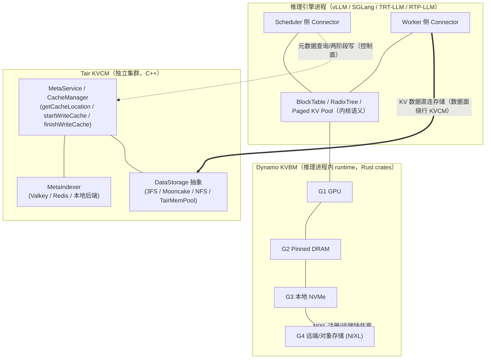

# KV Cache 外置化：Tair KVCM、Dynamo KVBM 与推理引擎的集成边界

> [!TLDR]
> Tair KVCache Manager（KVCM）和 Dynamo KV Block Manager（KVBM）解决的**不是同一个问题**，只是同一条演进路线的两个切面：**KVCM 把控制面搬出引擎**（中心化元数据目录 + 容量/配额管理，数据流完全绕行），**KVBM 把数据面做成 runtime**（推理进程内的分层内存管理与 NIXL 传输编排）。
>
> 两者都不是"往 vLLM/SGLang 里塞更多代码"的产物，而是引擎官方扩展点（vLLM `KVConnectorBase_V1`、SGLang `HiCache`）的对偶：**引擎保留协议与 hook，外置组件实现策略与搬运**。原因很具体：M×N 的集成组合、发布节奏差异、多引擎共存、故障域隔离，以及 block table / CUDA graph / TP-PP 布局这些**天然属于内核**的语义。

## 0. 起点：为什么 KV Cache 管理值得成为一个独立系统

### 0.1 Agent 场景改变了缓存的时间尺度和复用边界

阿里在 Tair KVCM 的设计文章里把问题定义成三个变化：

1. **会话轮数与持续时间变长**：调度对象从"请求"变成"会话"，亲和性要维持几十分钟量级；一旦为了 SLO 迁移请求，命中率就掉。
2. **并发会话数上升**：工具调用、MCP、编译执行这些非推理时间占比变高，要靠更多并发"填"算力空隙，调度难度进一步上升。
3. **会话间模式分化**：代码审查类 Agent 高频小轮次，数据分析类 Agent 少轮次大上下文，固定的算存比无法同时满足。

这三者叠加的结果是文章里那句结论：**KVCache 命中率与 SLO 调度目标冲突加剧，Prefill 负载可能非线性增长甚至雪崩**。

单机分层（GPU→Host）能突破显存容量，但突破不了"实例边界"：L2 是进程私有的 pinned memory，两台机器上的实例互相看不见对方的 CPU 缓存。要跨实例复用，缓存必须走出进程、走上网络。SGLang HiCache 的文档对此说得很直白：*L2 是节点本地且实例私有的，L1/L2 是私有的，只有 L3 才可能共享，且共享范围取决于后端配置*。这解释了为什么"KV 外置"会自然演化成一个系统，而不是一个内核 feature。

### 0.2 网络账本：跨机搬运 KV 是否划算

外置的前提是"读远端比重新 prefill 便宜"。阿里给出的量化（20 GB/s 量级跨机带宽）：

| 模型 | 单机 Prefill KV 写入带宽需求 | 20 GB/s 下读 64K 上下文耗时 | 单 Token KV 容量 | 64K 上下文 KV 容量 |
| --- | --- | --- | --- | --- |
| DeepSeek-V3/R1（H800 × 8） | 2.79 GB/s | 0.21 s | 70,272 B | 4.19 GB |
| Qwen3-Coder-480B（H20 × 8） | 3.55 GB/s | 0.76 s | 253,952 B | 15.14 GB |

结论：以 8 卡机型 20 GB/s 的通用/存储网络带宽，跨机拉取 KV 的时间成本远低于重新 prefill，**算力与存储解耦在带宽上成立**。这也是 Cloud Tair 团队敢把 KV 存储池化作为产品做的物理前提。

### 0.3 收益侧的公开数据

LMSYS 在 SGLang HiCache 的发布博客中给出三组实测：Novita AI 用 3FS KVStore 把 Qwen3-Coder-480B 编码 Agent 场景命中率从 40% 提到 80%，**平均 TTFT 下降 56%、吞吐翻倍**；Ant Group 用 Mooncake 在 DeepSeek-R1-671B PD 分离部署下，**命中请求相对全量重算 TTFT 降低 84%**；SGLang 自测给出**最高 6× 吞吐、80% TTFT 降幅**。

这些数字说明"外置 KV"不是架构美学，而是有明确 ROI 的工程选择。剩下的问题只有：**外置什么、放在哪一层、引擎内核保留什么**。

## 1. 两条路线：控制面外置 vs 数据面外置



### 1.1 Tair KVCM：把控制面搬出去

**部署形态**：KVCM 是独立部署的中心化服务（C++，HTTP + gRPC），只做**元数据与容量管理**；引擎侧 Connector 拿到位置后直连后端存储，**KVCache 数据流完全绕过 KVCM**。这是理解它的第一性事实——它不是 KV 存储，也不是传输层，它是**目录 + 资源管理器**。

从开源仓库 `alibaba/tair-kvcache` 可以读出完整的模块切分：

```text
kv_cache_manager/
├── manager/        cache_manager.cc / meta_searcher.cc / cache_reclaimer.cc
│                   write_location_manager.cc / data_storage_selector.cc
│                   cache_garbage_collector.cc / migration_manager.cc
├── meta/           meta_indexer.cc / meta_search_cache.cc
│                   meta_async_redis_backend.cc / meta_local_backend.cc
├── data_storage/   data_storage_backend.h / data_storage_manager.cc
│                   hf3fs_backend.cc / mooncake_backend.cc / nfs_backend.cc
├── service/        Access Layer（Meta/Admin/Debug 三组服务）
├── protocol/       protobuf 定义
├── client/  client_java/  py_connector/   引擎与周边系统接入
└── optimizer/      Trace 回放与容量规划
docs/design/        basic_concepts.md / module_architecture.md / ha_leader_elector.md
                    cache_reclaimer_*.md / meta_memory_primary_async_backup.md
                    client_sdk_io_contract.md / event_report_*.md
```

**核心抽象**（`docs/design/basic_concepts.md`）：

- 管控面：`Storage`（一套后端存储）、`Instance Group`（共享配额与可用存储列表）、`Instance`（描述模型与 KV 配置，仅 Instance 内复用）。
- 元数据面：`Block`（定长 token 段，带前缀依赖）、`CacheLocation`（单个 block 的一个存储位置，状态机 **writing → serving → deleting**）、`LocationSpec`（位置的组成片段，用 URI 统一内存地址/文件路径/KV key 三种表达，用 spec name 承载 TP/PP/混合注意力的差异）。

这层抽象刻意保留了 LLM 语义——**多 Block 间的前缀关系、同 Location 多 Spec 的关联关系**——因为通用存储接口抹掉这些语义后会付出真实代价。文章举的例子很典型：为了并行写入把单个 Block 拆成多个 key，如果多个 key 的驱逐时间不一致，部分 key 被驱逐后剩余 key 占着容量却无法命中。

**关键接口**：`getCacheLocation`（命中与位置查询，支持 KV 式 / 前缀式 / 滑动窗口式三种匹配）、`startWriteCache` / `finishWriteCache`（两阶段写，`writing` 状态 + 超时队列保证同一 key 不会被并发重复写）、`removeCache` / `trimCache`。两阶段写在源码里对应 `manager/write_location_manager.cc`。

**容量与 HA**：Instance Group 同时有 Quota（硬上限，可细分到存储类型）与水位（软上限，触发驱逐）；驱逐支持 TTL / LRU / LFU，由 `cache_reclaimer.cc`、`cache_reclaimer_group_lru.cc` 实现，删除进后台线程池异步执行；元数据持久化在 `meta/meta_async_redis_backend.cc` / `meta_local_backend.cc`，配合 `docs/design/ha_leader_elector.md` 描述的分布式锁主备选举做故障切换。`optimizer/` 用 Radix Tree 回放真实 trace（示例数据来自 `alibaba-edu/qwen-bailian-usagetraces-anon`）来估算容量-命中率曲线，是"上线前先算 ROI"的工具。

**为什么中心化**（原文给出的理由，值得逐条记住）：

1. 只做元数据 + C++，靠 scale up 就能撑住单推理集群，运维简单；
2. **避免把 KVCM 逻辑注入推理容器**，否则元数据后端（如 Valkey）的连接数会随推理实例数爆炸；
3. 结合 3FS Master 等组件可以只用 TCP 与引擎、后端存储交互，**不强依赖 RDMA**；RDMA 域里只有 GPU 机型时，可以把 KVCM 部署在域外的普通机型上，避开 GPU 机高故障率。

**支持面**：README 明确目前已支持 vLLM / SGLang / RTP-LLM / TRT-LLM 的 connector（`kv_cache_manager/py_connector`、`client/`、`client_java/`），这本身就是"外置一层、复用多个引擎"的收益证明。

### 1.2 Dynamo KVBM：把数据面做成 runtime

**定位**：KVBM 是**推理进程内的 runtime 组件**（Rust crates，位于 `ai-dynamo/dynamo` 仓库的 `lib/kvbm-*`），把自己描述为 "unified memory layer and write-through cache"，向上通过 connector 接入 vLLM / TensorRT-LLM，向下通过 NIXL 接远端内存与存储。它的设计文档明确写了灵感来源：**vLLM/SGLang 的 KV block manager + 通用 GPU 编程中的内存分层（memory tiering）**。

**三层结构**：LLM Runtime Layer（connector 翻译层）→ KVBM Logic Layer（block 分配、布局、生命周期、复用/驱逐策略）→ NIXL Layer（P2P/RDMA/NVLink 传输、块注册、存储插件）。四级池：

| 层级 | 介质 | 角色 |
| --- | --- | --- |
| G1 | GPU HBM | 服务模型执行的可变/不可变块池 |
| G2 | Pinned host DRAM | 承接 D2H offload，供 H2D onboard |
| G3 | 本地 NVMe | 承接 H2D→Disk，NIXL 描述符支持零拷贝/GDS |
| G4 | 远端/对象/云存储 | KVBM 视作 opaque blob store，经 NIXL 访问 |

**块生命周期**是一条显式状态机：`Reset → Partial → Complete → Registered`，注册/注销用 RAII handle 绑定 EventManager——`PublishHandle` 触发 Register 事件，drop 时触发 Remove 事件，事件经 NATS 事件面广播（`StoreEvent` / `RemoveEvent`，约 100 B/条，批量发布）。设计文档对这条事件面的定位很清晰：**存储厂商订阅事件流，自己建前缀树/索引，实现冷热分层、合并、预取，而不用改 KVBM 逻辑**。

**跨节点共享**是本路线最有含金量的部分：worker 各自 `nixl_register()` 注册内存区域，交换 `SerializedNixlBlockLayout`（LayoutConfig、BlockSetID、基址/stride/对齐、device id、内存类型），对端 `deserialize()` 重建视图。文档特意点出要解决 **TP=4 与 TP=8 节点之间的布局语义错配**——没有这一步，远端拉取会拿到错位甚至损坏的数据。

**源码地图**（`lib/` 下）：

```text
kvbm-engine/     src/{leader,worker,offload,object,pubsub,runtime,collectives}
                 leader/{instance.rs, onboarding.rs, accessor.rs, state.rs}
                 worker/{physical.rs, coordinated.rs, protocol.rs}
kvbm-logical/    src/{blocks, events, pools, registry, sequence, manager, integrations}
                 tinylfu.rs（LFU 驱逐）
kvbm-physical/   kvbm-common/  kvbm-config/  kvbm-consolidator/  kvbm-kernels/
```

**集成方式**：connector 分为 Scheduler（Leader）侧与 Worker 侧两半——Scheduler 侧编排 offload/onboard、生成传输元数据；Worker 侧在 forward 结束后执行异步搬运，避免打断计算。v1.3.0 的支持矩阵是 vLLM ✅ / TensorRT-LLM ✅ / **SGLang ❌**；SGLang 侧 NVIDIA 选择的路径是 **HiCache + NIXL**，而不是 KVBM。

### 1.3 对照表

| 维度 | Tair KVCM | Dynamo KVBM |
| --- | --- | --- |
| 形态 | 独立中心化服务（C++ / Bazel，HTTP+gRPC） | 推理进程内 runtime 库（Rust crates） |
| 核心职责 | 全局元数据目录、容量管理、多后端调度 | 块分配、分层内存池、传输编排、远端共享 |
| 数据面 | 绕行（引擎 Connector 直连后端存储） | 在进程内执行（CUDA D2H/H2D、NIXL RDMA/GDS） |
| 元数据 | 外置持久化（Valkey / 本地后端），支持 HA 选主 | 进程内 registry + NATS 事件面 |
| 传输 | 由引擎侧 Connector / 统一传输库完成 | NIXL |
| 存储后端 | 3FS / Mooncake / NFS / TairMemPool（外部系统） | G1–G4，G4 经 NIXL 视作 blob store |
| 生命周期状态机 | CacheLocation: writing → serving → deleting | Block: Reset → Partial → Complete → Registered |
| 容量治理 | InstanceGroup Quota + 水位 + TTL/LRU/LFU | 池内 LRU/LFU（`tinylfu.rs`）等策略，事件面驱动外部分层 |
| 多租户 | 显式建模（Storage / InstanceGroup / Account） | 非核心目标 |
| HA | 主备选举、元数据持久化与异步备份 | 无中心组件，靠 worker 生命周期与事件注销 |
| 引擎支持 | vLLM / SGLang / RTP-LLM / TRT-LLM | vLLM / TRT-LLM（SGLang 走 HiCache+NIXL） |

**两者的关系不是竞争**：KVCM 是"目录 + 配额"，KVBM 是"内存管理 runtime + 传输"。共同点只有三样——**Block 抽象、内容哈希去重、生命周期状态机**。理论上可以组合（进程内 runtime 负责搬运，集中目录负责全局视图），目前是两套生态各自的实现。同一族里还有 LMCache、Mooncake、SGLang HiCache、FlexKV。

## 2. 为什么不是"把这些功能直接写进 vLLM/SGLang 内核"

这是上一个问题最自然的延伸：既然逻辑都是"块管理 + 前缀匹配 + 分层搬运"，为什么不干脆在引擎里实现？

### 2.1 事实先摆出来：引擎已经给出了官方扩展点，而且它们都选择插件化

**vLLM**：v1 的 `KVConnectorBase_V1` 把接口切成 Scheduler 侧与 Worker 侧两半，方法签名就是"内核留给外部的 hook 清单"：

- Scheduler 侧：`get_num_new_matched_tokens()`（外部缓存还能命中多少 token）、`update_state_after_alloc()`、`build_connector_meta()`、`request_finished()`（可把 block 释放责任异步化）、`take_events()`。
- Worker 侧：`start_load_kv()` / `wait_for_layer_load(layer_name)` / `save_kv_layer(layer_name, ...)` / `wait_for_save()`，以及 `register_kv_caches()`（NIXL 预注册用）。
- 两个很说明问题的类方法：`requires_piecewise_for_cudagraph()`——**用异步逐层 load/save 的 connector 必须让引擎把 CUDA Graph 切成 PIECEWISE 模式**，否则 replay 会跳过这些操作造成数据竞争；`get_required_kvcache_layout()`——connector 可以反向要求 KV cache 的 HND/NHD 布局。

仓库里 `vllm/distributed/kv_transfer/kv_connector/v1/` 下的实现目录：`lmcache_integration`、`mooncake`、`nixl`、`hf3fs`、`flexkv`、`moriio`、`hisparse`、`offloading`（含 `simple_cpu_offload_connector.py`、`offloading_connector.py`），外加 `multi_connector.py`。连"CPU offload"这件事，vLLM 现在的做法都是**做成一个 connector**，而不是把策略塞进内核。

**SGLang**：HiCache 的三级结构（L1 GPU / L2 Host / L3 Storage）之上，所有 L3 后端统一服从一个 `HiCacheStorage` 抽象（`batch_exists` / `batch_get` / `batch_set` 等，`batch_exists` 契约是"从 keys[0] 开始连续存在的 page 数"，因为前缀命中不能跳过缺页）。`python/sglang/srt/mem_cache/storage/` 下已经挂了十几个后端：`mooncake_store`、`hf3fs`、`nixl`、`lmcache`、`aibrix_kvcache`、`flexkv`、`eic`、`mmap`、`shm`、`npu_memcache`、`simm`、`tensorcast_store`、`umbp`。

### 2.2 M×N 重复劳动的现场

把上面两组目录放在一起看，会发现一个尴尬的事实：**Mooncake、NIXL、HF3FS、LMCache 这些后端，在 vLLM 和 SGLang 里各被实现了一遍**。

- 引擎数 M（vLLM、SGLang、TRT-LLM、RTP-LLM……）× 存储/传输方案 N（Mooncake、3FS、NIXL、LMCache、AIBrix……）；
- 如果每个引擎都"直接集成进内核"，集成工作量是 **M×N**，而引擎内核的发布节奏又慢于存储/传输生态；
- 抽象出 Connector / HiCacheStorage 这样的协议后，工作量变成 **M+N**：后端实现一次协议，引擎实现一次 hook。

这正是 Tair KVCM 的落点：与其在四个引擎里各改一遍，不如在引擎外做一个适配层，"向上暴露 LLM 语义接口，向下把通用存储翻译成统一 `DataStorageBackend`"。也是 KVBM 的落点：connector 只做"runtime 语义 → KVBM 块语义"的翻译，内存分层与传输复用同一套 NIXL 实现。

### 2.3 内核必须保留的语义：这部分搬不出去

外置组件能接管策略与搬运，但有四类东西天然属于引擎内核，外部系统既无法替代也不该绑死：

1. **Block table 与显存分配**：paged KV 的物理页、引用计数、prefix hash 的计算与匹配，和 attention kernel 的寻址方式强耦合。
2. **调度时机**：外部命中要让 Scheduler 在分配 block 之前就知道"能省多少 token"（`get_num_new_matched_tokens`），异步 load 必须与 forward 的层执行流水线对齐（`wait_for_layer_load`），这些 hook 的位置由引擎的 batch 构造与内存生命周期决定。
3. **执行兼容性**：KV 搬运要兼容 CUDA Graph（`requires_piecewise_for_cudagraph`）、TP/PP 的 rank 划分与布局（`get_required_kvcache_layout`、`set_xfer_handshake_metadata_pp_aware`）、MLA/SWA/混合注意力下不同 block 的存取差异。
4. **本地前缀缓存**：vLLM APC / SGLang RadixAttention 这类纯本地、无外部依赖的能力，本来就该在内核里，它们决定了跨实例复用之外的"最后一公里"命中率。

外置组件把这些 hook 当作**协议**来对接，而不是把内核改造成某个存储/某个集群管理方案的定制分支。

### 2.4 外置组件不该"回流"内核的五个理由

1. **依赖重量与发布节奏**：NIXL/RDMA、3FS/Mooncake SDK、配额与租户管理、HA 选主——这些代码的体积、依赖和迭代频率都和推理内核不是一个量级；Tair 团队自己在文章里也把"避免把逻辑注入推理容器"列为选择中心化的直接动机。
2. **多引擎与版本共存**：生产集群里 vLLM + SGLang + TRT-LLM 混布是常态，模型版本切换还要求新旧 KVCache 隔离（KVCM 的 Instance Group 抽象就是为这个设计的）。跨越引擎、跨越版本的统一命名空间，只能存在于引擎之外。
3. **策略的多样性**：write-through / write-through-selective / write-back、LRU/LFU/TTL、Quota 与水位、按前缀的精细驱逐——策略空间还在快速试错，内核只应提供 hook，不该替用户选定一种。
4. **故障域隔离**：元数据服务故障不应等于推理服务故障；KVCM 甚至刻意支持部署在 RDMA 域之外，避开 GPU 机型的高故障率。反过来，KVBM 的事件面让存储厂商独立演化，不必同步发布引擎版本。
5. **生态惯性**：vLLM 的 connector 已经 10+ 个实现，SGLang 的 L3 后端也十几个。没有任何一个方案能让上游把它设为内核唯一实现——这是社区结构的现实，不是技术问题。

### 2.5 边界判定：一句话版本

> **本地、单实例、无外部依赖 → 内核；跨实例、跨机、多租户、外部存储 → 外置组件；引擎内保留协议与 hook，外置组件实现策略与数据搬运。**

具体到落地形态，就是已经存在的三样东西：vLLM 的 `KVConnector`、SGLang 的 `HiCacheStorage`、以及它们背后的传输/存储实现（NIXL、Mooncake、3FS……）。KVCM 和 KVBM 只是这层"外置"里更进一步的两个系统：一个把目录和治理集中化，一个把分层内存管理 runtime 化。

## 3. 选型建议

### 3.1 四条常见路线

1. **单机/单实例显存不足**：用引擎自带能力即可。SGLang 开 `--enable-hierarchical-cache` 配 host pool；vLLM 用 OffloadingConnector（CPU 主分层，可扩展二级）。不要引入中心化元数据服务，多一跳查询和一套运维不划算。
2. **单集群、多实例共享、需要 L3**：直接用引擎的 L3 后端（Mooncake / 3FS / NIXL / AIBrix），把命名空间、容量和淘汰策略配置对齐；跨实例命中即可发生，不需要额外管理面。
3. **多集群 / PB 级 / 多租户 / 跨引擎统一池 / 要求 ROI 评估与配额治理**：这类需求才值得引入 KVCM 式的全局管理服务，接入仍然走引擎 Connector，不需要 fork 引擎。
4. **NVIDIA 栈（vLLM + TRT-LLM）、需要 G1–G4 分层、事件面驱动存储分层**：KVBM 是既定参考实现；SGLang 侧目前对应 HiCache + NIXL。

### 3.2 风险清单

- **跨机带宽与命中模式匹配**：20 GB/s 量级对 64K 上下文成立，但对特大上下文（数 MB/token 的模型）或低命中率的随机访问，搬运可能不划算；上线前要用 trace 回放算容量-命中率曲线（KVCM 的 Optimizer 就是干这个的）。
- **元数据查询规模**：block_size=64 时 64K 上下文要查 1K 个 block 的存在性与位置；100 TB 存储对应上亿 block。元数据层的吞吐和延迟是外置方案的真瓶颈，不是数据搬运。
- **并行与布局对齐**：TP/PP 下同一条序列的 KV 分散在多个 rank，MLA 下各 rank 还持有完整副本。跨引擎/跨节点复用必须显式处理布局语义（KVBM 用 `SerializedNixlBlockLayout`，HiCache 用 `MIN` all-reduce 对齐连续命中长度）。
- **写路径一致性**：KVCM 用两阶段写（writing→serving）兜住"同一 key 并发写"；KVBM 用 RAII + 事件面兜住跨节点块注册/注销。自研方案里这两处是最容易出竞态的地方。
- **注意力机制差异**：SWA/Linear/混合注意力下，block 的复用语义不同（前缀依赖 + 反向滑动窗口），驱逐策略需要考虑后缀先于父亲 block 失效之类的情况。

## 4. 参考

- 阿里云 Tair KVCache Manager 架构文章（中文，2025-12-31）：[developer.aliyun.com/article/1703191](https://developer.aliyun.com/article/1703191)；英文版：[Alibaba Cloud Blog](https://www.alibabacloud.com/blog/alibaba-cloud-tair-kvcache-manager-architecture-design-and-implementation-of-enterprise-level-global-kvcache-management-service_602858)
- 开源仓库：[alibaba/tair-kvcache](https://github.com/alibaba/tair-kvcache)，设计文档在 `docs/design/`（`basic_concepts.md`、`module_architecture.md`、`ha_leader_elector.md`、`cache_reclaimer_*.md`、`client_sdk_io_contract.md`）
- Dynamo KVBM 设计文档：[KVBM Design](https://docs.nvidia.com/dynamo/v-0-9-0/design-docs/kvbm-design.md)；组件总览（v1.3.0 特性矩阵）：[KVBM Overview](https://docs.nvidia.com/dynamo/v1.3.0/components/kvbm)
- Dynamo 仓库：[ai-dynamo/dynamo](https://github.com/ai-dynamo/dynamo)（`lib/kvbm-*`）；NIXL：[ai-dynamo/nixl](https://github.com/ai-dynamo/nixl)
- vLLM KV Connector 接口：[KVConnectorBase_V1 API](https://docs.vllm.ai/en/stable/api/vllm/distributed/kv_transfer/kv_connector/v1/base)；实现目录：[kv_connector/v1](https://github.com/vllm-project/vllm/tree/main/vllm/distributed/kv_transfer/kv_connector/v1)；KV Offloading：[Usage Guide](https://docs.vllm.ai/en/stable/features/kv_offloading_usage)
- SGLang HiCache 设计：[HiCache System Design and Optimization](https://docs.sglang.io/docs/advanced_features/hicache_design)；后端目录：[mem_cache/storage](https://github.com/sgl-project/sglang/tree/main/python/sglang/srt/mem_cache/storage)；发布博客：[SGLang HiCache (LMSYS, 2025-09-10)](https://lmsys.org/blog/2025-09-10-sglang-hicache/)
