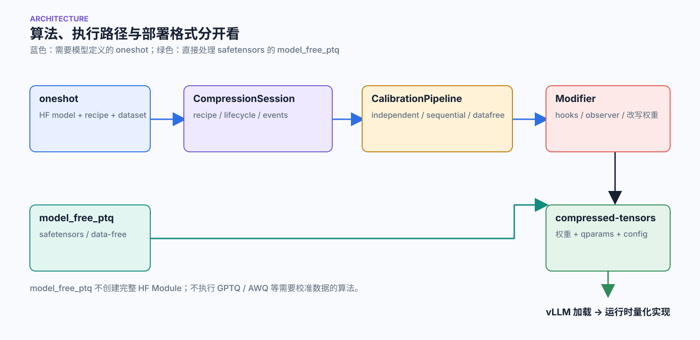
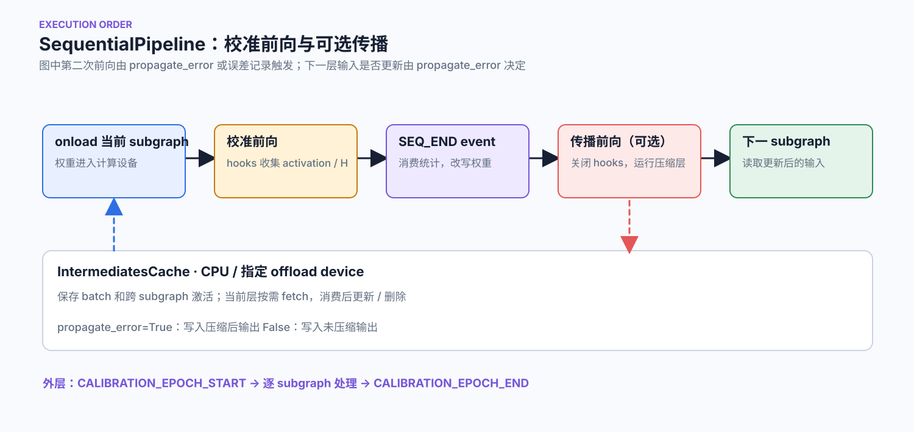
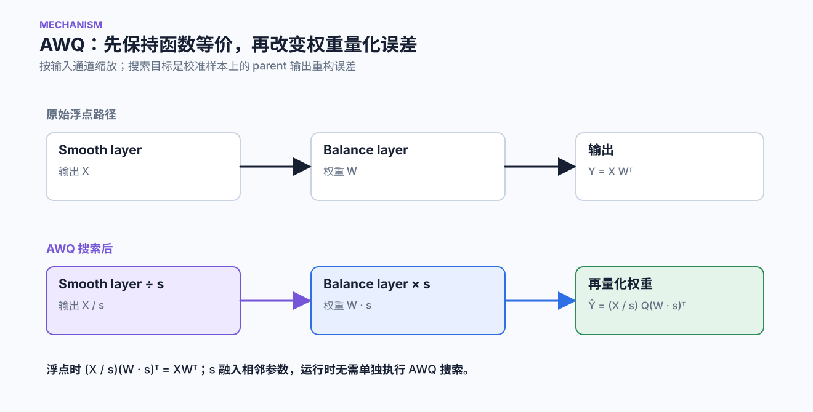

# llm-compressor 框架解析：从 Modifier 到可部署的量化权重

量化常被描述成“选一个 W4A16 或 FP8 scheme，然后保存模型”。但在 `llm-compressor` 中，**scheme 只规定目标数值格式；真正决定结果的还有算法、校准执行路径、保存格式和推理内核**。同样是 W4A16，RTN、GPTQ 和 AWQ 使用的信息不同；同样是 AWQ recipe，`independent` 与 `sequential` 的前向安排也不同。

这篇文章围绕三个问题展开：

1. `oneshot` 如何组织 recipe、`Modifier`、校准前向和生命周期事件？
2. GPTQ、AWQ、SmoothQuant 各自改变了哪一步？AWQ 为什么还需要后续量化？
3. 保存为 `compressed-tensors` 后，哪些事已在离线阶段完成，哪些仍由 vLLM 运行时决定？


## 先拆开四个容易混淆的层次

| 层次                 | 回答的问题                                       | 例子                                                |
| -------------------- | ------------------------------------------------ | --------------------------------------------------- |
| Scheme               | 哪些张量量化、位宽和 scale 粒度是什么？          | `W4A16_ASYM`、`FP8_DYNAMIC`、`FP8_BLOCK`、`NVFP4`   |
| Algorithm / Modifier | 如何选择量化参数或改写权重以降低误差？           | RTN、GPTQ、AWQ、SmoothQuant、AutoRound              |
| Calibration pipeline | 数据怎样经过模型，何时收集统计、压缩和传播误差？ | `independent`、`sequential`、`datafree`、`basic`    |
| Checkpoint / runtime | 权重怎样落盘，推理时用哪种实现？                 | `compressed-tensors`、vLLM 对应 quantization method |

例如 `FP8_DYNAMIC` 的典型路径是：离线对权重做 RTN，推理时按 token 动态量化 activation。它不必为了 activation 收集一个静态 scale。`W4A16_ASYM` 只是权重和 activation 的目标表示，选 GPTQ 时还要收集输入统计，选 AWQ 时还要搜索并折叠通道缩放。[官方 scheme 说明](https://github.com/vllm-project/llm-compressor/blob/b63f9549ba9c6332a5bb772952f3a1c00ae21c45/docs/guides/compression_schemes.md)



图中两条入口最后都写成带量化 metadata 的 checkpoint。`oneshot` 面向有 Hugging Face 模型定义的路径；`model_free_ptq` 直接按 safetensors shard 处理数据无关的 scheme，不构造完整 `torch.nn.Module`，因此不能拿它执行 GPTQ、AWQ、SmoothQuant 这类依赖校准前向的算法。[`oneshot` 文档](https://github.com/vllm-project/llm-compressor/blob/b63f9549ba9c6332a5bb772952f3a1c00ae21c45/docs/guides/entrypoints/oneshot.md)、[`model_free_ptq` 文档](https://github.com/vllm-project/llm-compressor/blob/b63f9549ba9c6332a5bb772952f3a1c00ae21c45/docs/guides/entrypoints/model-free-ptq.md)

## `oneshot`：入口把 recipe 交给谁

最小的 data-free FP8 例子如下。`output_dir` 不为空时，`oneshot` 会在后处理阶段保存模型；若已经持有模型对象，也可以之后调用经过扩展的 `model.save_pretrained(...)`。[入口源码](https://github.com/vllm-project/llm-compressor/blob/b63f9549ba9c6332a5bb772952f3a1c00ae21c45/src/llmcompressor/entrypoints/oneshot.py)、[保存文档](https://github.com/vllm-project/llm-compressor/blob/b63f9549ba9c6332a5bb772952f3a1c00ae21c45/docs/guides/saving_a_model.md)

```python
from llmcompressor import oneshot
from llmcompressor.modifiers.quantization import QuantizationModifier

oneshot(
    model=model,
    recipe=QuantizationModifier(
        targets="Linear",
        scheme="FP8_DYNAMIC",
        ignore=["lm_head"],
    ),
    output_dir="model-fp8",
)
```

入口可以概括成：

```text
parse_args / pre_process
  → CompressionSession.initialize(recipe, model)
  → CalibrationPipeline.from_modifiers(...)
  → pipeline(model, dataloader, args)
  → CompressionSession.finalize()
  → post_process / 保存（当 output_dir 已给出）
```

其中 `CompressionSession` 管理一次压缩的全局状态；recipe 定义 Modifier 列表；`CalibrationPipeline` 决定前向如何运行；`Modifier` 在事件回调里收集统计、修改模型。**PyTorch forward hook 是张量的入口；生命周期 event 是何时处理统计的入口**。[入口源码](https://github.com/vllm-project/llm-compressor/blob/b63f9549ba9c6332a5bb772952f3a1c00ae21c45/src/llmcompressor/entrypoints/oneshot.py)、[Modifier 基类](https://github.com/vllm-project/llm-compressor/blob/b63f9549ba9c6332a5bb772952f3a1c00ae21c45/src/llmcompressor/modifiers/modifier.py)

### 校准触发事件

- 生命周期先调用 `on_initialize` 为模块绑定配置
- pipeline 开始校准时发出 `CALIBRATION_EPOCH_START`，Modifier 才开始注册或启用统计 hooks
- 每次目标 module 前向时，hook 根据 scheme 读输入、输出或 attention 的 Q/K/V；到了 `SEQUENTIAL_EPOCH_END`，才把统计变成 qparams 或权重变换
- 最后 `CALIBRATION_EPOCH_END` 移除 hooks、冻结状态
- `finalize` 清理临时缓存。`INITIALIZE` / `FINALIZE` 分别由专门方法调用，不能把它们当普通 `lifecycle.event(...)` 发送。[生命周期分发](https://github.com/vllm-project/llm-compressor/blob/b63f9549ba9c6332a5bb772952f3a1c00ae21c45/src/llmcompressor/core/lifecycle.py)

| 触发点                               | 消费什么                | 典型动作                                      |
| ------------------------------------ | ----------------------- | --------------------------------------------- |
| `on_initialize`                      | 模型结构、recipe scheme | 匹配 target，绑定量化配置；AWQ 解析 mapping   |
| `CALIBRATION_EPOCH_START`            | 当前模型状态            | 建 observer 和 hook，开始统计                 |
| module forward hook                  | 实际输入 / 输出 tensor  | 记录 MinMax、activation 强度、GPTQ 输入相关性 |
| `SEQUENTIAL_EPOCH_END`               | 当前子图的模块集合      | AWQ 改写权重，或计算 qparams / GPTQ 量化      |
| `CALIBRATION_EPOCH_END` / `finalize` | 剩余统计和临时状态      | 冻结量化，释放 hook、缓存                     |

- 例如静态 input activation 使用 `forward_pre` hook；
- 静态 output activation 使用 `forward` hook；
- GPTQ 在目标 Linear 的 `forward` hook 里从 `args[0]` 累积 Hessian 近似。
- 动态 activation scheme 不需要在离线校准时存一份静态 input observer；它在运行时按当前输入算 scale。[QuantizationMixin hooks](https://github.com/vllm-project/llm-compressor/blob/b63f9549ba9c6332a5bb772952f3a1c00ae21c45/src/llmcompressor/modifiers/quantization/quantization/mixin.py)、[GPTQ hook](https://github.com/vllm-project/llm-compressor/blob/b63f9549ba9c6332a5bb772952f3a1c00ae21c45/src/llmcompressor/modifiers/gptq/base.py)

### `independent`

`oneshot(..., pipeline="independent")` 是默认参数。`IndependentPipeline` 依 recipe 顺序，每次只取一个 Modifier，再按它是否需要校准数据推断 `sequential` 或 `datafree`。因此 `[AWQModifier(), QuantizationModifier(...)]` 默认经历两个独立阶段；[`oneshot` 默认参数](https://github.com/vllm-project/llm-compressor/blob/b63f9549ba9c6332a5bb772952f3a1c00ae21c45/src/llmcompressor/entrypoints/oneshot.py#L325-L385)、[`IndependentPipeline`](https://github.com/vllm-project/llm-compressor/blob/b63f9549ba9c6332a5bb772952f3a1c00ae21c45/src/llmcompressor/pipelines/independent/pipeline.py)

| Pipeline      | 前向方式                                       | 适用边界                                           |
| ------------- | ---------------------------------------------- | -------------------------------------------------- |
| `independent` | 每个 Modifier 拥有自己的校准阶段；当前快照默认 | 便于组合不同算法；多阶段可能重复前向               |
| `sequential`  | trace 子图，逐子图 onload、校准、处理、offload | 大模型及需要逐层误差传播的路径；模型需能正确 trace |
| `datafree`    | 不跑校准前向，触发处理所有模块的事件           | RTN 等无需 activation 的路径                       |
| `basic`       | 在整模型上共用一轮校准前向                     | 模型及算法辅助状态能放入可用显存时                 |

如果用户显式传 `pipeline="sequential"`，所有 recipe Modifier 参与同一套逐子图事件；这时 recipe 顺序直接决定同一个子图上 AWQ transform 与后续量化的先后。两种路径最终都要求 AWQ 在量化之前，但**重复校准次数、误差传播时点、峰值内存和统计输入并不完全相同**。[Pipeline registry](https://github.com/vllm-project/llm-compressor/blob/b63f9549ba9c6332a5bb772952f3a1c00ae21c45/src/llmcompressor/pipelines/registry.py)、[`SequentialPipeline`](https://github.com/vllm-project/llm-compressor/blob/b63f9549ba9c6332a5bb772952f3a1c00ae21c45/src/llmcompressor/pipelines/sequential/pipeline.py)

### 逐层路径：校准、事件、再传播

`SequentialPipeline` 先依据 `sequential_targets` trace 子图。通常目标是 decoder layer；将目标细化到 `Linear` 可以减小同时 onload 的权重，却会增加处理时长，也可能让某些模块没在预期的子图边界完成校准。激活存于 `IntermediatesCache`，跨层时按需 fetch / offload。[逐层 onloading 指南](https://github.com/vllm-project/llm-compressor/blob/b63f9549ba9c6332a5bb772952f3a1c00ae21c45/docs/guides/big_models_and_distributed/sequential_onloading.md)、[`QuantizationMixin.end_calibration` 的剩余统计处理](https://github.com/vllm-project/llm-compressor/blob/b63f9549ba9c6332a5bb772952f3a1c00ae21c45/src/llmcompressor/modifiers/quantization/quantization/mixin.py)



- 图中第一个前向让 hooks 收集 activation 或 GPTQ Hessian 所需的输入`LifecycleCallbacks.sequential_epoch_end(subgraph.submodules(model))` 
- 随后让 Modifier 消费当前子图的统计并修改权重 / qparams。若 `propagate_error=True`
- 第二个前向关闭统计 hooks，使用处理后的子图输出更新激活缓存，下一子图便看到上游压缩误差；
  - 若为 `False`，下一层使用未压缩输出
  - `log_sequential_error=True` 也可能触发第二次前向用于 SQNR 记录
- `AutoRoundModifier` 会在这条 pipeline 中关闭 `propagate_error`，因为它逐层独立优化。[逐层 pipeline 源码](https://github.com/vllm-project/llm-compressor/blob/b63f9549ba9c6332a5bb772952f3a1c00ae21c45/src/llmcompressor/pipelines/sequential/pipeline.py)、[参数默认值](https://github.com/vllm-project/llm-compressor/blob/b63f9549ba9c6332a5bb772952f3a1c00ae21c45/src/llmcompressor/args/dataset_arguments.py)

校准前向还运行在 `torch.no_grad()`、eval、关闭 KV cache、禁用部分可能绕过 hook 的 HF kernel、临时禁用 `lm_head` 等上下文里。`DisableQuantization` 只负责暂时关闭已安装的量化执行；它**不等于没有收集统计**。另一个重要细节是强制 eager attention：trace 时的 causal-mask 路径必须与实际校准前向一致，否则未 padding 的样本可能在重放时遇到不同的 mask 形态。[校准上下文源码](https://github.com/vllm-project/llm-compressor/blob/b63f9549ba9c6332a5bb772952f3a1c00ae21c45/src/llmcompressor/utils/helpers.py)

## Modifier 

`QuantizationMixin` 在初始化时为匹配的模块附上 `QuantizationScheme`；校准开始时创建 observer 和前向 hooks；子图结束时由具体 Modifier 调用 `observe`、`update_qparams`；校准结束时移除 hooks、冻结量化状态。

**Mixin 不会自行决定何时更新 weight scale**，这个责任仍在 Modifier。GPTQ 也复用 Mixin 的量化配置和 activation 校准，但它另行收集 Hessian 来选择权重量化值。[Mixin 源码](https://github.com/vllm-project/llm-compressor/blob/b63f9549ba9c6332a5bb772952f3a1c00ae21c45/src/llmcompressor/modifiers/quantization/quantization/mixin.py)、[`QuantizationModifier`](https://github.com/vllm-project/llm-compressor/blob/b63f9549ba9c6332a5bb772952f3a1c00ae21c45/src/llmcompressor/modifiers/quantization/quantization/base.py)、[`GPTQModifier`](https://github.com/vllm-project/llm-compressor/blob/b63f9549ba9c6332a5bb772952f3a1c00ae21c45/src/llmcompressor/modifiers/gptq/base.py)

| Modifier                            | 消费的数据                                         | 在压缩链路中的作用                                                         |
| ----------------------------------- | -------------------------------------------------- | -------------------------------------------------------------------------- |
| `QuantizationModifier` / RTN        | 权重；静态 activation scheme 时还要校准 activation | 绑定 scheme、observer、qparams，并完成基础量化                             |
| `GPTQModifier`                      | 校准输入形成的二阶统计                             | 分组 / 分块量化权重并补偿后续列误差                                        |
| `AWQModifier`                       | activation 强度和 parent 输出重构误差              | 搜通道 scale，把缩放折入相邻层；后面仍要有量化 Modifier                    |
| `SmoothQuantModifier`               | activation 范围与权重范围                          | 在 activation 与权重间搬移量化难度；后续再做 W8A8 量化                     |
| `AutoRoundModifier`                 | 校准样本的 block 输出                              | 优化 rounding / clipping 参数，再得到目标低比特权重                        |
| `QuIPModifier`、`SpinQuantModifier` | 取决于 transform 类型与 recipe                     | 通过旋转 / 基变换改变低比特误差分布；部署需检查在线算子                    |
| `kv_cache_scheme`                   | Q/K/V 相关统计或静态配置                           | 在 checkpoint 描述 KV cache scale / scheme；实际缓存 dtype 由 runtime 选择 |

前四项不是同一类量化器：
- AWQ 和 SmoothQuant 主要是**变换**
- `QuantizationModifier` / GPTQ 负责根据目标 scheme 产出量化状态
- 旋转类方法部分旋转能融合进权重，部分必须在在线数据路径中保留，要看具体 transform 与内核。[变换示例](https://github.com/vllm-project/llm-compressor/blob/b63f9549ba9c6332a5bb772952f3a1c00ae21c45/examples/transform/README.md)

### scale 粒度

对均匀整数 Q/DQ，可以写作

$$
q=\operatorname{clip}\!\left(\operatorname{round}(x/s)+z,q_{\min},q_{\max}\right),
\qquad \hat x=s(q-z).
$$

这里 `s` 是反量化乘数，`z` 是零点。per-tensor、per-channel、per-group、per-block 的差别在于**哪些元素共享同一个 `s`**。

共享范围过大时，outlier 会拉大普通值的量化步长；粒度过细又会增加 scale 的存储与运行时处理。二维 128×128 block 与“一行权重”的 per-channel 没有固定优劣，须同时看矩阵形状、outlier 位置和内核支持。FP8 / FP4 不是把这个整数公式机械换一个 bit 数：它们有指数、尾数及各自的 scale 编码约束。[格式背景](量化综述.md)、[官方 schemes](https://github.com/vllm-project/llm-compressor/blob/b63f9549ba9c6332a5bb772952f3a1c00ae21c45/docs/guides/compression_schemes.md)

## 三条典型算法路径

### RTN 与 GPTQ：是否用输入相关性修正误差

RTN（round-to-nearest）直接根据权重与目标 scheme 计算 scale，再把权重投到最近的可表示值。它便宜、可 data-free，适合先建立 FP8 / microscaling 的基线；但“无校准”只在 **weight 和 activation scheme 都允许动态或权重自统计**时成立。静态 activation quantization 仍需样本。[官方算法选择](https://docs.vllm.ai/projects/llm-compressor/en/stable/steps/choosing-algo/)、[`oneshot` 使用边界](https://github.com/vllm-project/llm-compressor/blob/b63f9549ba9c6332a5bb772952f3a1c00ae21c45/docs/guides/entrypoints/oneshot.md)

**GPTQ** 试图让一层在校准输入 `X` 上的输出尽量不变：

$$
\min_{\hat W}\;\lVert XW^\top-X\hat W^\top\rVert_F^2.
$$

它通过 hook 收集近似 $H\propto X^\top X$，逐列或逐块量化权重，并用二阶信息把当前列的舍入误差补偿到尚未量化的列。这说明为什么 GPTQ 相比 RTN 有额外内存需求：单层输入维度为 `d` 时，Hessian 相关状态可达 $O(d^2)$；分块处理与逐层 onloading 控制的是同时驻留的状态，而非消除这项局部开销。[GPTQ 源码](https://github.com/vllm-project/llm-compressor/blob/b63f9549ba9c6332a5bb772952f3a1c00ae21c45/src/llmcompressor/modifiers/gptq/base.py)、[GPTQ 原论文](https://arxiv.org/abs/2210.17323)

`actorder` 控制列处理顺序，当前实现有 `static` 默认值。它对精度和序列化后的访问方式都有影响；不能只看局部重构误差就假定任何排序都没有部署代价。[`GPTQModifier` 参数](https://github.com/vllm-project/llm-compressor/blob/b63f9549ba9c6332a5bb772952f3a1c00ae21c45/src/llmcompressor/modifiers/gptq/base.py)

需要较强 W4A16 基线时，可以先从这个 recipe 出发，再针对具体模型检查 group size、忽略层、校准数据和运行时支持：

```python
from llmcompressor.modifiers.gptq import GPTQModifier

recipe = GPTQModifier(
    targets="Linear",
    scheme="W4A16",
    ignore=["lm_head"],
)
oneshot(model=model, dataset=calibration_dataset, recipe=recipe, output_dir="model-gptq")
```

### AWQ：先做等价重参数化，再量化

AWQ 用校准 activation 找出值得保护的输入通道。设线性层输出为 $Y=XW^\top$，选逐通道 scale `s` 后：

$$
Y=(X/s)(W\odot s)^\top,\qquad
\hat Y=(X/s)Q(W\odot s)^\top.
$$

第一式在浮点下等价，第二式的误差则依赖 `s`。
- 对每个结构 mapping 缓存 parent forward 参数、累计 activation 绝对值均值，
  -  默认$\alpha$搜索: 计算$s_i = act\_mean_i^{\alpha}$，然后归一化处理 `scales / sqrt(scales.max() * scales.min())`
  -  duo_scaling：$s_i = \frac{act\_mean_i^{\alpha}}{w\_stat_i^{1-\alpha}}$
- 在候选 `s` 上临时量化 balance layer 权重，再以 parent 输出 MSE 选最优值。 
  - `duo_scaling` 候选还把权重强度纳入比例；`"both"` 同时搜索带与不带这项的候选。源码还会校验目标量化粒度是否支持这种缩放。[AWQ 源码](https://github.com/vllm-project/llm-compressor/blob/b63f9549ba9c6332a5bb772952f3a1c00ae21c45/src/llmcompressor/modifiers/transform/awq/base.py)、[AWQ 论文](https://arxiv.org/abs/2306.00978)



图中的 `X/s` 通常不作为额外在线节点留下。**`AWQMapping` 指定一个产生激活的 `smooth_layer` 与消费它的 `balance_layers`；找到 `s` 后，前者的相关参数除以 `s`，后者对应输入通道的权重乘以 `s`。** 映射必须与模型结构相符：并行 block、fused QKV、MoE expert 等情形不能只凭名字推断缩放一定可折叠。[mapping 源码](https://github.com/vllm-project/llm-compressor/blob/b63f9549ba9c6332a5bb772952f3a1c00ae21c45/src/llmcompressor/modifiers/transform/awq/mappings.py)、[AWQ 实现](https://github.com/vllm-project/llm-compressor/blob/b63f9549ba9c6332a5bb772952f3a1c00ae21c45/src/llmcompressor/modifiers/transform/awq/base.py)

一个可读的 recipe 是：

```python
from llmcompressor.modifiers.transform.awq import AWQModifier
from llmcompressor.modifiers.quantization import QuantizationModifier

recipe = [
    AWQModifier(duo_scaling="both"),
    QuantizationModifier(
        targets="Linear",
        scheme="W4A16_ASYM",
        ignore=["lm_head"],
    ),
]
```

**AWQ 不负责输出 int4**。recipe 验证还要求它后面出现继承 `QuantizationMixin` 的 Modifier。默认 `independent` 下，AWQ 的 transform 阶段先完成，之后 QuantizationModifier 计算正式 qparams；显式 `sequential` 下，两者按 recipe 顺序响应每个子图的事件。无论哪条路径，最终保存的 AWQ 结果是已经重参数化的权重及其量化参数，不是给 vLLM 重新搜索 scale 的任务。[官方 AWQ recipe](https://docs.vllm.ai/projects/llm-compressor/en/latest/examples/awq/)、[recipe 顺序校验](https://github.com/vllm-project/llm-compressor/blob/b63f9549ba9c6332a5bb772952f3a1c00ae21c45/src/llmcompressor/recipe/recipe.py)

把源码中的 AWQ 搜索缩成五步，比单看公式更容易理解它为什么耗时：

1. **`AWQMapping` 找到 smooth layer、balance layers 和可重放的 parent** ；forward hooks 缓存 parent 参数与输入通道的平均绝对激活。
2. **原始 parent 前向产生参考输出 `Y_ref`**。候选 scale 由 activation 强度、可选的权重强度和网格参数构成；`duo_scaling=True` 还会加入一个接近恒等变换的候选。
3. 对每个候选，临时把 balance 权重乘以 `s`，以目标 scheme 的 observer 求 qparams，做一次 fake quant，再跑 parent 比较输出。
4. 选择输出 MSE 最低的候选，恢复原权重后把最优 `s` 永久折入 smooth / balance 两侧参数。
5. 后续量化 Modifier 对**改写后的**权重求正式 qparams，保存时由 `compressed-tensors` pack。

**候选搜索里要反复运行 parent**，因此 `n_grid`、校准 batch 数和 parent 的范围直接影响离线成本。源码还会跳过没有有效 activation 的映射；MoE 中某个 expert 没被样本命中，不能据此断言这个 expert 已完成 AWQ 平滑。`use_loss_mask` 可以限制损失统计的 token，但部分 MoE 映射无法可靠对齐 mask。[AWQ 搜索与跳过分支](https://github.com/vllm-project/llm-compressor/blob/b63f9549ba9c6332a5bb772952f3a1c00ae21c45/src/llmcompressor/modifiers/transform/awq/base.py)

### SmoothQuant 与 AutoRound：降低误差的另一种目标

SmoothQuant 也利用

$$
(X/s)(W\odot s)^\top=XW^\top,
$$

但它的重点是将 activation outlier 的量化难度转移到权重，使 W8A8 的 activation 更容易量化；因此权重侧可能变得更难，强度参数要和后续 scheme、模型精度一起评估。它同样是量化之前的 transform，而不是压缩 checkpoint 的最后一步。[SmoothQuant 源码](https://github.com/vllm-project/llm-compressor/blob/b63f9549ba9c6332a5bb772952f3a1c00ae21c45/src/llmcompressor/modifiers/transform/smoothquant/base.py)、[SmoothQuant 论文](https://arxiv.org/abs/2211.10438)

**AutoRound 则在校准样本上优化舍入与 clipping，使量化 block 的输出接近原输出**。它比 RTN 有更多优化工作，但“更复杂”不保证每个模型、scheme 或任务都更准。对于低 bit，评价应同时包含质量、压缩时间和最终 serving 路径。[AutoRound 源码](https://github.com/vllm-project/llm-compressor/blob/b63f9549ba9c6332a5bb772952f3a1c00ae21c45/src/llmcompressor/modifiers/autoround/base.py)

SmoothQuant 的 recipe 也体现了“先变换、再量化”的次序：

```python
from llmcompressor.modifiers.transform.smoothquant import SmoothQuantModifier
from llmcompressor.modifiers.quantization import QuantizationModifier

recipe = [
    SmoothQuantModifier(smoothing_strength=0.5),
    QuantizationModifier(targets="Linear", scheme="W8A8", ignore=["lm_head"]),
]
```

这里的 `smoothing_strength` 不是越大越好：它改变 activation 与 weight 两侧的可量化程度，必须用保存后模型的任务质量验证。[实现参数](https://github.com/vllm-project/llm-compressor/blob/b63f9549ba9c6332a5bb772952f3a1c00ae21c45/src/llmcompressor/modifiers/transform/smoothquant/base.py)

## 格式与部署：压缩完成之后还有一次选择

| Scheme / 方向     | 离线主要产物                                       | 推理侧仍需决定                                                |
| ----------------- | -------------------------------------------------- | ------------------------------------------------------------- |
| `W4A16` / `W8A16` | packed 权重、scale、可能的 zero-point / group 索引 | 对应 weight-only kernel 是否支持 shape、group size、设备      |
| `FP8_DYNAMIC`     | FP8 权重及 scale                                   | activation 动态量化和 GEMM 实现                               |
| `FP8_BLOCK`       | 分块权重与 block scale                             | block shape 是否被目标内核接受                                |
| `NVFP4` / `MXFP4` | 4-bit 权重、局部 / 全局 scale 等格式参数           | 硬件与实现是否支持该 microscaling 数据路径                    |
| FP8 KV cache      | KV 量化 scheme / scale                             | 是否实际用 FP8 存 KV，以及 attention backend 是否支持对应粒度 |

`compressed-tensors` 负责把冻结后的量化状态序列化到权重文件和 `config.json` 的 `quantization_config`。vLLM 加载该配置后选择其支持的量化实现。**checkpoint 可被解析，不代表某个 GPU、shape 与 batch 下必然命中期望的快 kernel**；低 bit unpack、dequant、scale 加载和 activation 动态量化都可能抵消权重带宽收益。[保存文档](https://github.com/vllm-project/llm-compressor/blob/b63f9549ba9c6332a5bb772952f3a1c00ae21c45/docs/guides/saving_a_model.md)、[vLLM compressed-tensors 量化实现](https://github.com/vllm-project/vllm/tree/main/vllm/model_executor/layers/quantization/compressed_tensors)

### KV cache：checkpoint 描述与运行时内存是两层决策

`QuantizationModifier(kv_cache_scheme=...)` 可以为 K/V 相关路径准备量化配置与 scale。vLLM 是否真的把 KV cache 存为 FP8，还取决于 `kv_cache_dtype` 等运行时设置。per-tensor 与 per-attention-head scale 的支持范围也不同：vLLM 文档将 per-head 限定在特定 attention backend，并要求 llm-compressor 的校准路径。因此不能把“checkpoint 有 KV scale”直接等同于“本次 serving 已节省一半 KV 显存”。[vLLM FP8 KV cache 文档](https://docs.vllm.ai/en/latest/features/quantization/quantized_kvcache/)、[`kv_cache_scheme` 实现](https://github.com/vllm-project/llm-compressor/blob/b63f9549ba9c6332a5bb772952f3a1c00ae21c45/src/llmcompressor/modifiers/quantization/quantization/mixin.py)

### `model_free_ptq` 与 `datafree` 有什么不同

二者都能用于不需要校准 activation 的 scheme，但不在同一层：

- `datafree` 是 **`oneshot` 内的 Pipeline**。已有 HF 模型对象，初始化 Modifier 后直接触发处理模块的事件，不跑校准前向。
- `model_free_ptq` 是 **另一入口**。它逐个 safetensors shard 验证 tensor、构造最小 Linear、从权重计算 qparams、调用 `compressed-tensors` 压缩并更新 checkpoint 索引；不要求模型有完整 HF 定义。[源码与使用边界](https://github.com/vllm-project/llm-compressor/blob/b63f9549ba9c6332a5bb772952f3a1c00ae21c45/docs/guides/entrypoints/model-free-ptq.md)

```python
from llmcompressor import model_free_ptq

model_free_ptq(
    model_stub="path/to/source-checkpoint",
    save_directory="path/to/fp8-checkpoint",
    scheme="FP8_BLOCK",
    ignore=["lm_head"],
    device="cuda:0",
)
```

这是缺少 Transformers 模型定义时的工程出口，但不能替代 GPTQ、AWQ 或静态 activation 校准。具体 scheme 是否 data-free，要检查它的 activation 和 scale 约束，而不能仅凭“FP8 / FP4”字样判断。

## 如何评估一个压缩结果

先检查**语义是否按预期执行**：recipe 中每个 target 是否匹配到真实模块；AWQ mapping 是否覆盖并正确折叠；GPTQ 是否收集到有效样本；MoE expert 是否被校准数据触达；保存后的 `quantization_config`、scale shape 与目标 runtime 是否一致。当前源码提供 MoE 校准选项，但真实 workload 中未被路由到的 expert 仍值得单独检查。[AWQ 空激活处理](https://github.com/vllm-project/llm-compressor/blob/b63f9549ba9c6332a5bb772952f3a1c00ae21c45/src/llmcompressor/modifiers/transform/awq/base.py)、[`oneshot` 参数](https://github.com/vllm-project/llm-compressor/blob/b63f9549ba9c6332a5bb772952f3a1c00ae21c45/docs/guides/entrypoints/oneshot.md)

再量质量与性能：在目标任务数据上比较质量；在**实际保存并由 vLLM 加载**的 checkpoint 上量显存、prefill 吞吐和 decode 时延。理论权重体积约为 `参数量 × bit/8`，但还需加 scale、zero-point、group metadata 与对齐；权重显存减少也不等于总显存等比例下降。小 batch decode、较大 batch prefill、长上下文会暴露不同瓶颈。没有设备、模型、shape、batch、数据集和内核信息，就不能宣称某算法普遍“更快”或“更准”。

一个反例是：更细粒度 scale 可以降低局部量化误差，却因 metadata 或内核布局增加加载成本；AWQ 的重构 MSE 下降，也可能不转化成下游任务分数提升。**最终选择由任务质量与 serving 路径共同决定，而不是只看 PTQ 过程里的 loss。**

## 总结

`llm-compressor` 的核心抽象可以写成：

```text
recipe 选择 Modifier 和 scheme
  → Pipeline 决定校准前向与事件时序
  → hooks / observers / 算法状态决定如何改写参数
  → compressed-tensors 保存权重和量化配置
  → vLLM 根据设备、scheme 与内核支持执行
```

其中最容易误读的两处是：**当前快照的默认 `independent` 不是一次共享的逐层校准**；**AWQ、SmoothQuant 等 transform 与最终低比特序列化是相邻但不同的步骤**。这些区分能帮助我们从“选哪个算法”继续追到“哪份激活被谁观测、何时生成 qparams、最终运行的是哪条数据路径”。

## Reference

- [llm-compressor 官方仓库与源码快照](https://github.com/vllm-project/llm-compressor/tree/b63f9549ba9c6332a5bb772952f3a1c00ae21c45)
- [`oneshot`、`model_free_ptq`、scheme 与保存指南](https://github.com/vllm-project/llm-compressor/tree/b63f9549ba9c6332a5bb772952f3a1c00ae21c45/docs/guides)
- [compressed-tensors 项目](https://github.com/vllm-project/compressed-tensors)
- [vLLM Quantized KV Cache 文档](https://docs.vllm.ai/en/latest/features/quantization/quantized_kvcache/)
- [GPTQ](https://arxiv.org/abs/2210.17323)、[AWQ](https://arxiv.org/abs/2306.00978)、[SmoothQuant](https://arxiv.org/abs/2211.10438) 原论文
