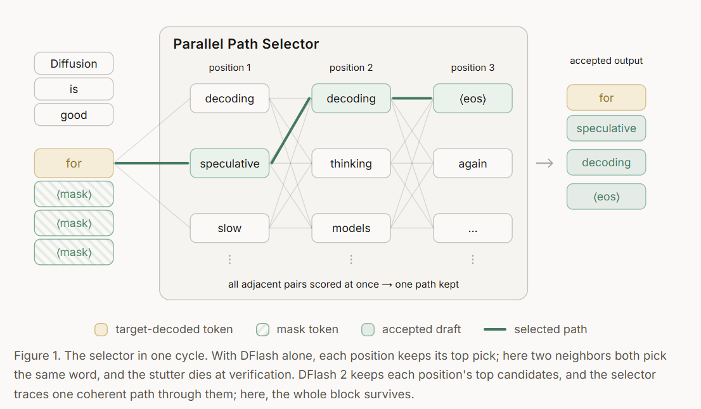

# Speculative Decoding

> [!NOTE]
> 下文的 SGLang 实现以 2026-10-07 的源码快照 [`ba77d30256bf`](https://github.com/sgl-project/sglang/tree/ba77d30256bfb1d1e0d53cd877c87f0b2e279ef1) 为准。经典拒绝采样公式与 SGLang 的具体采样分支分别讨论；不同算法和设备后端不能直接共用一条执行路径。

## Motivation

设 target 已经执行了前缀 $x_{1:t}$，对应 KV 和 hidden states 都已存在，并从最后一个位置的分布中采样出 $x_{t+1}$。将这个刚生成的 token 记为 anchor $a$。

此时系统的状态是：

```text
已执行 target：    A B C
已生成但尚未执行：      D   ← anchor
希望 draft 预测：        E F G H

已有 target feature：h_A h_B h_C
尚无 target feature：            h_D h_E h_F ...
```

**anchor 已确定，但 target 尚未以它为输入执行 forward。** 这个一位偏移贯穿 EAGLE 的特征递推、DFlash 的训练 mask 和验证后的 KV 提交。

统一记号如下，避免把不同论文里的 $K$、$\gamma$、block size 混在一起。

| 记号                  | 本文含义                                          |
| --------------------- | ------------------------------------------------- |
| $a=x_{t+1}$           | 上轮 target 生成、这一轮要处理的 anchor           |
| $m$                   | 本轮新提出的 draft token 数，不包含 anchor        |
| $B=m+1$               | 线性 target verify 的输入长度：anchor 加草稿      |
| $r$                   | 实际接受的 draft 前缀长度，$0\le r\le m$          |
| $\tau=\mathbb E[r+1]$ | 平均每轮新输出 token 数，包含 correction/bonus    |
| $K$                   | DFlash 2 每个位置保留的候选数，与 block size 不同 |

target 验证的输入是 `[a, d1, ..., dm]`。因果 attention 允许一次得到所有位置的条件分布：anchor 那一行预测 `d1`，`d1` 那一行预测 `d2`，依此类推。第一个不匹配或被拒绝的位置使后缀作废；若所有草稿都通过，则再从最后一行采样 bonus。

因此，**全部接受时是 $m+1$ 个新输出，而不是接受 $m-1$ 个再补一个**。到达 EOS 或输出长度上限时，面向用户的输出还会被截断。

### Lossless 保证

对随机 proposal，令 $q_j$ 为 draft 在实际已选前缀下使用的条件分布，$p_j$ 为 target 在同一前缀下的分布。对 $d_j\sim q_j$，经典拒绝采样使用：

$$
\alpha_j(d_j)=\min\left(1,\frac{p_j(d_j)}{q_j(d_j)}\right).
$$

拒绝后从残差分布采样：

$$
p'_j(v)=\frac{[p_j(v)-q_j(v)]_+}{\sum_u[p_j(u)-q_j(u)]_+}.
$$

接受分支提供的概率质量是 $\min(p_j(v),q_j(v))$，拒绝分支补上 $[p_j(v)-q_j(v)]_+$，两者之和恰好为 $p_j(v)$。这里不要求 $q=p$；两者越接近，通常接受率越高，但不接近首先损失的是速度。[原始 speculative decoding 论文](https://arxiv.org/abs/2211.17192)给出了这一分布保持机制。

- Greedy 验证比较 target argmax 和候选 token，在相同数值与 tie-breaking 条件下保持 greedy 输出。
- 使用 $p/q$ 拒绝采样时，验证端要求**实际 proposal 分布**。经过 DSpark correction 或 DFlash 2 selector 后，不能继续把未经修改的 unary softmax 当成 $q$；target-only 验证另有不读取原始 $q$ 的算法。
- 分布相同不意味着同一个随机种子下逐 token 相同；并行路径对随机数的消费顺序可能不同。


### 优化目标

单请求稳态下，可以用下面的近似理解收益：

$$
T_{\text{token}}
\approx\frac{T_d+T_v+T_{\text{state}}+T_{\text{sched}}}{\tau}.
$$

$T_d$ 是 drafting，$T_v$ 是 target verification，另外两项包含 KV 提交、draft 状态刷新、采样和调度开销。这是把一轮成本除以有效输出数的摊销模型，不能把其中某一项默认视为零。

若无投机时每个 token 成本为 $T_{\text{AR}}$，收益条件是：

$$
T_d+T_v+T_{\text{state}}+T_{\text{sched}}<\tau T_{\text{AR}}.
$$

小 batch 下，合并多个位置有机会摊薄权重读取和执行开销；高并发下，target 已经忙于服务大量请求，**验证低质量后缀会与其他请求竞争容量。**

## Draft

draft 负责提出候选，候选形状取决于算法。EAGLE/EAGLE-2 逐步展开 token，其中 `topk>1` 可形成树；DFlash 用一次 masked block forward 并行预测；DSpark 在并行 backbone 后用 Markov head 引入块内依赖；DFlash 2 则在并行预测的候选集合上选择一条路径。不能把它们都称为“多步候选树”，也不能假定每种 drafter 都读取 target 的多层 feature。

### DFlash 2：先并行评分，再沿一条路径选择

设块内有 $m=B-1$ 个待预测位置。drafter 一次前向产生隐藏状态 $h_j$；[`compute_candidates()`](https://github.com/sgl-project/sglang/blob/ba77d30256bfb1d1e0d53cd877c87f0b2e279ef1/python/sglang/srt/models/dflash.py#L1231) 通过 LM head 在每个位置取得候选集 $\mathcal C_j$ 及其 unary logits $U_j$。对于位置 $j>1$ 的相邻候选，selector 计算：

$$
S_j(a,b)=U_j(b)+\left\langle A(a)\odot H(h_j),B(b)\right\rangle,
\quad a\in\mathcal C_{j-1},\ b\in\mathcal C_j.
$$

$A$、$B$ 是 checkpoint 中的前驱和后继 codebook，$H$ 是一次线性投影。候选 ID、unary logits 和各位置的隐藏状态在选路径前已经确定，因此 [`build_lattice()` / `_score_edges()`](https://github.com/sgl-project/sglang/blob/ba77d30256bfb1d1e0d53cd877c87f0b2e279ef1/python/sglang/srt/models/dflash.py#L1046) 能并行算出每个位置的 $K\times K$ 转移分数。把两组候选嵌入堆叠为 $A_{j-1},B_j\in\mathbb R^{K\times d}$，可写成：

$$
\mathbf S_j=\bigl(A_{j-1}\odot H(h_j)\bigr)B_j^\top
+\mathbf 1\mathbf u_j^\top\in\mathbb R^{K\times K}.
$$

**首个待预测位置是特例：前驱固定为 anchor。** 源码把 anchor ID 复制到该位置的 $K$ 个前驱槽，所以首个 $K\times K$ 矩阵的各行相同。之后的前驱才来自上一位置的 top-K；源码实现的 lattice 形状为 `[batch, m, K, K]`。



最后，[`sample_path()`](https://github.com/sgl-project/sglang/blob/ba77d30256bfb1d1e0d53cd877c87f0b2e279ef1/python/sglang/srt/models/dflash.py#L1140) 从 anchor 行开始，每步只读取已选前驱对应的一行，再做 argmax 或按该行 softmax 逆 CDF 采样。它是**逐步条件选择**，不是对整条路径分数求和的全局最优搜索。随机采样时，代码还返回实际走过各行的条件分布 `q_rows`，供后续验证使用；评分可并行，沿路径的索引依赖仍是串行的，不能仅凭矩阵很小就断言这部分端到端开销“极低”。

top-K selector 只能在候选集合内改进选择，无法找回未进入 top-K 的正确 token；候选提取仍需处理 LM head 的词表 logits。这个边界也是 [DFlash 2 增加局部卷积](https://inco.ai/blog/dflash2/)改善后部位置候选覆盖的原因。

## Verify

target 验证时，已执行的前缀由 KV cache 提供；本轮 `input_ids` 是 verify block/tree，**其中包含尚未执行的 anchor 根节点**。EAGLE 的 [`build_eagle_verify_input()`](https://github.com/sgl-project/sglang/blob/ba77d30256bfb1d1e0d53cd877c87f0b2e279ef1/python/sglang/srt/speculative/eagle_worker_common.py#L366) 把上一轮的 `bonus_tokens` 作为根传给建树函数；[`eagle_prepare_for_verify()`](https://github.com/sgl-project/sglang/blob/ba77d30256bfb1d1e0d53cd877c87f0b2e279ef1/python/sglang/srt/speculative/eagle_utils.py#L522) 再令 `batch.input_ids = verify_input.draft_token`。所以这里的 `draft_token` 是包含根的 verify 输入名称，并不等于“本轮新提出的 token”。

对线性 `[a,d_1,\ldots,d_m]`，因果 attention 的各行分别给出 $p(d_1\mid\text{prefix},a)$、$p(d_2\mid\text{prefix},a,d_1)$ 等条件分布；最后一行用于全部通过时采样下一轮 anchor。EAGLE 树则用 tree mask 限制节点只能看到自己的祖先，`retrieve_next_token`、`retrieve_next_sibling` 和 `accept_index` 用于沿接受路径遍历。DFlash 的 [`DFlashVerifyInput`](https://github.com/sgl-project/sglang/blob/ba77d30256bfb1d1e0d53cd877c87f0b2e279ef1/python/sglang/srt/speculative/dflash_info.py#L24) 明确是 `topk=1` 的线性 verify。两种路径都不会把已缓存的前缀整段重新喂入 target。


## Sampling Method

### 经典 $p/q$ 拒绝采样

前文的 $\alpha=\min(1,p/q)$ 与 $[p-q]_+$ 是**使用实际 draft proposal 分布 $q$** 的算法：沿候选路径依次判定，首次拒绝时从残差分布抽取 correction；若全部接受，使用 target 最后一行抽取 bonus。对于 $p(x)\ge q(x)$ 的候选，接受概率为 1；对于 $p(x)<q(x)$，接受概率为 $p(x)/q(x)$。这解释了 lossless 性质，也解释了为什么改变 proposal 后必须同步改变验证用的 $q$。

SGLang 的 [`eagle_sample()`](https://github.com/sgl-project/sglang/blob/ba77d30256bfb1d1e0d53cd877c87f0b2e279ef1/python/sglang/srt/speculative/eagle_utils.py#L738) 明确分支：greedy 用 `verify_tree_greedy_func`；启用 `speculative_use_rejection_sampling` 时，用 `chain_speculative_sampling_triton` 并检查 `draft_probs` 与 target 词表维度一致；其余支持的非贪心路径用 `tree_speculative_sampling_target_only`。所以不能把这三种验证统称为“EAGLE 的 typical sampling”。设备后端也会影响可用分支。

### SGLang 的 target-only tree sampling

target-only 分支在 Python 侧把 `draft_probs` 初始化为零，并非把原始 draft softmax 当作 $q$。[CUDA kernel](https://github.com/sgl-project/sglang/blob/ba77d30256bfb1d1e0d53cd877c87f0b2e279ef1/python/sglang/kernels/jit/include/sgl_kernel/speculative/sampling.cuh#L64) 沿树从根向下查看同层 sibling：累积候选的 target 概率 `prob_acc`，满足 `coin < prob_acc / threshold_acc` 或单项概率达到 `threshold_single` 时接受；未接受的 sibling 会把其 target 概率写进工作用的 `draft_probs` buffer。路径停止后，kernel 从当前 target 分布扣除这些已排除 sibling 的概率质量，再采一个终结 token；若整条路径通过，直接用最后一行 target 分布采 bonus。

这里 kernel 中的 `draft_probs` **是被写入的排除质量缓冲区**，不能按变量名把它解释为 drafter 的原始 proposal 分布，也不能把最后的 `relu(target_probs - draft_probs)` 直接解释为经典 $[p-q]_+$。将 `threshold_single` 或 `threshold_acc` 调离 1 还会改变接受规则，不能仅凭“有残差采样”就声称任何阈值配置都严格保持 target 分布。

### DFlash 2 的随机路径

DFlash 2 的 selector 按实际已选前驱返回每一步的 `q_rows`。[`_selector_sampling_accept()`](https://github.com/sgl-project/sglang/blob/ba77d30256bfb1d1e0d53cd877c87f0b2e279ef1/python/sglang/srt/speculative/dflash_worker_v2.py#L1455) 将这些仅覆盖 top-K 候选的概率散射到完整词表维度，再传给 `accept_sampling()`。因此，“一开始无需知道前驱”只适用于**并行建好所有边分数**；真正采样的条件 $q_j$ 必须由已经选出的前驱决定。

## 完整流程

### EAGLE V2：从 Prefill 到 Draft

Prefill 先由 target extend 得到可供 drafter 使用的 hidden states 与已采样的 anchor，随后运行 draft extend，建立 draft KV 和下一轮候选种子。进入 decode 后，[`forward_batch_generation()`](https://github.com/sgl-project/sglang/blob/ba77d30256bfb1d1e0d53cd877c87f0b2e279ef1/python/sglang/srt/speculative/eagle_worker_v2.py#L1323) 的常规顺序是 `draft()` → `verify()` → `_draft_extend_for_decode()`；流水并行、零步 drafting 等分支另有调度处理。

1. `EagleDraftInput` 带着上一轮产生的 `bonus_tokens`、hidden states 和 top-K 种子进入 [`draft()`](https://github.com/sgl-project/sglang/blob/ba77d30256bfb1d1e0d53cd877c87f0b2e279ef1/python/sglang/srt/speculative/eagle_worker_v2.py#L598)。这里的 `bonus_tokens` 是已输出、尚未由 target 执行的当前 anchor。
2. [`draft_forward()`](https://github.com/sgl-project/sglang/blob/ba77d30256bfb1d1e0d53cd877c87f0b2e279ef1/python/sglang/srt/speculative/eagle_worker_v2.py#L674) 逐步展开。对于 `topk>1`，每步用父节点累计分数与新候选概率选出下一层；[`organize_draft_results()`](https://github.com/sgl-project/sglang/blob/ba77d30256bfb1d1e0d53cd877c87f0b2e279ef1/python/sglang/srt/speculative/eagle_worker_v2.py#L847) 保留预算内的节点，不把完整满树交给 target。
3. 建树函数把 **anchor 作为根** 拼入 verify 输入，同时生成 `positions`、tree mask 和 `retrieve_*` 索引。`topk=1` 且满足后端条件时，代码可走专门的 `build_chain_tree()` 快路径；不能把 `build_tree_kernel_efficient()` 当成唯一入口。

### KV 预留与接受路径

此前“每轮恰好分配 `num_steps × topk` 个槽，未接受的当轮立刻释放”的说法与当前 V2 不符。[`get_alloc_len_per_decode()`](https://github.com/sgl-project/sglang/blob/ba77d30256bfb1d1e0d53cd877c87f0b2e279ef1/python/sglang/srt/mem_cache/allocation_sizing.py#L27) 先取 `max(topk × num_steps, num_draft_tokens)`，`page_size>1` 且树分支有 draft KV 时还按最坏页占用扩大；[`get_alloc_reserve_per_decode()`](https://github.com/sgl-project/sglang/blob/ba77d30256bfb1d1e0d53cd877c87f0b2e279ef1/python/sglang/srt/mem_cache/allocation_sizing.py#L60) 再取两倍，吸收 overlap 下提交长度落后一轮的窗口。实际新增页数还取决于之前已预留多少空间。

`kv_committed_len` 表示 target 验证后确认的长度，`kv_allocated_len` 表示请求已占有的物理窗口上界。[`alloc_for_spec_decode()`](https://github.com/sgl-project/sglang/blob/ba77d30256bfb1d1e0d53cd877c87f0b2e279ef1/python/sglang/srt/mem_cache/allocation.py#L739) 扩大后者并更新 `req_to_token_pool`；未接受的 verify/draft 槽可留在已分配窗口中由后续轮次覆盖。`batch.out_cache_loc` 只是当次 forward 使用的槽位视图。树的已接受路径需要移动到每请求连续的前部时，[`_finalize_accept_tree_path()`](https://github.com/sgl-project/sglang/blob/ba77d30256bfb1d1e0d53cd877c87f0b2e279ef1/python/sglang/srt/speculative/eagle_worker_common.py#L478) 执行 KV 与 hidden/predict 的整理；链式 `topk=1` 不需要这一步。

### Verify 与 Draft Extend

[`run_eagle_verify()`](https://github.com/sgl-project/sglang/blob/ba77d30256bfb1d1e0d53cd877c87f0b2e279ef1/python/sglang/srt/speculative/eagle_worker_common.py#L532) 先以 `TARGET_VERIFY` 执行 target forward，再按上一节的 greedy、target-only 或 rejection 分支得到 `accept_index`、接受长度和下一轮 anchor。**接受长度包含最后的 correction/bonus 输出；target 本轮真正算过 KV 的，是旧 anchor 与被接受草稿对应的输入行。** 新采出的 correction/bonus 已输出给用户，但还没有以它自身为输入执行 target forward，不能误认为已经有它的 target KV。

随后 `_draft_extend_for_decode()` 沿本轮确认的路径推进 drafter，使下一轮从正确的前缀继续。EAGLE 需要 target 验证产生的 feature 与新 anchor 的 token 信息，`EagleDraftInput` 把这些状态带入下轮；这一步的成本应计入前文的 $T_{\text{state}}$。DFlash 使用自己的 block draft 状态与 worker，不走这条 EAGLE 专属的 `topk_p/topk_index` 递推链。

如果是 greedy 树，`verify_tree_greedy_func` 在当前节点的 children 中寻找与 target argmax 相同的候选；找不到就以 target argmax 结束本轮。这个描述只适用于 greedy 分支；随机验证还有独立的概率与阈值处理。

## 工程细节 SGLang

### Mamba Cache Problem

Transformer 的 target 状态主要按 token 保存在 KV 槽中；Mamba/GDN 等混合模型还维护随请求推进的卷积和 SSM 状态。verify 会计算多个候选节点，却只提交其中一条接受路径，因此这些序列状态必须与接受位置同步，不能直接取 verify 计算的最后一步。

当前源码中的入口不是原文写的 `prepare_for_v2_verify()` 与 `_mamba_verify_update()`。EAGLE 的 `eagle_prepare_for_verify()`、DFlash 的 `DFlashVerifyInput.prepare_for_verify()` 都调用 [`prepare_mamba_track_for_verify()`](https://github.com/sgl-project/sglang/blob/ba77d30256bfb1d1e0d53cd877c87f0b2e279ef1/python/sglang/srt/speculative/spec_utils.py#L841)：按需重建 `mamba_track_indices`，并清空可能来自 extend 阶段的 `mamba_track_mask` 与 `mamba_track_seqlens`，避免 verify forward 使用过期的 tracking 元数据。

验证完成后，[`commit_mamba_states_after_verify()`](https://github.com/sgl-project/sglang/blob/ba77d30256bfb1d1e0d53cd877c87f0b2e279ef1/python/sglang/srt/speculative/spec_utils.py#L933) 根据 `accept_index` 和接受长度确定最后被接受的 verify 步；启用 prefix-cache tracking 时，还确定跨过 track interval 的那一步。普通 hybrid attention 后端可调用 `update_mamba_state_after_mtp_verify()` 把这两处状态提交到工作槽与 tracking 槽。但 **ReplaySSM/GDN/KDA 已有独立的 ring 或 fold 提交分支**，不能再概括为“固定两次 scatter”。共同的不变量是：工作态对应接受路径末端，tracking snapshot 对应实际跨越的边界。


