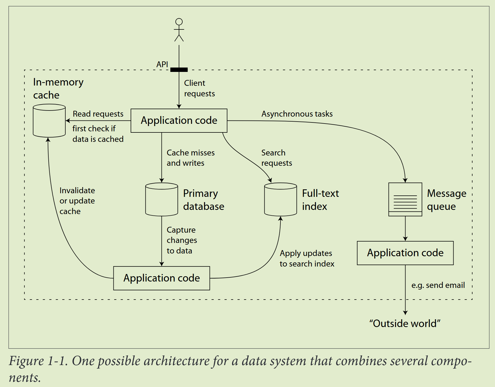

---

title: DDIA Chapter I
created: 2026-10-27
tags:
  - Distributed System
description: DDIA 第一章读书笔记：可靠、可扩展、可维护三个核心目标，以及数据系统的基础构成。

---

# Reliable Scalable and Maintainable Applications
## 4 fundamental building blocks

- Database: Store data so that they, or another application, can find it again later
- Caches: Remember the result of an expensive operation, to speed up reads 
- Indexes: Allow users to search data by keyword or filter it in various ways
- Stream Processing: Send a message to another process, to be handled asynchronously 
- Batch Processing: Periodically crunch a large amount of accumulated data

## Data Systems
Databases and message queues have some superficial similarity--both store data for some time, but they have different access patterns.

Now the boundaries between the categories are becoming blurred:
- Redis: data stores that are also used as message queues
- Kafka: message queues has database-like durability guarantees

### Example
For example, if you have an application-managed caching layer (using memcached or  similar), or a full-text search server separate from your main database (such as Elasticsearch or Solr), it is normally the application code’s responsibility to keep those  caches and indexes in sync with the main database.

Some tricky questions:
- How do  you ensure that the data remains correct and complete, even when things go wrong internally? 
- How do you provide consistently good performance to clients, even when parts of your system are degraded? 
- How do you scale to handle an increase in load?  
- What does a good API for the service look like?

## Three Important Concerns
### Reliability
- definition roughly(*fault-tolerant* or *resilient*): The system should continue to work correctly (performing the correct function at the desired performance) even in the face of adversity (hardware or software  faults, and even human error).
- fault and failure: A **fault** is usually defined as one component of the system deviating from its spec, whereas a **failure** is when the system as a  whole stops providing the required service to the user. It is impossible to reduce the  probability of a fault to zero; therefore it is usually best to design fault tolerance  mechanisms that prevent faults from causing failures.
### Scalability

### Maintainability