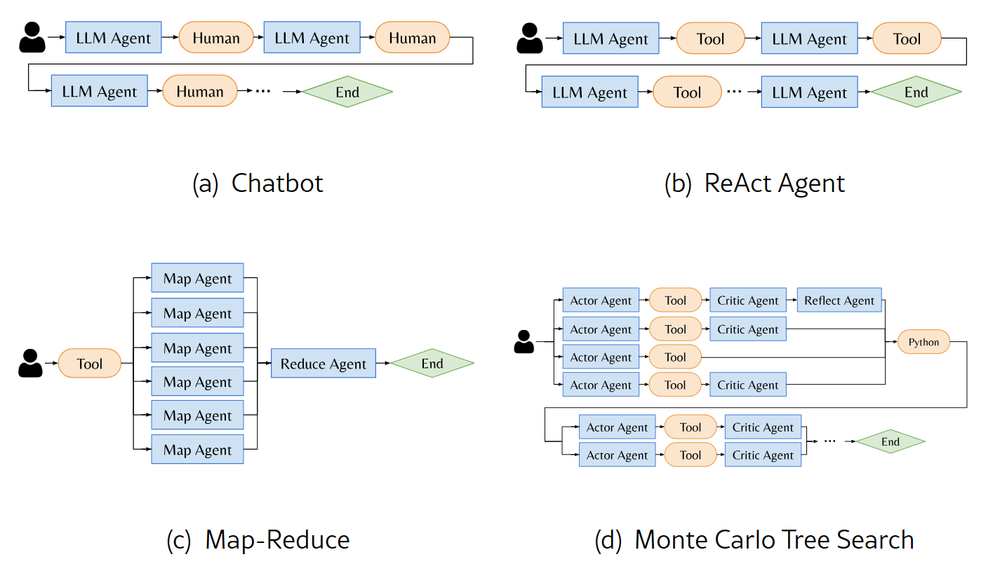
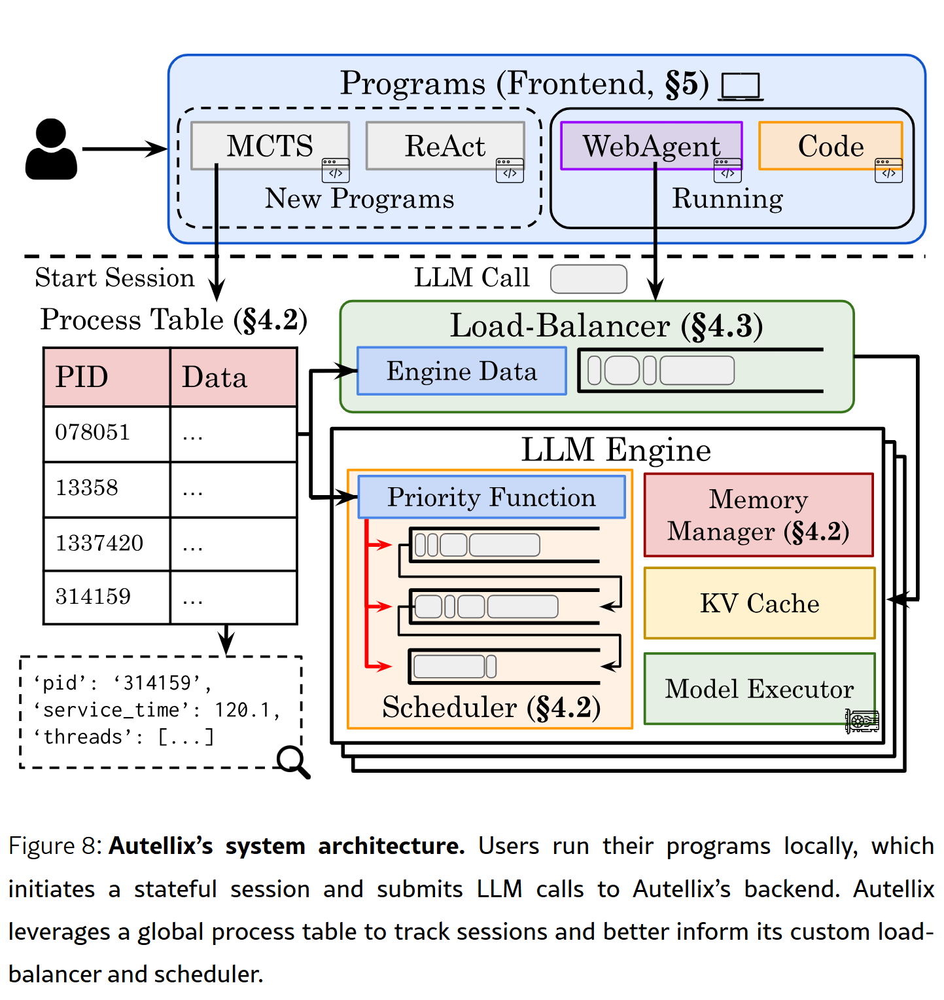
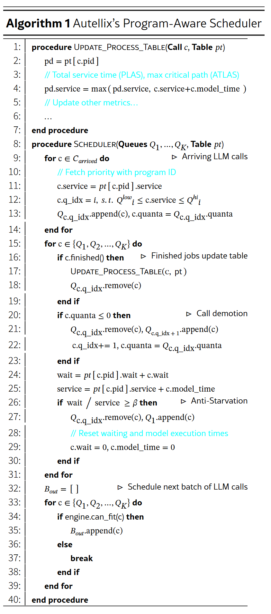

---

title: "Autellix: An Efficient Serving Engine for LLM Agents as General Programs"
created: 2026-11-13
tags:
  - Paper Notes
  - LLMInference

description: "首个面向 agentic program 的 LLM 服务引擎：以进程表跟踪程序级状态，用 PLAS/ATLAS 两种非先知调度算法解决调用级与程序级队头阻塞，并通过数据局部性感知的负载均衡复用 KV 缓存。"

---

# Autellix: An Efficient Serving Engine for LLM Agents as General Programs

## Bibliographic Information

- Authors: Michael Luo, Xiaoxiang Shi, Colin Cai, Tianjun Zhang, Justin Wong, Yichuan Wang, Chi Wang, Yanping Huang, Zhifeng Chen, Joseph E. Gonzalez, Ion Stoica（UC Berkeley / Google DeepMind / 上海交通大学）
- Year / Venue: 2025 年 2 月，arXiv 预印本（cs.LG / cs.AI / cs.DC）
- DOI: [10.48550/arXiv.2502.13965](https://doi.org/10.48550/arXiv.2502.13965)

## 1. Problem & Solution
Problem: LLM 应用已从简单聊天机器人演变为由大量 LLM 调用、工具调用和人类输入组成的动态智能体程序（以 DAG 表示，如 ReAct、Map-Reduce、蒙特卡洛树搜索 MCTS），但现有服务系统（如 vLLM）只优化单个请求，忽略了程序层面的依赖关系，导致严重的端到端延迟问题。
两级队头阻塞（HoL Blocking）
- **调用级阻塞**：长解码的 LLM 调用阻塞短调用（vLLM 的 FCFS 调度所致）。
- **程序级阻塞**：即使有抢占式调度（如 MLFQ），长程序的后续新调用仍会被反复优先处理，导致短程序被"饿死"。

Solution: 
- **进程表（Process Table）**：借鉴操作系统思想，通过有状态会话追踪每个程序的累计服务时间、等待时间、线程元数据等全局统计信息。
- **两个非先验（non-clairvoyant）调度算法**：
  - PLAS（单线程程序）：按程序已累计的服务时间排优先级——累计运行越少的程序优先级越高，让短程序先完成。
  - ATLAS（多线程程序/DAG）：按**程序关键路径（critical path）上的累计服务时间排优先级**，同时让同一程序的并行线程进度均衡，避免拖尾线程。
- **离散化多级队列 + 反饿死机制**：将连续优先级分桶到 K 个队列（类似 MLFQ），并按"等待/服务时间比"超阈值时提升优先级，兼顾平均延迟与公平性（P95/P99 尾延迟）。
- **数据局部性感知的负载均衡**：观察到同一程序内的 LLM 调用 KV 缓存命中率超过 90%，而跨程序几乎只共享系统提示词（**agent workload 是否这样有待考察？**）。因此短请求（≤2048 token）路由到最空闲的引擎做负载均衡，长请求则固定路由到其程序所在引擎以复用 KV 缓存。
- **工程优化**：多步调度减少调度频率；合并式 KV 块传输内核将 GPU-CPU 交换次数降低最多 18 倍。

## 2. Findings
### Dynamic Nature of Agentic Programs
> 首次把 agentic programs 形式化成 DAG

单线程程序在两个维度上有所差异：1）程序的长度，这取决于用户提示；2）LLM 调用与中断的序列，这由程序的控制流决定。

多线程程序通常形成有向无环图（DAG）。Map-Reduce 这一经典的多线程程序和蒙特卡洛树搜索（MCTS）都会随时间推移在分叉与合并的线程数量上发生变化，其中每个线程可能包含不同的 LLM 调用与中断序列。
> 特别是，MCTS 是一种广泛用于推理智能体和基于网页的智能体搜索与规划的技术

## 3. Autellix Design

一个旨在运行程序而非单个 LLM 调用的 LLM 推理系统。受操作系统进程调度器的启发，我们的核心思想是按**程序先前已完成调用的总执行时间来确定 LLM 调用的优先级**；来自长程序（不太可能很快完成）的 LLM 调用会被降低优先级，从而让较短的程序先完成。
  
利用全局的程序级统计信息（例如程序在引擎上的累计执行时间）来最小化等待时间并提升引擎吞吐量。我们提出两种非先知（non-clairvoyant）调度算法，它们假定对程序的工作负载没有任何先验知识：用于单线程程序的 PLAS（程序级已获服务量，Program-Level Attained Service），以及用于以一般动态 DAG 表示的多线程程序的 ATLAS（自适应线程级已获服务量，Adaptive Thread-Level Attained Service）。
- PLAS 根据调用所属程序当前的累计服务量（即执行时间）来确定 LLM 调用的优先级。
- ATLAS 根据同一程序中**所有线程的最大累计服务时间**来确定 LLM 调用的优先级，这相当于按程序的关键路径 [88] 对调用进行排序。除了缩短等待时间外，ATLAS 还通过**优先调度那些否则会阻塞程序进展的关键 LLM 调用**，缩短了程序的完工时间（makespan）。

Autellix 遵循程序的数据局部性，将长调用路由到其程序所在的引擎，同时将较短的调用负载均衡到其他引擎——在这些引擎上，系统提示构成了短调用的绝大部分输入。

程序从用户的本地机器执行，与 Autellix 建立会话，并随时间推移携带相应的会话 ID 发出 LLM 调用。
- 当会话启动时，Autellix 会向全局进程表中添加相应的条目。该表跟踪程序的元数据，包括总服务时间、线程级元数据以及程序各次 LLM 调用之间的等待时间。
- 引擎级调度器和有状态的负载均衡器都利用该表来调度下一次解码批次的 LLM 调用，并根据程序的数据局部性将 LLM 调用路由到相应引擎

### Program-Aware Scheduler

进程表（Process Table, pt）：借鉴操作系统的进程表，为每个正在运行的程序（program）维护一条记录，字段包括：
- Service time（服务时间）：单线程程序 = 所有已完成调用在模型执行器上的累计运行时间；多线程程序 = 已观测到的最长关键路径的执行时间。这是优先级的唯一依据。
- Waiting time（等待时间）：程序的调用在调度队列里排队的总时间——用于反饿死。
- Engine ID(s)：程序当前运行在哪个引擎上——供负载均衡器使用。
- 线程元数据：每个"线程"对应一个活跃的 LLM 调用，记录各自的到达、等待、服务时间。
- 最近一次调用到达 / 完成时间：用于识别" stale 程序"和检测长时间的外部中断（工具调用、人工输入）。

K 个优先级队列（Q₁…Q_K）：优先级从 Q₁ 到 Q_K 递减，每个队列覆盖一段连续的服务时间区间 [low, high)，相邻队列区间首尾相接（Q₁ 从 0 开始，Q_K 到 ∞）。

调度器每运行一次，做三件事（对应算法三个循环）：

- 入队（第 9–14 行）：对每个新到达的 LLM 调用，用它的程序 ID 查进程表，取出该程序的累计服务时间 c.service（第 11 行），然后看这个时间落在哪个队列的区间内，就把调用放进那个队列（第 12–13 行），并赋予该队列的时间片（quanta）。
> 这是与传统 MLFQ 最本质的区别：传统 MLFQ 里所有新任务都从最高优先级队列 Q₁ 开始——这恰恰导致长程序的每个新调用都插队到短程序前面（程序级队头阻塞）。Autellix 让新调用继承其程序的历史，长程序的后续调用一进来就被放到低优先级队列。

- 状态维护（第 15–31 行）：遍历所有队列中的调用：
  - 完成则更新进程表（第 16–18 行）：调用结束时，把它的服务时间累加（单线程 PLAS）或取 max（多线程 ATLAS）写回进程表（第 4 行的 pd.service = max(pd.service, c.service + c.model_time)）。
  - 时间片耗尽则降级（第 20–23 行）：调用用完当前队列的量子后，被降到下一级队列——**这是调用级的抢占，防止长解码调用独占 GPU**。
  - 反饿死提升（第 24–30 行）：
    - Autellix 的方案是程序级的饿死度量：当某个调用的"总等待时间 / 总服务时间"比值超过阈值 β 时（第 24–27 行）：(W_p + W_c) / (T_p + T_c) ≥ β → 提升到 Q₁

    > 其中 W_p、T_p 是程序级的累计等待和服务时间（来自进程表），W_c、T_c 是该调用自身的。注意分子分母都包含程序历史，所以判定的是"这个程序整体上是不是等太久了"，而不是单个调用。

  - 组批次（第 32–39 行）：从 Q₁ 开始按优先级扫描，只要引擎装得下（can_fit，即 KV 缓存空间足够）就把调用加入下一个解码批次 B_out，直到装不下为止。

## 4. Summary
Autellix 是 2024 年底第一个转向 agentic program 的 llm engine，将 scheduler 粒度从 llm call 级别提升到 program 级别，针对 llm-call-level 的 call-level HoL blocking 和 program-level HoL blocking 提出 PLAS 和 ATLAS 两种非先知调度算法，结合离散化多级队列和反饿死机制，兼顾平均延迟与公平性。通过数据局部性感知的负载均衡，Autellix 在 8 个引擎上对 6 种智能体程序的评测中，平均降低了 1.5× 的端到端延迟和 1.3× 的尾延迟。

> 对于当前 agent workload 其调度策略并不适用，没有考虑到当前 workload prefix cache 命中率更重要，kv cache life cycle 相比于 program-level scheduling 更重要，后续可以考虑结合 KVTether 的生命周期感知 KV 缓存管理系统，进一步优化 agent workload 的调度策略