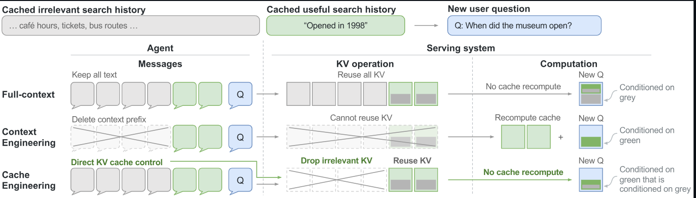
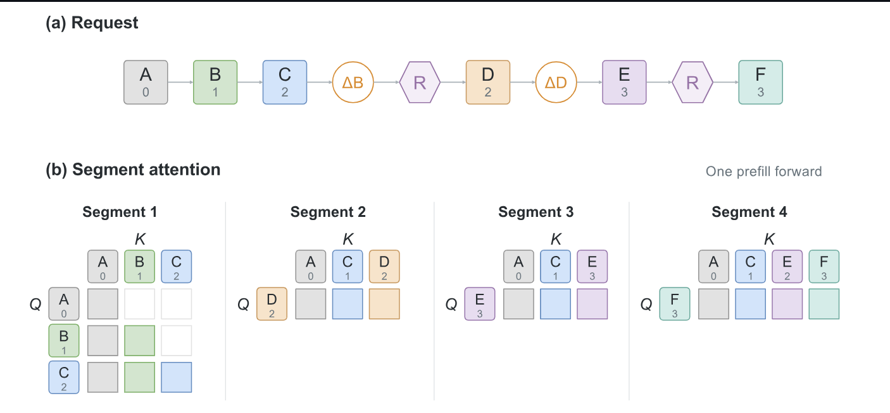
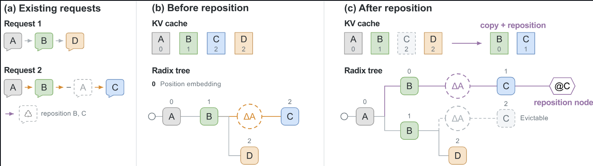
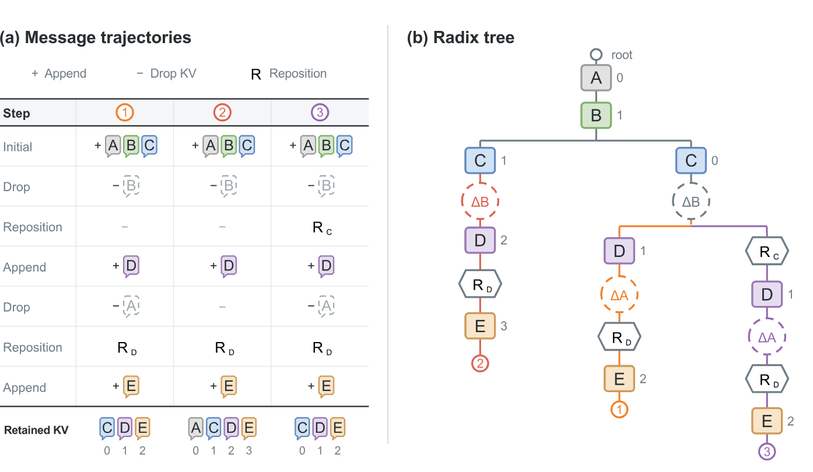

---

title: Cache Engineering for Agents
created: 2026-11-14
tags:
  - Paper Notes
  - LLMInference

description: "AKV 提出 Cache Engineering：不改文本轨迹，通过 drop/repos 缓存操作丢弃或重定位 KV，配合扩展 radix tree 与 segment-batch attention 复用缓存并免去 re-prefill。"

---

# Cache Engineering for Agents

## Bibliographic Information

- Authors: Tianyu Fu, Ruoxi Wang, Zihan Min, Zhongqi Ren, Zhihao Li, Tengxuan Liu, Shengxu Mu, Hanling Zhang, Yu Wang（清华大学 / The Chinese University of Hong Kong）
- 原文标注：† equal contribution；† corresponding author: Yu Wang (yu-wang@tsinghua.edu.cn)
- Year / Venue: 2026 年 10 月，arXiv 预印本（cs.CL）
- DOI: [10.48550/arXiv.2610.28577](https://doi.org/10.48550/arXiv.2610.28577)

## 1. Problem & Solution
Problem: 
- 成本侧：agent 轨迹越来越长（上百轮），KV cache 的存储与 I/O 成为主导开销——论文实测 KV cache 读取占 API 总成本的 82.4%。
- 精度侧：attended KV 数量或位置跨度超过模型可靠范围时，准确率严重退化（RULER 等已有观察）。
> 相同的 token 序列在不同的缓存操作序列下可能产生不同的缓存状态，这使得仅靠前缀匹配不足以实现正确的缓存复用
- 现有方案的两难：context engineering（trim/summarize，如 Claude Code、Codex 的 compaction）修改了轨迹前缀 → 后续所有 KV 失效 → 保留的后缀必须 re-prefill。
  - 编辑点越靠前，重算越多。为了不 re-prefill，harness 往往把 compaction 推迟到接近阈值、然后激进地砍掉大部分历史 → 丢信息、掉精度。
  - 论文实测：trim 方案成本反而是全量的 1.85×；48K 阈值的 summary 方案省 7% 成本但掉 5 个点准确率。**「re-prefill 成本」和「信息保留」不可兼得，这是核心矛盾。**

Solution: Cache Engineering——一种让智能体直接控制其活跃 KV 缓存的新方案。该方案不修改文本轨迹，而只是将**选定的 KV 条目排除在未来的注意力计算之外，并复用所有保留的 KV 状态，无需重新预填充**。这使得智能体可以在给定的成本预算内，逐步丢弃较旧的 KV 条目，同时保留更多的后缀 KV
- append: 新增 token 添加 KV 状态
- drop: 将选定的 KV 条目从后续注意力中移除
- repos: 调整保留键中编码的位置。

在整个执行过程中，LLM 与 harness 决定何时以及如何应用这些操作，并将其与 append 反复交错，以塑造活跃缓存。这种可编程控制还使智能体能够通过递归自我改进（RSI）来搜索、评估和优化缓存工程策略。

## 2. Motivation
- **Why Cache Engineering?**: trim 方案成本反而是全量的 1.85×；48K 阈值的 summary 方案省 7% 成本但掉 5 个点准确率。相比之下，直接丢弃较旧的工具响应缓存可以复用剩余缓存，同时提高准确率并降低成本。保留的缓存还可能保留来自已丢弃历史的信息

- **保留缓存的哪些部分**: 保留所有推理过程与近期工具响应的缓存，同时丢弃较早的工具响应缓存

- **如何管理位置编码**: 我们将位置编码索引与逻辑索引和缓存大小解耦，使用单独的缓存操作通过 RoPE 旋转重新定位缓存的键，而无需 re-prefill

## 3. Cache Engineering Design
Stateless Interface, Stateful Cache Management with Extended Radix Tree and Segment-Batch Attention
> context engineering 通过裁剪或摘要来修改逻辑词元序列。相比之下，cache engineering 通过缓存操作直接修改活跃缓存，同时保持逻辑词元序列不变。

### Segment-Batch Attention
每当 drop 或 repos 操作改变可见历史或其位置映射时，AKV 便通过对查询进行分区来恢复缺失的 KV 状态。每个分段选取相应的 KV 页面，并应用标准的因果注意力，从而在不构建稠密自定义掩码的情况下编码历史可见性。

### Cache Management
- **通过 drop 节点实现复用**: AKV 在基数树前缀匹配的基础上扩展了 drop 节点。当请求调用 drop 时，AKV 会在请求路径上的触发点插入一个 drop 节点 Δ，记录被丢弃缓存所对应的逻辑 token 索引。
  - 由于 drop 不会改变保留的状态，但会影响后续的注意力计算，这种放置方式在保留前缀共享的同时区分了后续状态。扩展后的基数树进行前缀匹配时，会沿匹配到的 token 前缀和操作前缀复用缓存
  - KV 优先逐出被 drop 的缓存，而不是已完成请求的缓存，因为后者在下一轮中更有可能被复用。

- **通过键旋转实现复用**: AKV 在 repos 之后通过复制缓存状态并旋转键来复用缓存，而无需重新计算隐藏状态。在基数树中，这些副本形成一个带有更新位置索引的新分支，并在 C 之后记录一个 reposition 节点。前缀匹配同时检查 token 历史和操作历史：位置索引一致时可直接复用，索引不同时则需要进行键旋转
  - 当某个位置编码版本不再被任何进行中的计算或恢复操作使用时，AKV 会独立地将其逐出
  

### Cache Reuse Matching Rules
每个缓存节点记为 𝑇(𝑥, 𝑝)：𝑥 是 token，𝑝 是它缓存的 K 里当前编码的位置。

**规则 1：精确匹配（exact match）——直接复用**
token 相同 **且** 位置 𝑝 相同 **且** 路径上的操作记录完全相同 → 缓存原样拿来用，什么都不用改。

**规则 2：重触发匹配（retrigger match）——变换后复用**
只要求 token 序列相同、操作历史相同，**允许位置 𝑝 不同**。因为只要计算历史一样，隐藏状态就一样，差异只在 K 的旋转角度上，可以用一个变换补回来，不用重新跑模型：

$$K_t = R(p_t)\,R(p_s)^{-1} K_s, \qquad V_t = V_s$$

**查找顺序**：先找最长的精确匹配前缀；再从头找历史兼容的分支，只有"严格更长"才替换（打平时保住精确匹配）；遇到第一个 token 或操作不一致就停。

## 4. Summary
AKV 发现 context engineering 的两难：保留的后缀必须 re-prefill，导致成本高、精度低。AKV 提出 cache engineering：直接丢弃较旧的 KV 条目，同时复用所有保留的 KV 状态，无需重新预填充。通过 drop 和 repos 操作，智能体可以在给定的成本预算内，逐步丢弃较旧的 KV 条目，同时保留更多的后缀 KV，从而提高准确率并降低成本。

kv cache management 需要额外处理 drop 和 repostion，使用扩展的 radix tree 来管理缓存状态，使用 segment-batch attention 来恢复缺失的 KV 状态。

> 很好的 co-design 方式，extended radix tree 想法很新颖，没有像 epic 这类方式尽可能多的复用 kv cache(额外 attention 处理 + cope 等其他旋转算法)——而是直接在 radix tree 上做 drop/reposition，复用的同时不需要额外 attention 处理；segment-batch attention 也很巧妙，利用了 attention 的因果性和分段的方式来恢复缺失的 KV 状态，而不是像 epic 那样构建稠密自定义掩码。

> 给我的启示是， co-design 势在必行，agent harness 需要向 llm engine 暴露 lifecycle 或者文中这种 kv cache 处理的信息；同时 llm engine 和 agent harness 之间需要一个桥梁(stateful interface)，类似 kvtether llm engine 只对 token-level 处理，复杂的管理和 transposition 由中间层进行处理 