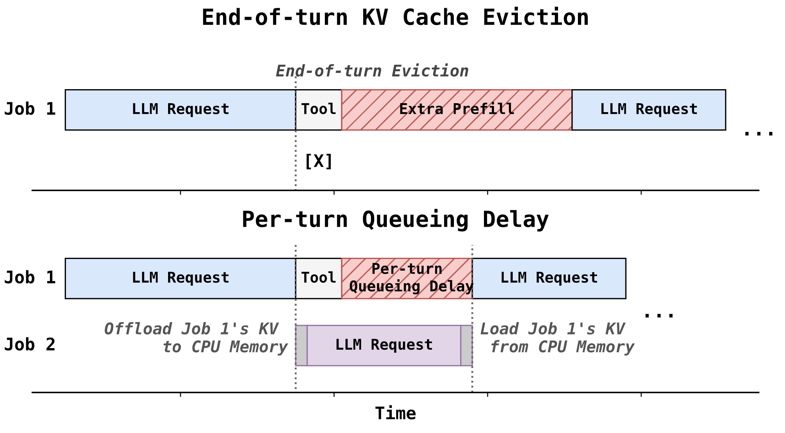
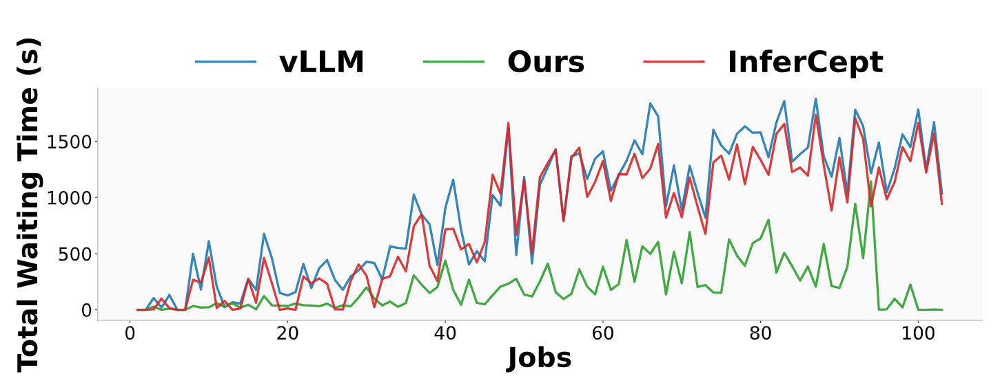
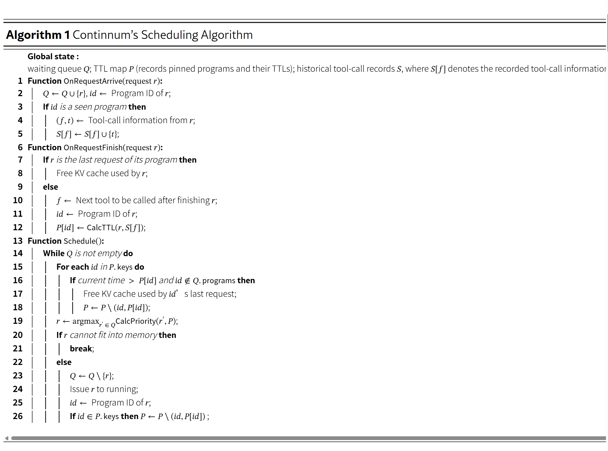

---

title: "Continuum: Efficient and Robust Multi-Turn LLM Agent Scheduling with KV Cache Time-to-Live"
created: 2026-11-13
tags:
  - Paper Notes
  - LLMInference

description: "给工具调用期间的 KV cache 设 TTL：按工具历史耗时分布、被驱逐请求的排队延迟与记忆性因子计算最优保留时长，缓解 end-of-turn 驱逐与 per-turn 排队延迟。"

---

# Continuum: Efficient and Robust Multi-Turn LLM Agent Scheduling with KV Cache Time-to-Live

## Bibliographic Information

- Authors: Hanchen Li, Runyuan He, Qiuyang Mang, Qizheng Zhang, Huanzhi Mao, Xiaokun Chen, Hangrui Zhou, Huanchen Zhang, Alvin Cheung, Joseph Gonzalez, Ion Stoica（UC Berkeley / Stanford / 清华大学；前三位作者共同贡献）
- Year / Venue: 2025 年 11 月，arXiv 预印本（cs.OS / cs.AI / cs.NI）
- DOI: [10.48550/arXiv.2511.02230](https://doi.org/10.48550/arXiv.2511.02230)

## 1. Problem & Solution
Problem: llm engine 会驱逐 finished request，在 agent workload 下存在问题，llm + tool call 的场景下，finished request 可能会被后续的 request 复用，过早驱逐会导致重复推理，增加延迟和成本。保留之前的 kv cache 存在挑战：
- 重新计算（若启用卸载则为重新加载）的潜在成本，以及从 GPU 逐出后不断增长的排队延迟。
- 由于工具调用时长存在内在波动，该方法必须在工具调用时长可预测性有限的情况下保持鲁棒性。

Solution: Continuum，time-to-live mechanism for KV cache retention. 对于会生成工具调用的请求，Continuum 会根据 **reload 成本以及由驱逐引起的潜在排队延迟**，选择性地将 KV 缓存以一定的生存时间值固定在 GPU 内存中。当生存时间到期后，KV 缓存可被自动驱逐以释放 GPU 内存，从而在边缘情况下提供稳健的性能

## 2. Findings
### Key Issue
request’s KV cache is evicted when the agent transforms from inference step to tool call. End-of-turn eviction causes pre-turn-queueing delay.

### Problems in Related Work

**Fixed Workflow**: 假设 DAG 是静态或确定性定义的，无法处理 ReAct 风格的动态智能体工作负载——这类负载的依赖图会在运行时演化。这限制了这些工作去优化实践中种类繁多的智能体

**No Tool-Call Awareness**: Autellix（Luo 等人，2025b）提出了程序级已获得服务（PLAS）调度，优先处理智能体程序累计服务时间更短的请求。Tempo（Zhang 等人，2025）提出了一种调度器，用于在面对不同类型的请求（聊天、智能体、推理）时满足 SLO，而我们的关注点 specifically 在于具有多轮次和可变工具调用的智能体工作负载。Apt-Serve（Gao 等人，2025）联合优化混合缓存管理与请求调度以提升有效吞吐，但它针对的是单个 LLM 请求，而非动态的多轮智能体工作流。AlignedServe 探索了面向 LLM 服务的前缀感知批处理（Bai 等人，2026）。这些工作未能考虑智能体工作负载中工具调用的独特特性，例如其可变的持续时间以及对 KV 缓存管理的影响。这种忽视可能导致次优的调度决策和增加的延迟

**Insufficient KV Cache Retention Strategies**: Cache-Craft（Agarwal 等人，2025b）管理*可复用的分块缓存以实现高效的检索增强生成*，但它关注的是文档分块，而非在工具调用之间保留特定于请求的智能体状态。InferCept（Abhyankar 等人，2024）引入了一种“保留”（preserve）操作，*在工具调用之间固定 KV 缓存。然而，其策略忽视了请求的多轮特性*。

## 3. Continuum Design
### Challenges
**Turn-based Eviction:** vLLM 或 SGLang 会在解码完成后立即逐出请求的 KV 缓存，隐式地假定该请求已完成。然而，如果 KV 缓存已被逐出，引擎就必须重新执行完整的预填充（prefill），或者在启用卸载时从 DRAM 重新加载 KV 缓存，从而产生额外的延迟。大多数系统在处理这些场景时效率低下。

**Per-Turn Queueing Delay**: 调度器为最大化吞吐量而将 GPU 内存分配给其他请求，当前程序的 KV 缓存就会从 GPU 内存中移除。当程序的工具调用返回、后续 LLM 请求被发送到调度器时，它必须排在其他正在进行的预填充/解码请求之后，等待 GPU 空间释放。*无论 KV 缓存是否存储在 CPU DRAM 中，这段等待期都会在智能体程序的执行中产生一个间隙*。除了先前的预填充/加载成本外，这一间隙也构成了工具调用所引发的延迟，并且会随轮次累积，给每个程序造成可观的延迟。此外，它还破坏了程序执行的连续性，使到达时间较早的请求反而排在到达时间较晚的请求之后执行。请注意，即使我们赋予等待队列中新请求最高优先级，它仍会被已在 GPU 上运行的其他请求的计算所阻塞。

**Variable Tool Call**: 当前的 KV 缓存保留策略在工具调用时长差异很大时也会失效。因此，静态的保留策略在实际场景中缺乏鲁棒性。

### Continuum Scheduling Algorithm

最优的 KV 缓存保留策略应具备以下特性：

- 在工具调用后不久就会复用缓存的请求保留 KV 缓存，从而最小化预填充/加载开销。
- 应考虑智能体程序的多轮连续性，减少等待并保持程序顺序。
- 应对不同的工具调用延迟具有稳健性。

**Solution**: 一个 Agent 程序是多轮的：LLM 推理 → 发起工具调用（tool call）→ 等工具返回 → 带着更长的上下文回来继续推理。每一步的 KV cache 都包含前面所有历史，如果下一步还能复用，就能省掉昂贵的 prefill。

但已有策略都很极端：

- **用完就释放**：工具调用返回后要重新 prefill / 从 CPU reload，开销大，还会重新排队；
- **一直 pin 住**：工具调用可能很慢甚至失败，KV cache 无限期占着 GPU 显存，阻塞其他请求，拉低整体吞吐。

所以作者借鉴传统系统里的 **Time-to-Live（TTL）** 思想：给每个 KV cache 设一个“最长保留期限”。到期就释放，这样：

- 正常返回快的工具调用 → 命中缓存，省 prefill、省排队；
- 慢工具 / 失败工具 → TTL 到期自动释放，不会无限占用显存。

系统维护三个全局状态：

- **Q**：等待队列；
- **P**：TTL 映射表，记录哪些程序的 KV 被 pin 住、到期时间是什么；
- **S**：历史工具调用记录，`S[f]` 是工具 f 的历史耗时集合。

三个事件钩子：

1. **OnRequestArrive**：请求进队列；如果所属程序已见过，就把“上次完成 → 这次到达”的时间间隔记录为工具耗时，存入 `S[f]`。
2. **OnRequestFinish**：如果是程序最后一步，直接释放 KV；否则解析出下一个要调用的工具 f，调用 `CalcTTL(r, S[f])` 算出 TTL，写入 `P[id]`。
3. **Schedule**：每轮调度先扫描 P，把“已过期且其程序的后续请求不在队列里”的 KV 释放掉；然后按优先级（见下文）选请求调度。

### TTL Design
#### TTL 的收益与成本

所有收益和成本都统一折算成**时间**（对全系统任务完成延迟的影响），这样可以直接比较。

**成本（机会成本）**：pin 住 r 的 KV 意味着占了显存，阻塞了别的请求：

$$\text{Cost}(\tau, r) = \frac{\text{MemUsage}(r)}{\mathcal{M}} \times \tau$$

`MemUsage(r)/ℳ` 表示“r 占的显存相当于几个平均请求”，pin 了 τ 秒，就大致给 k 个请求各加了 τ 秒延迟。

**收益**：在 TTL 窗口内返回并复用时，省掉两块开销：

$$\text{Benefit}(r) = \text{CacheMissCost}(r) + \text{OutOfOrderCost}(r)$$

- **CacheMissCost**：重新 prefill / 从 CPU reload 的开销，按受影响的请求数放大：$\frac{\text{MemUsage}(r) \times \text{Prefill-Reload}(r)}{\mathcal{M}}$；
- **OutOfOrderCost**：这是本文相对 InferCept 等前作的关键增量。即使开了 CPU offloading 让 reload 很快，被驱逐的请求回来后仍要**重新排队**，这个排队延迟以前没人建模。

**OutOfOrderCost 与 η（记忆性因子）**：排队收益取决于工作负载的记忆性——程序剩余步数是否随已服务步数可预测地减少。定义为

$$\eta = -\text{Corr}(k, N-k)$$

- 几何分布（完全无记忆）：η = 0，保序没有收益（论文解释：此时无法借此近似 SJF）；
- 固定轮数（完全有记忆）：η = 1，TTL 保序就等价于近似最短作业优先（SJF），收益最大；
- η < 0 是长尾反模式，理论上应频繁切换程序，虽没实际观察到但模型兼容。

于是：$\text{OutOfOrderCost}(r) = \frac{\mathcal{T}}{\mathcal{M}} \times \text{MemUsage}(r) \times \eta$，其中 𝒯 是被驱逐请求历史排队延迟的滑动平均，乘 MemUsage 是因为大上下文请求更难调度（要等足够连续显存释放）。

---

#### TTL 设置

**最优 TTL 的定义**：最大化期望净收益：

$$\tau^* = \arg\max_\tau \ \mathcal{P}(\tau, f) \times \text{Benefit}(r) - \text{Cost}(\tau, r)$$

其中 $\mathcal{P}(\tau, f)$ 是“工具 f 在 τ 秒内完成的概率”——TTL 内回来才拿得到收益，所以收益要乘上这个概率。

**巧妙化简**：三项里都含公共因子 $\text{MemUsage}(r)/\mathcal{M}$，消掉后变成：

$$\arg\max_\tau \ \mathcal{P}(\tau, f) \times (\mathcal{T}\cdot\eta + \text{Prefill-Reload}(r)) - \tau$$

这意味着在线只需要两个量：

- **𝒯**：滑动窗口统计被驱逐请求的平均排队延迟；
- **𝒫(τ, f)**：用 `S[f]` 的历史记录算**经验 CDF**：$\mathcal{P}(\tau,f) = \frac{1}{|S[f]|}\sum_{t \in S[f]} \mathbb{1}[t \le \tau]$。

**求解**：不用连续优化，直接枚举 `S[f]` 里出现过的所有不同工具耗时（外加 τ = 0）作为候选，取期望收益最大的那个。候选数有限，计算是 O(n)，非常便宜。

**冷启动三级兜底**（阈值 K = 100）：

1. `|S| ≤ K`（全局记录都太少）：用固定 TTL **T_default**。它是用同一成本模型解析推导的——假设工具耗时服从 Exp(1)、工作负载完全有记忆（η = 1）时的最优 τ；
2. `|S| > K` 但 `|S[f]| ≤ K`（单工具数据不足）：用全局工具记录算 $\mathcal{P}(\tau, f_{any})$；
3. 数据充足：用细粒度的 per-tool 经验 CDF。

另外作者指出：Agent 上线前通常会带工具做后训练（post-training），这些统计量可以在训练阶段就拿到，进一步缓解冷启动。

---

#### 与 TTL 配套的调度优先级

光 pin 住缓存还不够——后续请求到达时如果被排在队尾，TTL 可能白等。所以定义了多键优先级元组，依次比较：

1. **被抢占的请求**优先（沿用原引擎规则）；
2. **TTL 窗口内的 pinned 程序请求**优先于未 pin 的（保住程序连续性）；
3. 同类内部按**程序级到达时间**排，保持 FCFS 公平。

注意它保的是程序级的 FCFS，而不是单请求级——这样既让多轮程序尽快走完，又不会让某个程序无限插队。

## 4. Summary
Continuum 是第一个将 time-to-live(TTL) 引入 react agent 的工作；它主要聚焦于 llm engine 和 related work 孤立地对单个 req 进行调度，导致 per-turn queueing delay 和 end-of-turn kv cache eviction，对 agentic workload 不友好。

为了解决该问题，Continuum 观察到 tool call 执行期间可以对 kv cache 进行 offload 处理，但是需要根据 tool call time 进行建模或者预测；Continuum 提出了一种基于历史经验的 TTL 计算方法，结合了工具调用的历史耗时分布、被驱逐请求的平均排队延迟以及工作负载的记忆性因子，来计算最优的 TTL，从而在保证程序连续性的同时，减少了不必要的预填充和排队延迟。

> 微软的 Agentic Coding in the Wild: Characterizing GitHub Copilot Traces at Production Scale 也是相似观点，但微软团队基于生产环境下的大规模 GitHub Copilot 智能体轨迹数据，训练了一个轻量级空闲时间预测器，用于在每轮对话结束瞬间预判用户的下一轮等待时长。该预测器能够准确捕获 86% 至 90% 的总空闲时间，从而指导底层推理引擎动态决定是否卸载缓存、降频或调度后台任务；而 Continuum 是启发式的方法，对动态变化的 workload 和长尾的 tool call 不是一个好的选择