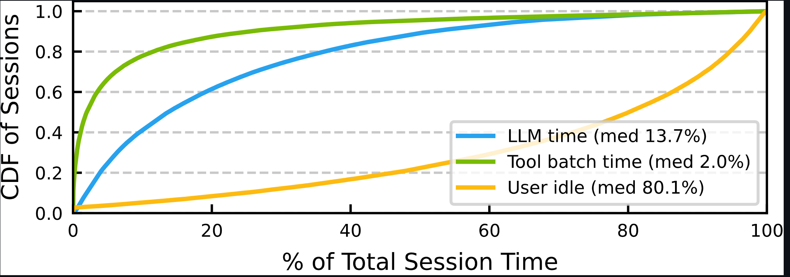

---

title: "Agentic Coding in the Wild: Characterizing GitHub Copilot at Production Scale"
created: 2026-11-14
tags:
  - Paper Notes
  - LLMInference

description: "基于 GitHub Copilot 生产轨迹刻画 coding-agent workload：紧密的 LLM-tool loop、turn 边界缓存失效与双峰 idle，并训练轻量空闲时间预测器指导 KV 缓存与容器资源回收。"

---

# Agentic Coding in the Wild: Characterizing GitHub Copilot at Production Scale

## Bibliographic Information

- Authors: Banruo Liu*（UIUC）, Haoran Qiu, Íñigo Goiri, Rodrigo Fonseca, Ricardo Bianchini, Esha Choukse（Microsoft Azure Research）
- Year / Venue: 2026 年 7 月，arXiv 预印本（cs.AI / cs.LG）
- DOI: [10.48550/arXiv.2608.00101](https://doi.org/10.48550/arXiv.2608.00101)

## 1. Problem & Workload
Problem: AI coding agents are different from conventional LLM serving workloads, which interleave multi-step LLM inference with tool execution.


Analysis: 这种结构产生的 KV 缓存命中率在一个回合内平均为 90%，但跨回合边界下降到 55%，并且在模型切换或上下文压缩等事件发生后急剧失效。通过可变和长尾的令牌消耗、时间跨度和工具调用来观察不同的工作流程和用户行为。我们强调了快速代理周转时间与周转边界长达数分钟的用户空闲期之间的差异，并设计了一个轻量级的空闲时间预测器，可以捕获 86-90% 的总空闲时间，从而实现主动决策以实现高效的资源编排


The telemetry uses a three-level hierarchy:  
- **Session**: a coding agent session lifetime. 
- **User-Turn (or simply Turn)**: one agentic coding conversation triggered by the user prompt and followed by the agent’s full autonomous response chain. Therefore a single user turn may comprise many LLM calls, depending on the path that the agent takes. 
- **Step**: a single LLM invocation or tool call within a turn; the last step in a turn is always an LLM invocation.  
Within each turn, the canonical execution pattern is:  
```
User prompt → LLM → [LLM | tools → LLM]∗ → final response
```
Every turn begins with exactly one user-initiated LLM call; all subsequent LLM invocations or tool calls within the turn are agent-initiated (auto-continued). 

## 2. Core Insight & Invariants
coding-agent workloads properties:
1. **Self-initiated LLM <-> Tool coupling**: Agent execution  forms a sequential chain in which tool outputs drive subsequent LLM calls.
2. **Session-structured KV-cache lifecycle**: Prompt prefix  caching accounts for an average of 90% of tokens within an agent session, but its effectiveness depends strongly on execution structure. Each session consists of multiple turns (a user prompt and the agent’s full autonomous response chain following that), and cache hit rates drop to 55% at these turn boundaries, while model switches cause drastic cache invalidation, pulling hit rates down to a mere 8%.(**This paper recognizes this problem is a scheduling challenge**)
3. **Context compaction is a critical systems event**: Context compaction is triggered in 7.8% of sessions yet affects 44% of total tokens, dropping over 70% of prompt tokens and resetting cache state as severely as a model switch.
4. **Tool failures amplify compute costs**: Tool failures happen in 9% of turns and trigger autonomous retry loops with growing context windows, amplifying compute by up to 4×. Tool reliability and LLM verification are, therefore, a key determinant of serving efficiency.
5. **Heterogeneous user population**: Uniform resource policies are suboptimal.
6. **Alternating GPU and tool-execution phases**: Agent execution naturally alternates between *GPU-bound LLM inference and CPU/IO-bound tool execution*, creating bimodal idle periods—seconds within turns, minutes across turns—with turn boundaries providing the single most actionable signal for *container resource reclamation and KV-cache eviction/offloading.*

Contribution:
1. A deep dive into the **LLM call and tool call characteristics**
2. A quantitative analysis of **KV cache lifecycle dynamics**, including intra-turn cache accumulation, turn-boundary degradation, model-switch invalidation, and context compaction—that establishes the KV cache as a sessionaware schedulable resource.
3. An analysis of resource alternation patterns and idle-time distributions, with a lightweight idle-time predictor that identifies turn boundaries as actionable signals for resource lifecycle management.(**将空闲时间和分布作为 kv cache lifecycle 信号来指导kv cache调度**)

## 3. Findings
1. **The 1:1 LLM <-> Tool Ratio**: The agentic loop enforces a strict 1:1 LLM↔tool coupling. Serving systems must treat LLM calls and their corresponding tool invocations as inter-dependent pair, not independent requests.
2. **Agent Autonomy: 87% Auto-Continuation**: 87% of LLM calls are agent-initiated. User request arrivals alone do not predict LLM load; capacity planning requires session- or turn-level modeling of autonomous agent execution chains.
3. **LLM Call Parallelism**: (1) 当具有多个并行上游 LLM 调用的代理必须等到所有上游响应准备好才能启动下游 LLM 调用或工具调用时，可能会发生掉队问题；(2) 服务系统必须处理来自同一会话（而不仅仅是来自不同会话）的 2-3 个调用的并发 KV 缓存访问和更新. Agentic execution is *predominantly serial*. While 63% of multi-call turns exhibit some overlap, concurrency remains shallow (P90=1.4) and is concentrated in the middle of turns, creating occasional *straggler dependencies and same-session KV-cache contention*.
4. **Agents often encounter failed builds, incorrect assumptions, missing dependencies, or unexpected execution results, triggering additional reasoning, retries, and tool invocations before converging on a solution**: Coding-agent workflows are highly heterogeneous, resulting in a large variation in LLM/tool calls and token consumption. Iterative retry workflows can amplify compute by up to 4×, making *workflow-aware scheduling and resource management* important for efficient serving.
5. **Token-intensive**: Coding-agent workloads are highly tokenintensive: both prompt and completion lengths are substantially larger than those observed in text-only and multimodal LLM API traces for Chatbots. Moreover, a large share (28%) of prompt tokens originates from tool-call results.
6. **LLM-bound**: Agentic sessions are overwhelmingly LLMbound, but the time and token contributions are inverted. LLM execution takes 85.4% of wall-clock time yet contributes 48% of prompt tokens, whereas tool calls take only 4.7% of time yet contribute 28% of tokens.
7. Prefix caching rate is high overall (median 98%), and follows a predictable trajectory within a turn45% on the cold-start call, jumping to 86% by the second call, and plateauing at 92–94% from the third call onward.
8. **Cache Degradation at Turn Boundaries**: Turn boundaries degrade absolute cache hit rates by −26% on average, primarily via *time-based servingsystem eviction during inter-turn idle periods*.
9. **Model Switches degrade cache performance**: Model switches are mostly reactive to rate limiting, compound turn boundary into near-total cache loss (↓67%, average hit rate 8%). Session-to-model pinning and proactive cache staging on the target model are needed to avoid this added cold-start cost.
10. **Compaction is therefore a hidden cost of long agentic sessions**: the agent fills the context window during deep exploration, triggers compaction, loses nearly all cached state, and then must *rebuild the cache from scratch on subsequent calls*, incurring both higher latency and higher cost exactly when the session is most complex.
11. **Heterogeneous Tool usage**: Tool usage is highly concentrated and heterogeneous. Read-heavy tools complete fast and succeed nearly universally, while execution tools such as run_build and run_command dominate the tail and fail more often; failed invocations take substantially longer, extending dependency chains and workflow resource residency.
12. **Lack of tool parallelism**: Tool execution is more parallel than LLM execution but remains largely sequential: 93% of tool batches invoke a single tool, while most parallel batches contain only 2–3 read-only operations
13. **LLM-Tool overlap**: Tool-LLM overlap is pervasive by count (97% of batches run inside an LLM window) but hides only 7.7% of aggregate tool wall-clock time; the long-tail of long-running tools dominates total tool time, is largely un-overlapped, and drives session latency.
14. **Tiered SLO model for agent serving**: 
    - **Retention priority**: Deep-loop and Coder sessions  should receive higher KV-cache retention priority due to their large re-prefill cost and higher probability of nearterm reuse compared to the other types.  
    - **Eviction aggressiveness and container lifecycle**:  Chat-only and Reader sessions can be evicted after short idle timeouts, without meaningful latency penalty, freeing memory for higher-priority sessions. Terminal and Coder users require *stateful container management (checkpointing rather than termination),* while Reader containers can be cold-started freely. 
    - **Capacity planning**: The heavy-tailed user distribution means that per-user fair-share policies must account for the 50× token-consumption gap between Chat-only and Deep-loop users to avoid both starvation of intensive users and over-provisioning for light users.

15. **量化这些资源回收的机会**: 
    - **Container idle**: the elapsed time between *two consecutive tool invocations*. During this interval, the agent is processing tool outputs through one or more LLM calls, leaving the tool-execution container idle. 
    - **KV-cache idle**: the elapsed time between *two consecutive LLM calls*. During this interval, the agent is executing tools or waiting for user input, while the corresponding KV cache remains allocated but unused.
    - **User idle**: Between *two consecutive user turns*, waiting for user prompt.
> Resource idle time is bimodal. Intra-turn idle periods are short (5.8 s container, 1.2 s KV cache) and occur during autonomous agent execution, whereas **crossturn idle periods are minutes long** (243 s and 172 s) due to user idle time. Turn boundaries therefore provide a natural trigger for container eviction and KV-cache offloading.


## 4. Design
Training a deep learning network for predicting idle time:
- Input Feature: Each completed turn is summarized by turnlevel features (duration, LLM calls, tokens, tool time, failures, success rate), session-level features (turn index, elapsed time, prior idle gap, average idle so far), and temporal features (e.g.,  is_weekday).
- Prediction Formulation: 器输出生存曲线 $$S(t) = \Pr(\mathrm{idle} > t)$$ （例如，空闲时间大于 t 秒的概率）。这个公式让资源管理器选择一个操作点——例如，“一旦 Pr(idle > 60s) 下降到某个阈值以下，就逐出 KV 缓存”，而无需重新训练，并且让系统随着时间的推移廉价地改进其估计：一旦 t0 秒过去而没有新的轮次到达，条件生存概率将以封闭形式重新计算为 $$S(t \mid \mathrm{idle} > t_0) = S(t)/S(t_0)$$，不需要额外的努力。
## My Summary
通过 copilot 真实数据分析分析 coding-agent workloads 特征，发现如下优化机会：
- agent 会自动调用 llm calls，需要更好地进行规划
- tool 并行不好可以进一步优化
- llm 与 tool 绝大多数情况下可以 overlap，但长尾的 tool 执行时间占据了大部分的 session latency
- 在 turn boundary 处，llm 的 prefix cache 命中率会下降很多，model switch 或 context compaction 会导致命中率下降到 8%，因此需要更好地进行 cache 管理，可以在 user idle time 进行 state offloading（**这里训练了一个空闲时间 predictor，对调度进行指导 classic Microsoft idea**）

