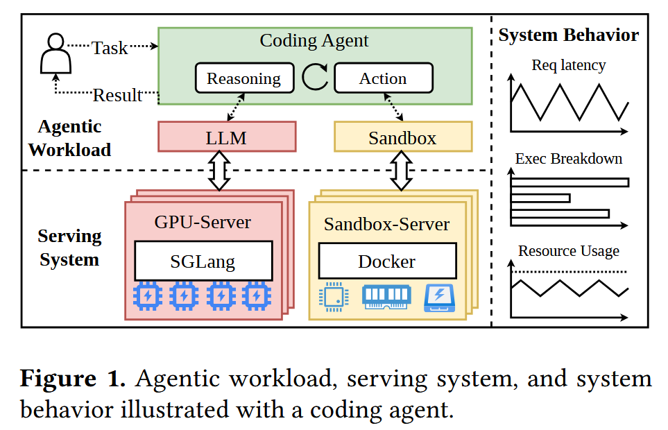

---

title: "From LLM Inference to Agentic Workloads: Characterization and Implications for Serving Systems"
created: 2026-11-04
tags:
  - Paper Notes
  - LLMInference

description: "通过 10 个 agentic applications 研究 Agentic workloads(coding-agent 为主)的特征：根据特征提出 4 个设计探索，分别是 task-aware serving、communication-aware placement、state offloading、tool-result caching。"

---

# From LLM Inference to Agentic Workloads: Characterization and Implications for Serving Systems

## Bibliographic Information

- Authors: Chaokun Chang*, Yukun Zhou*, Kaihua Fu, Dakai An, Tianyu Feng, Hanfeng Lu, Sheng Yao, Pu Guo, Yinghao Yu, Yizhou Shan, Bo Li, Binhang Yuan, Wei Wang（1 HKUST；2 Alibaba Group；3 ByteDance）
- Year / Venue: 2026 年 8 月，arXiv 预印本（cs.OS / cs.AI / cs.DC / cs.MA）
- DOI: [10.48550/arXiv.2608.15127](https://doi.org/10.48550/arXiv.2608.15127)

## 1. Problem & Workload
Problem: the system behavior of these workloads—where latency, cost, and bottlenecks arise—remains poorly characterized, leaving serving systems to rely on assumptions built for conventional inference.

Solution: We present AgentSysBench, a benchmark suite and measurement toolkit with ten representative agentic applications and unified systems-level instrumentation

Revealing six properties that distinguish agentic workloads from conventional LLM serving: 
1. execution is **heavyweight and stateful**, with non-LLM components dominating latency in 5 of 10 applications and sandbox working-set memory peaking at 28 GB per session; 
2. applications compose components with **heterogeneous resource affinity—GPU-bound inference**, memory-bound retrieval, CPU-bound sandboxes—whose task latencies diverge by up to 32×; 
3. bottlenecks shift across requests, models, and deployments; 
4. production sessions hold state idle for minutes to hours between active steps; 
5. a control-plane tax—auxiliary LLM calls and context overhead from tool schemas and observations—crowds out productive compute and context; 
6. production traces from three applications reveal heavy cross-request redundancy in search queries and web fetches, exposing a large caching opportunity.

Four design explorations:
1. task-aware serving reduces latency by 29–40%,
2. communication-aware placement by up to 4.5×,
3. state offloading reduces memory usage by 4.6×
4. tool-result caching removes 35.2% of redundant search calls and saves 19.3% of aggregate search latency.

## 2. Core Insight & Invariants
Definition: agentic workloads are those that combine model inference, tool execution, environment interaction, and state management under LLMdriven control.

Efficient agentic serving therefore requires *coordinated management of models, tools, state, and communication*, not model-centric optimization alone.

Key Findings:
1. **Heavyweight execution with non-LLM dominance**: Implication: the serving stack must accelerate tool-heavy stages and manage session state, not just model inference
2. **Cross-stack heterogeneity**: A single application composes components with divergent resource profiles: GPUbound LLMs, memory-bound vector databases, CPU-bound sandboxes, and network-bound services. Implication: provisioning and scheduling must be *heterogeneity-aware,  matching each task’s resource profile rather than assuming uniform cost*.
3. **Shifting bottlenecks**: Even a simple RAG pipeline shifts its bottleneck between embedding and vector-database operations as inputs change. Implication: application-level averages mask this variance; *serving needs online, per-request adaptation*, not static profiling.
4. **Long idle-but-live intervals**: Implication: serving systems must distinguish “done” from “waiting” to reclaim resources while *preserving resumability, which we exploit for state offloading*.
5. **LLM control-plane tax**: Beyond productive work that deciding the next action and producing outputs, tokens are spent on *tool schemas, raw observations, and safety checks*. This control-plane tax grows over multi-step sessions and fills context, raising latency and cost. Implication: serving systems need *context-budget-aware tool interfaces and observation compression* to recover capacity for useful work.
6. **Explitable cross-request redundancy**: 27% of unique search queries recur and account for 67.3% of all search API calls. Implication: *query- and object-level caching* can eliminate most redundant external calls, cutting latency and cost.

To show this, we conduct four design explorations that yield significant performance gains: 
- task-disaggregated serving (29–40% lower latency), 
- agent-aware co-location (up to 4.5×), 
- state offloading (4.6× less memory), 
- tool-result caching (35.2% fewer redundant search calls and 19.3% less aggregate search latency).
These gains come from simple, characterizationguided mechanisms rather than a full system optimizationevidence that current workload-oblivious serving leaves substantial efficiency unclaimed.

## 3. Motivations
Agentic Workloads Definition: 执行的分布，我们将其称为代理工作负载，并用四个因素概括：W =⟨R, T, M, O⟩。请求分布 R 捕获应用场景、任务难度和负载大小。工具和环境集 T（例如，沙箱、浏览器和向量数据库）决定 I/O 行为、状态足迹、故障模式和非 LLM 瓶颈。模型选择和推理策略 M 确定延迟、成本、令牌量、上下文长度和缓存行为。编排结构 O（例如，预定义的管道、ReAct 循环或规划器-执行器设计）塑造动态性、并行性和状态保留。这些因素共同决定了执行长度、资源需求和成本；使用它们来选择代表性应用程序。

Serving System: 我们将服务系统建模为 S=⟨H, C, A⟩，其中 H 表示硬件资源，包括 GPU、CPU、DRAM、存储和网络带宽； C 表示组件服务机制，即如何服务每个组件（LLM 引擎、嵌入或重新排名服务、向量数据库、沙箱管理器、浏览器或 GUI 环境以及协调器）； A 表示部署架构，即组件是否位于同一位置、单独容器化或由远程云服务提供服务

Control-Plane Tax: The tax has three forms: control-plane state occupies context-window capacity, auxiliary tasks invoke additional LLM work, and the interaction between session idleness (§7.1) and cache lifetime causes repeated prefill.

## 4. Implications
1. The extended runtime dramatically increases the likelihood of node or network failures during a single request, making simple retry-on-failure strategies prohibitively expensive. Serving systems must therefore provide *lightweight, low-overhead fault tolerance to checkpoint and resume agent sessions*. Serving stack must transition to *joint optimization to improve end-to-end latency* because non-LLM dominate the excution time.
2. 由于每个连续的 LLM 调用都会将整个历史对话、工具执行日志和系统提示附加到上下文窗口，因此输入大小与轮数成二次方缩放。因此，ReAct 风格的代理工作负载每个会话消耗的令牌比典型的 RAG 工作负载多几个数量级. Token usage grows chronologically with agent complexity, heavily driven by Cache Hit tokens from iterative loops. Serving systems must optimize for *high-volume context caching and token cost mitigation*.
3. 我们将缓存的性能状态(kv cache)和持久正确性状态与活动工作集内存区分开来。前两个必须在会话暂停期间进行管理；最后一个是暂时的资源需求，并且不一定是静态边界处的可检查点状态。
      - Persistent correctness state: 持久正确性状态包括可变的执行数据，这些数据在不破坏程序执行语义的情况下不会丢失。在像 DeepResearch 这样的搜索密集型应用程序中，每个会话都会实例化一个独立的、每个会话的向量数据库集合，其中包含动态检索的文档和嵌入索引。图 6(c) 显示收集大小中位数达到 7.4 MB，较大的会话超过 49 MB。 Codex 等编码代理还需要持久的文件系统更改、安装的依赖项和进程元数据。代理应用程序可能会进一步产生外部副作用（例如，发送电子邮件），使相应的外部组件状态部分正确。
      - Active working-set memory: 活动工作集内存。实时沙箱在执行命令时也会消耗 DRAM。如图 6(b) 所示，沙箱峰值 DRAM 使用量中位数约为 0.8 GB，而在编译和单元测试期间，每个会话峰值达到 28 GB。这个 28 GB 值是工作集峰值：瞬态编译器和测试页不一定是持久的正确性状态，也不需要全部保持活动状态或复制到静态检查点中
  > 性能状态、持久正确性状态和大型活动工作集的共存使资源管理变得复杂。标准无状态微服务通过简单、廉价的请求重试来容忍故障。相反，代理会话失败或迁移需要协调 LLM 引擎和工具运行时的状态检查点，而资源配置必须单独适应瞬态沙箱峰值。至关重要的是，典型沙箱内存占用量与峰值沙箱内存占用量之间的巨大差距暴露了一个关键的优化机会：**静态点快照**。
  > - 在步骤间空闲间隔期间（例如，当代理等待 LLM 生成结果时）调度沙箱检查点可以避免将瞬态工作集峰值视为可检查点的实时占用空间。
  > - 代理等待长时间运行的沙盒工具执行时，主机系统可以卸载或调出空闲会话的 GPU KV 缓存，从而最大限度地提高活动 GPU 内存利用率
4. Extensive Data I/O: I/O 不仅仅是有状态的副作用；它也是有状态的。这是一个一流的瓶颈。在分布式部署中，嵌入、沙箱观察和累积上下文的序列化、反序列化和网络传输会消耗大量带宽和 CPU 周期。因此，组件间网络容量和序列化效率限制了可实现的并发性和端到端延迟，而与计算配置无关。
5. 具有成本意识的服务系统必须超越令牌效率并协调整个工具使用生命周期。为了大规模、经济高效地运行代理工作负载，服务平台必须部署*主动沙箱复用和动态资源配置*。与无服务器冷启动优化类似，服务堆栈应*在空闲期间动态暂停、快照和恢复容器环境*​​，从而将物理资源计费与代理循环的空闲时间解耦。要点：在工具密集型应用程序中，LLM 基础设施token cost中占主导地位。成本感知服务必须考虑沙箱、检索和环境费用，而不仅仅是token cost.

6. 异构性资源会造成如下问题：
   - 排队干扰。轻量级嵌入查询任务和重量级嵌入文档任务共享一个服务实例和一个请求队列。大型文档请求会占用嵌入工作线程较长的时间间隔，迫使对延迟敏感的查询请求在其后面等待。
   - 共批干扰。 LLM 引擎在每次解码迭代时批量处理活动请求，以提高 GPU 利用率。由于批次中的请求通过相同的解码迭代前进，因此这项额外工作还会增加短请求观察到的每个输出令牌的时间 (TPOT)
   - 共享资源争用。最后，我们在八个并发 Codex 沙箱中重演 installklee-minimal 基准测试任务。在隔离设置中，每个沙箱都固定到不相交的 16-CPU 集。在共享设置中，所有八个沙箱都调度在同一个 128 个 CPU 池上。尽管两种设置使用相同的总 CPU 容量，但共享允许沙箱通过 CPU 调度以及共享缓存和内存子系统进行干扰
7. The bottleneck in agentic serving shifts whenever any workload factor (R, T , M, O) or serving-system factor (H , C, A) changes. Static profiling and fixed resource allocation cannot track these shifts; serving systems must adopt online, per-request adaptation.
8. 将 wait state 视作一等公民：二元“运行”与“完成”生命周期不足以实现代理服务。该安全带应暴露第三个静态“等待”状态，以及预期的恢复触发器或截止日期（如果可用）。然后，服务层可以分别管理正确性状态和性能状态：检查点或将沙箱和终端状态卸载到持久层，同时根据其预期的重用效益保留、迁移或驱逐 KV 缓存。恢复预测和预取可以隐藏恢复延迟。生产代理商**常常在等待，而不是完成。将“等待”视为一流的生命周期状态可以在不牺牲可恢复性的情况下实现积极的状态回收。**
9. 代理控制平面税是一个跨层系统问题，而不仅仅是一个即时工程问题。首先，工具接口应该是代理原生的。工具不应每次都重新注入完整模式和原始输出，而是应*公开稳定的模式标识符、类型化和大小限制的观察、增量增量以及完整工件的可检索句柄*。然后，该工具可以仅具体化当前决策所需的字段，减少令牌量和预填充，同时保留上下文窗口外的准确状态。其次，上下文应该虚拟化为分层状态。结构化历史记录、分层摘要和按需检索详细信息可以将冷观察排除在提示之外，并取代单一的、接近极限的压缩。第三，harness和模型服务器应该协调缓存策略：固定 TTL 驱逐应该让位于基于会话等待状态和预测返回的重用感知 KV 保留、卸载和预取。辅助调用同样应该按用途进行标记，以便服务系统可以单独考虑它们，并且在正确性和安全性允许的情况下，对它们进行批处理、缓存或将它们路由到成本较低的模型。
10. 跨会话重用要求在共享工具服务边界处进行缓存，其中重用可以跨代理聚合，而不是隐藏在一个会话内。第一层可以*缓存精确的查询到结果的映射*；第二个可*以删除重复的 URL 获取并重用获取的对象（以及，如果适用的话，其解析的表示）*。这种机制不需要改变代理的控制逻辑

## My Summary
This paper present a new bech -- agentsysbench, which is a benchmark suite and measurement toolkit with ten representative agentic applications and unified systems-level instrumentation. The paper reveals six properties that distinguish agentic workloads from conventional LLM serving.
1. **Heavyweight execution with non-LLM dominance**: Implication: the serving stack must accelerate tool-heavy stages and manage session state, not just model inference
2. **Cross-stack heterogeneity**: A single application composes components with divergent resource profiles: GPUbound LLMs, memory-bound vector databases, CPU-bound sandboxes, and network-bound services. Implication: provisioning and scheduling must be *heterogeneity-aware,  matching each task’s resource profile rather than assuming uniform cost*.
3. **Shifting bottlenecks**: Even a simple RAG pipeline shifts its bottleneck between embedding and vector-database operations as inputs change. Implication: application-level averages mask this variance; *serving needs online, per-request adaptation*, not static profiling.
4. **Long idle-but-live intervals**: Implication: serving systems must distinguish “done” from “waiting” to reclaim resources while *preserving resumability, which we exploit for state offloading*.
5. **LLM control-plane tax**: Beyond productive work that deciding the next action and producing outputs, tokens are spent on *tool schemas, raw observations, and safety checks*. This control-plane tax grows over multi-step sessions and fills context, raising latency and cost. Implication: serving systems need *context-budget-aware tool interfaces and observation compression* to recover capacity for useful work.
6. **Explitable cross-request redundancy**: 27% of unique search queries recur and account for 67.3% of all search API calls. Implication: *query- and object-level caching* can eliminate most redundant external calls, cutting latency and cost.
