---

title: "From Requests to Sessions: A Large-Scale Characterization of Human-Driven Agentic Workloads"
created: 2026-11-02
tags:
  - Paper Notes
  - LLMInference

description: "研究 Agentic workloads(coding-agent 为主)的特征：紧密的 llm-tools loop 与长时间的 user idle。15 分钟内的缓存重用收益极高而保留更长的前缀存储成本显著上升"

---

# From Requests to Sessions: A Large-Scale Characterization of Human-Driven Agentic Workloads

## Bibliographic Information

- Authors: William Nixon（University of Chicago / Harvard University）, Muxin Tian（University of Toronto）, Yunjia Zheng（Harvard University）, Haryadi S. Gunawi（University of Chicago）, Juncheng Yang（Harvard University）
- Year / Venue: 未在 arXiv 检索到对应条目，日期待补

## 1. Problem & Workload
Problem: 当前没有相关研究仔细研究过 agentic workloads 的特征（企业中只有ToC的大模型企业会有相关数据）
Solution：study 3.7 months of production traffic from FreeInference, spanning 209B input tokens and 12K sessions across 13 agent harnesses, revealing agentic workload characteristics that are not captured by request-centric views of LLM serving.

## 2. Core Insight & Invariants
Production coding-agent workloads exhibit distinct characteristics that are not captured by request-level analyses of LLM serving. **Treating sessions** as the unit for designing and evaluating efficient agent-serving systems.
- **Session**. The highest-level unit, spanning the user’s end-toend interaction with the agent. A session contains one or more turns, accumulating context across its lifetime. 
- **Turn.** One user-initiated interaction within a session. A turn begins with a user prompt, after which the agent enters an autonomous LLM–tool loop until it produces a final response and returns control to the user. 
- **Step**. One model request within a turn. The first step is triggered by the user prompt. Subsequent steps are triggered by tool results and continue the LLM–tool loop until the final step returns a response and ends the turn.
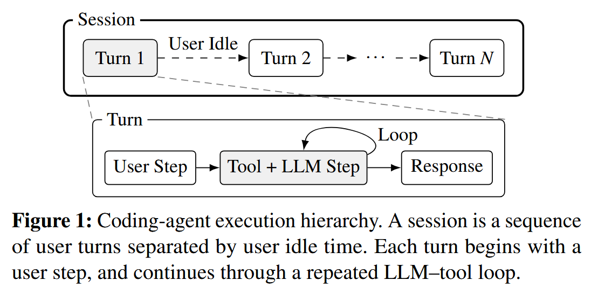

Findings:
- **Cache reads dominate session cost:** Among requests with reported cache usage, cached input accounts for 97% of token volume and 73% of API cost.
- **Tool execution dominates active-session latency:** Halving tool latency yields a 1.38× speedup, far exceeding the 1.09× and 1.16× gains from halving prefill and decode time, respectively.
- **Tool parallelism is underused, while synchronous subagents suffer from stragglers:** Parallel tool execution reduces repeated LLM–tool round trips, yet 84.5% of requests issue only one tool call. Subagents are used in only 10.4% of sessions and are mostly synchronous, with stragglers that can take over 5× longer than the fastest sibling.
- **Context mutations are widespread and drive substantial recomputation, yet are necessary to control serving cost:** 
  - Although only 4.0% of requests modify prior context, mutations occur in 56% of sessions
  - Eliminating contextreduction mutations does not generally reduce prefill or cost. Instead, it increases context length, cache-read volume, and the penalty of cache misses
- **A 15-minute rule for prefix caching: balancing recomputation and storage cost:** A 15-minute retention time captures much of the available reuse while keeping providerside storage cost low. Capturing nearly all reuse requires a day of retention, but incurs 25.6× higher storage overhead. Harness-provided session-level signals can help reclaim dead blocks and make longer retention practical.
- **Benchmark replays are different from human-driven workloads:** SWE-Bench runs a fixed task based on a long, detailed input, while humans send many short prompts to agents. Benchmark replays produce sessions that are 9.4× shorter in duration and 5.1× smaller in context than humandriven sessions, and require only 5 minutes of retention for ideal prefix reuse versus about one day in production.

### Dataset
For each request, we record the input and output text along with their associated tool calls. We also log metadata including **the timestamp, model, and anonymized user identifier**, together with serving measurements such as **input, output, and cached token counts, completion latency, and time to first token (TTFT)**. For requests forwarded externally, we use the reported latency measurements. As a result, metrics such as TTFT may **include internal buffering or queueing delays**

**Session Reconstruction**
- Using strict prefix matching: a request is linked to a prior request only if it preserves the full previous input as a prefix. However, this approach splits sessions too aggressively whenever harnesses modify earlier context and break prefixes.
- Using replayed LLM outputs: Although harnesses may modify earlier context, a later request typically retains the previous LLM output in its input history.
### Session
**Two components: fast LLM–tool execution loops within turns and longer idle gaps between multiple user turns**
- **Sessions are mostly tool and LLM-driven**: a median of 4 user steps, but 36 tool and 42 LLM steps per session
- **Sessions last for hours, while each user turn runs for minutes**: The median user turn lasts about one minute, while the median session lasts 30 minutes. Idle time primarily drives the long duration.

#### Tokens and Cost
- **Fresh prefill and output per request are small**; API cost is dominated by prefix-cache hits.
- **Prefill concentrates in the first few steps**. Early requests are therefore more prefill-heavy, whereas later requests are more cache-heavy.
- **Tool history peaks and is pruned, while assistant history continues to grow**. This divergence reflects a common harness policy: pruning older tool outputs while retaining assistant messages, including their tool calls.
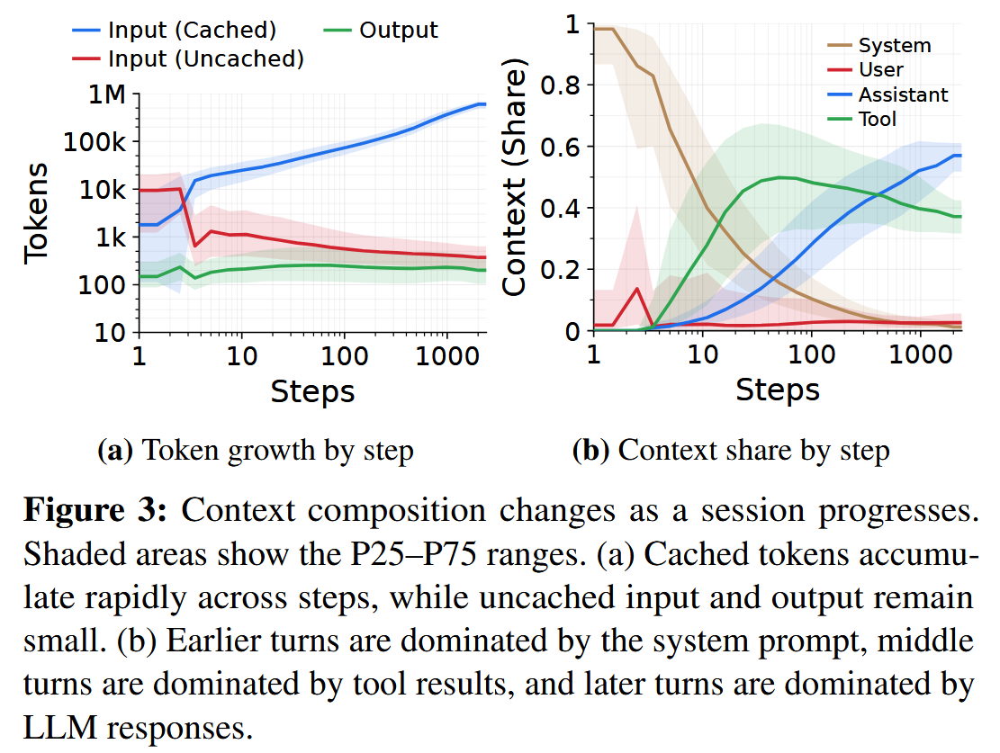
#### LLM and Tool Latency
- **Request latency is TTFT-bound, largely due to serving overheads**. Both models process prefill at roughly 8K tokens/s, while the median request contains fewer than 1K uncached tokens, making pure prefill typically less than 0.1 s. As a result, serving overheads account for most of the roughly 4 s median TTFT.
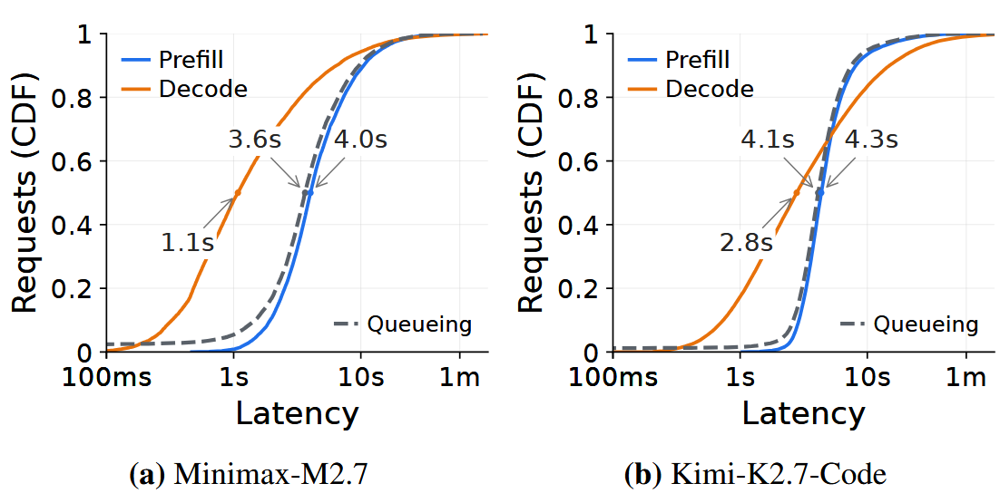
- **Most time is spent outside the LLM**. On average, user idle time accounts for 50.3% of session time, followed by tool execution at 21.7%, decode at 18.1%, and prefill at 9.9%.
- **Tool execution is the new bottleneck.** With tool gaps capped at 15 minutes, doubling tool-execution throughput provides a 1.38× speedup, compared with speedups of only 1.09× and 1.16× from doubling prefill and decode throughput, respectively.
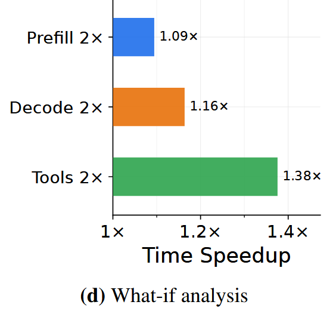

### Tools
Agents have two types of tools: (1) native tools provided by the harness and (2) a bash tool that performs more diverse functions.
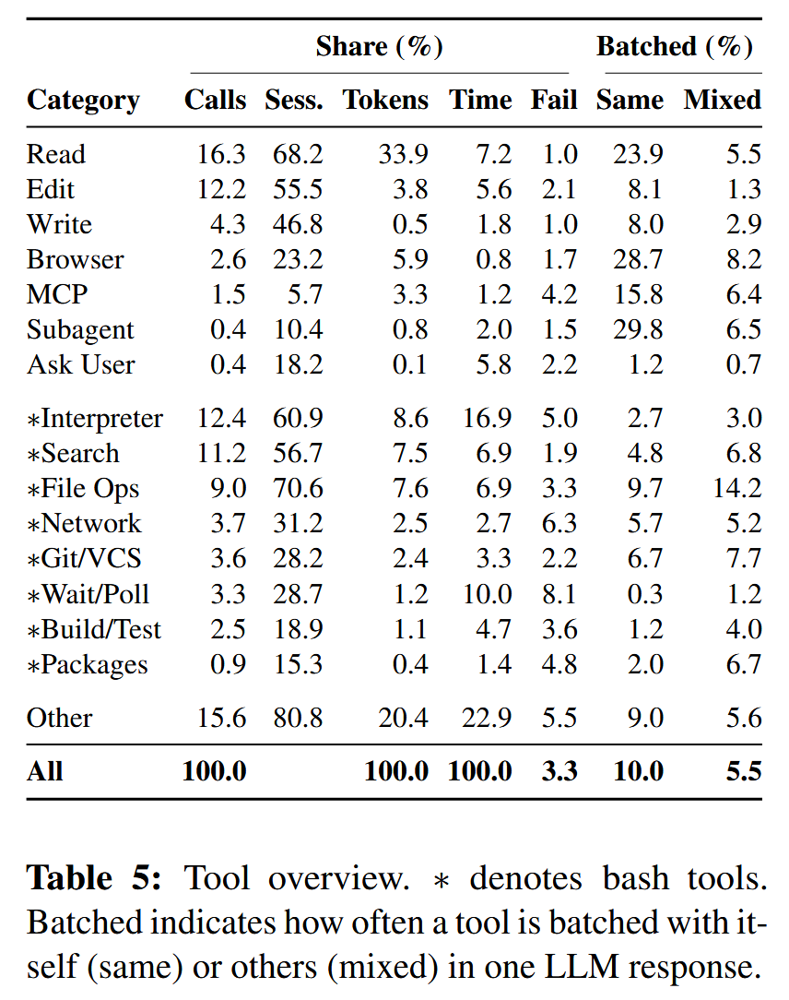

- **Tool usage is concentrated in a small set of broadly used operations**. Read, Interpreter, Edit, Search, and File Ops together accounting for over 60% of calls.
- **Tool frequency hides large differences in cost and execution behavior**. Read, Browser, and Subagent are more often issued in batches, whereas most shell commands are issued serially.
- **Most tool operations are fast with a very long tail.** Part of this tail may come from commands that require human approval under certain harness or user configurations. The same pattern is more pronounced for slower operations, with Subagent and Ask User operations reaching 8.9 and 13.3 minutes at P95, respectively.
- **Read and external tools drive context growth** Read produces the largest output, with a median of 441 tokens, and accounts for 33.9% of all result tokens despite representing only 16.3% of calls.

### Tool Parallelism

- **Tool batching reduces latency.**
- **Tool batching is mostly used for read-only native tools.** 84.5% of requests issue only one tool call. Subagent, Browser, Read, and MCP are batched most often. Shell show little batching, as *a single invocation can effectively batch by composing multiple commands using pipes*.
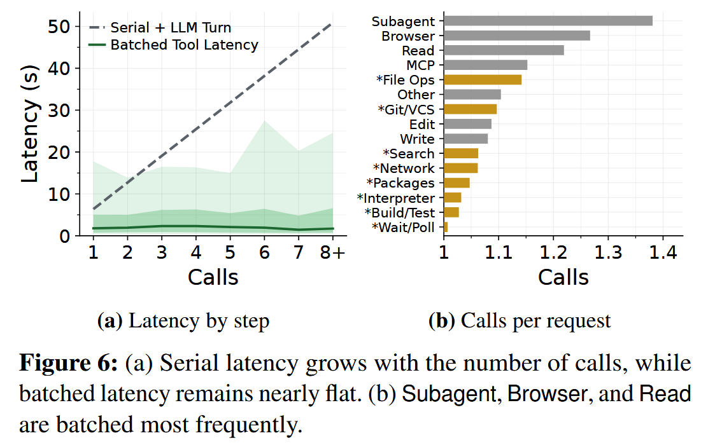
- **Subagents are uncommon and typically invoked synchronously.**
- **Subagents have a straggler problem.** Because roles can require substantially different amounts of tool work, they produce greater execution-time imbalance.
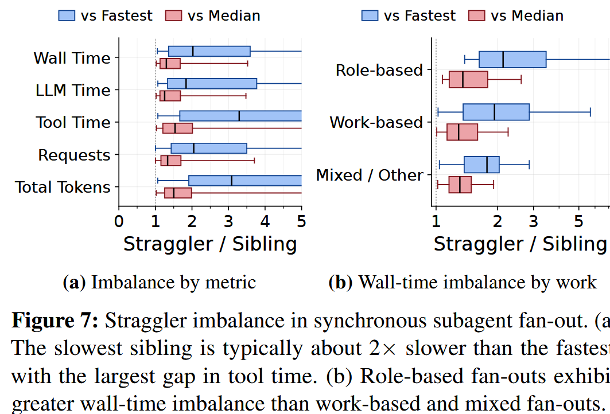

### Prefix Caching
We separate inter-request gaps into four categories: *Tool Gap* for ordinary tool execution, *Ask User* for tools that explicitly request user input, *User Idle* for user idle time between turns, and *Subagent* for delegated subagent execution.

#### Production System
- **Cache retention times vary widely across providers**
- **Cache reuse drops most after longer user waits**

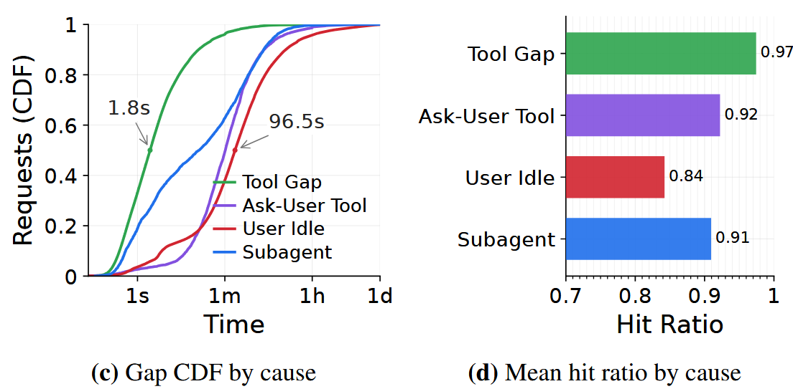

#### Context Mutation
we find that in practice, agent harnesses frequently modify earlier context in ways that break prefix reuse.

- **Context mutations are rare per step but common over a session.** They are usually triggered by user input, and mutations are a major cause of recomputation, contributing 62% of new prefill tokens.
- **Context mutations vary widely in cause and severity.**
  - *Tool definitions*: Harnesses may change the set or definitions of tools offered to the model as agent capabilities evolve across turns
  - *Context injection*: Harnesses may attach runtime state, such as environment information or instructions, to later user messages, then strip or relocate this information in subsequent turns.
  - *System-prompt rewrites:* Harnesses may rewrite the system prompt to update permissions, operating modes such as editor, planning, or review mode, or environment information.
  - *History truncation*: Harnesses also mutate context to manage its size. History truncation drops older turns using a rolling context window
  - *Context compaction*: Harnesses may also compact context for reducing the amount of kv cache that needs to be processed and stored.
  - *Tool-result mutations*: Harnesses prune old tool outputs, update long-running tool results with progress information, or re-serialize structured outputs such as JSON, causing unnecessary cache misses.

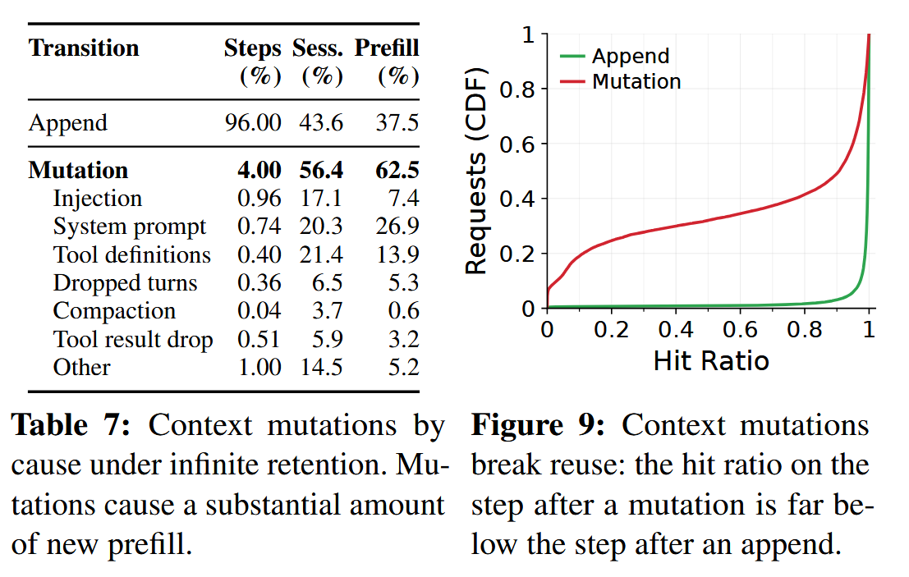

#### Prefix Retention Tradeoffs
- **Lowering cache-read prices to reduce context mutations does not necessarily reduce user cost.** With finite retention, however, eliminating reductions leaves longer contexts in the session, making cache misses more expensive and offsetting the benefit of avoiding mutations.
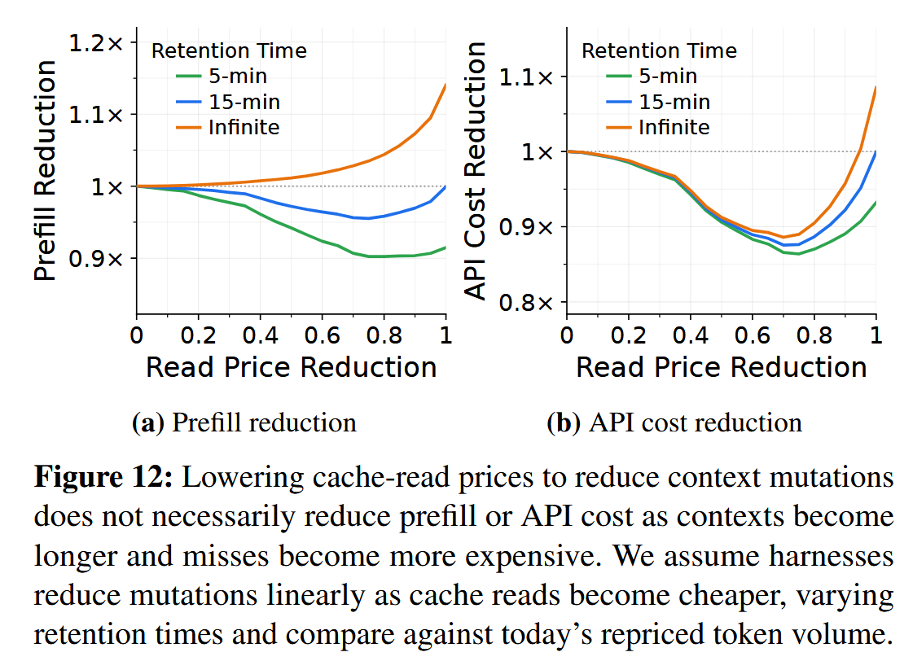
- **Session-level lifecycle signals reclaim dead KV blocks and make long retention practical.** Given a session_id, a mutate signal identifies freed blocks invalidated by a context mutation, while an end signal frees all blocks belonging to a completed session. Thus, lifecycle signals enable longer retention by giving providers hints to keep useful prefixes longer while promptly reclaiming blocks that are no longer reusable.
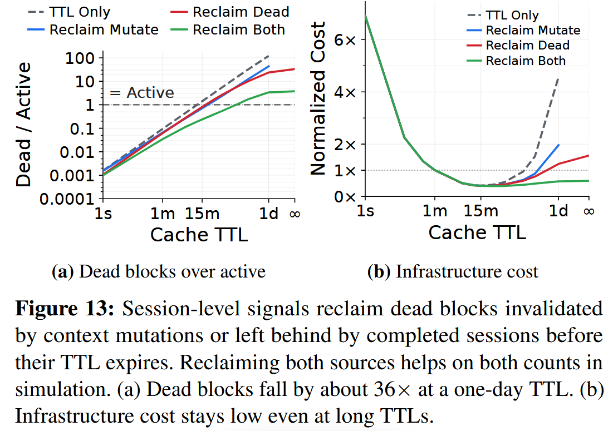

## 3. Findings
**Finding 1**: Agentic requests repeatedly reuse large and growing contexts while adding short new input and output tokens. Prefix-cache reads dominate coding-agent session costs.  

> Serving systems should optimize the cost of serving prefix-cache hits. 

> Harnesses should aim to reduce the number of steps rather than input per turn; 

> Users should pay more attention to cache-read pricing.

**Finding 2**: Serving overheads such as queueing dominate per-request TTFT, whereas tool execution dominates active session time. User idle time dominates end-to-end session duration. 

> Serving systems should jointly optimize routing and load balancing to preserve prefix reuse while minimizing queueing delays. 

> Hardware designers should optimize for emerging tool-execution workloads. 

> To shorten session duration, harnesses should select lower-latency tools, minimize the need for user intervention, and potentially request user clarification promptly and asynchronously.

**Finding 3:** Tool latency and result size show distinct characteristics by category, which may provide useful signals for scheduling and prefix-cache management. However, both also vary substantially within each category, making tool type alone a weak predictor.  

> Serving systems may combine category with historical user and tool-specific behavior to guide serving decisions. 

> Harnesses should be co-designed with serving engines to provide hints on tool-call duration.

**Finding 4:** Parallel tool calls significantly speed up agent progress; however, most tool calls today are issued serially. Most subagents run synchronously, so variation in their execution times causes severe straggler delays.  

> Agent harnesses should exploit parallelism more aggressively, both by issuing independent tool calls concurrently and by encouraging the use of the shell to compose commands. They should also schedule subagents intelligently to mitigate stragglers, e.g., by launching heavy subagents first.

>  Serving systems and harnesses should be co-designed to coordinate subagent execution and mode

**Finding 5:** Agentic sessions are bursty, with short interrequest gaps during LLM–tool loops and long gaps when control returns to the user or a subagent, triggering misses.  

> Serving systems should treat the session as the management unit for KV-cache retention and prioritize retention during active loops. 

> Harnesses can expose activity hints to guide retention, such as when a user is unlikely to return for eviction or offloading, or when a session resumes for prefetching or eager prefill. 

> Users should measure the hidden retention time when comparing providers.

**Finding 6:** Context mutation is common in agentic sessions, invalidating otherwise reusable prefixes and causing substantial new prefill. Some mutations are intentional, such as environment injection and compaction, while others result from avoidable changes such as re-serialization.  

> Agent harnesses should preserve stable prefixes by placing volatile state later in the prompt and serializing repeated state deterministically. They should batch mutations into fewer, less frequent updates and quantify their associated cost. 

> Users should use these signals to assess how efficiently a harness manages context.

**Finding 7:** Longer retention improves prefix reuse, but dead blocks from mutations and completed sessions quickly increase storage overhead. Context reduction remains necessary to control the read and miss costs of long contexts.  
> Serving systems and agent harnesses should be codesigned to selectively retain useful state and reclaim dead blocks early. 

> Harnesses can expose lifecycle hints such as *mutation* to reclaim invalidated blocks, *pause* to offload state, *resume* to prefetch it, and *end* to release it. 

> Users can reduce cost by compacting long sessions or starting a new session after long breaks to avoid expensive misses.

## My Summary
It reveals that real agentic workloads from *FreeInference* have distinct characteristics that are not captured by request-level analyses of LLM serving. And it offers some findings to introduct us to the design of efficient agent-serving systems(Serving System, Agent Harness and User Guide for LLM API). The paper also provides a [dataset](https://github.com/HarvardMadSys/freeinference_agentic_trace) for future research.

For Serving System:
- Design a machism to optimize the cost of serving prefix-cache hits. More budget for one session is not a [good idea](#prefix-retention-tradeoffs), because it will increase the cost of prefill tokens and the cost of cache misses. TTL and session-level lifecycle signals are good ways to reclaim dead KV blocks and make long retention practical.
- Optimize routing and load balancing to preserve prefix reuse while minimizing queueing delays. Because queueing dominates per-request TTFT, whereas tool execution dominates active session time. User idle time dominates end-to-end session duration.
- Combine category with historical user and tool-specific behavior to guide serving decisions. And serving systems and harnesses should be co-designed to coordinate subagent execution and mode.
- Serving systems and agent harnesses should be codesigned to selectively retain useful state and reclaim dead blocks early. Harnesses can expose lifecycle hints such as *mutation* to reclaim invalidated blocks, *pause* to offload state, *resume* to prefetch it, and *end* to release it. Users can reduce cost by compacting long sessions or starting a new session after long breaks to avoid expensive misses.

For Agent Harness:
- Reduce the number of steps rather than input per turn. Because more turns may occur more mutations, which will increase the cost of prefill tokens and the cost of cache misses.
- Shorten session duration, harnesses should select lower-latency tools, minimize the need for user intervention, and potentially request user clarification promptly and asynchronously. Because the cost of toll-calls dominates active-session latency.
- Exploit parallelism more aggressively, both by issuing independent tool calls concurrently and by encouraging the use of the shell to compose commands. They should also schedule subagents intelligently to mitigate stragglers, e.g., by launching heavy subagents first.
- Expose activity hints to guide retention, such as when a user is unlikely to return for eviction or offloading, or when a session resumes for prefetching or eager prefill.
- Preserve stable prefixes by placing volatile state later in the prompt and serializing repeated state deterministically. They should batch mutations into fewer, less frequent updates and quantify their associated cost.
