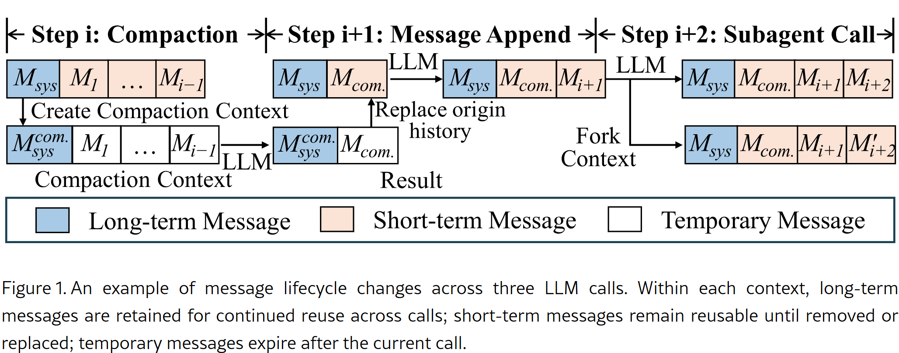
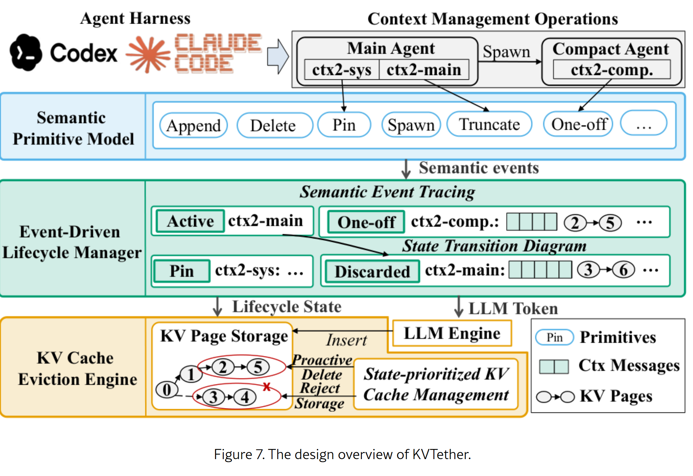
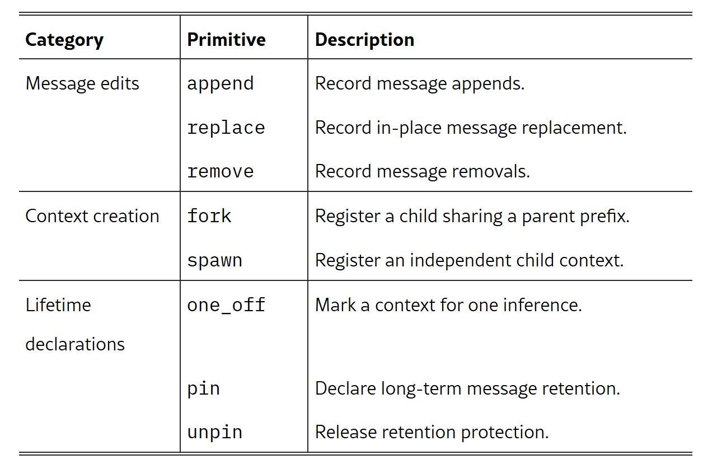
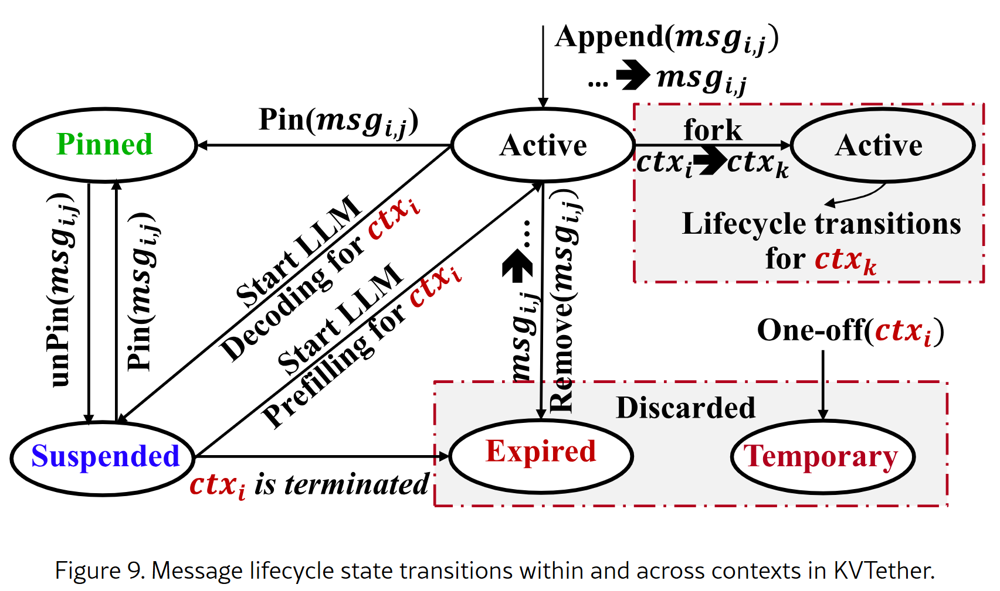

---

title: "Capture the lifecycle: KV Cache management in ReAct Agents with KVTether"
created: 2026-11-14
tags:
  - Paper Notes
  - LLMInference

description: "ReAct agents 的 KV 缓存管理在 agent harness 和 KV 缓存之间存在语义鸿沟。KVTether 在 harness 导出 message-level primitives，通过 lifecycle-aware kv cache management framework 将其转化为 KV-level lifecycle state，并在缓存引擎中应用 MRU 策略，缓解过早驱逐问题。"

---

# Capture the lifecycle: KV Cache management in ReAct Agents with KVTether

## Bibliographic Information

- Authors: Kaihua Fu*, Yukun Zhou*, Chaokun Chang, Yinghao Yu, Luping Wang, Guodong Yang, Jiuchen Shi, Quan Chen, Wei Wang
- Year / Venue: 2026 年 9 月，arXiv 预印本（cs.OS）
- DOI: [10.48550/arXiv.2609.39819](https://doi.org/10.48550/arXiv.2609.39819)

## 1. Problem & Solution
Problem: agent harness through context mutation, tool execution, and subagent coordination, context messages may become *actively engaged, permanently discarded, and temporarily unused*, while the serving stack only observes accesses to the corresponding KV cache(LRU)

Solution: KVTether, a **lifecycle-aware** KV cache management framework for ReAct agents. KVTether 在高度动态的执行过程中捕获*运行时生命周期语义*。随后，KVTether 将消息级语义转换为 KV 级生命周期状态，并利用这些状态驱动按状态优先级排序的缓存管理，同时不向 agent 框架暴露底层物理复杂性。减少在复用之前的过早驱逐

## 2. Findings
### Semantic Gap between Agent Harness and KV Cache
- the agent harness manages contexts through message-level operations such as *append, replace, remove, fork, and one-shot construction*, which define the *logical lifecycle of messages*: how long they remain reusable within each context.
 
- The LLM inference layer translates these contexts into token sequences, from which the KV-cache storage layer observes only *cache pages, shared prefixes, and access events*. 
- As a result, physical KV residency can diverge from the logical lifecycles of source messages: **the storage layer cannot tell whether a cached KV span is logically live, explicitly retained, temporarily waiting, or already dead**.

two common inefficiencies caused by this lack of lifecycle visibility:
1. KV can remain physically resident as zombie KV after its logical lifetime ends
   > after a compaction subagent replaces a long history with a summary, both the discarded history and the one-shot compaction context are logically dead, yet their KV may persist until passive eviction
2. recency-only policies such as LRU can misorder live KV
   > **admitted KV is needed later than the resident KV it displaces**. This happens because recently produced KV in ReAct agents often awaits tool execution, scheduling, or subagent coordination rather than being closest to reuse

Lifecycle export practical chanllenges:
- Diverse agent harnesses
- Cross-layer complexity
- Uncertain reuse intervals

### Problems in Related Work

**Semantic-blind KV substrates**: serving stack 决定 ReAct 场景下 KV 缓存复用的逻辑消息操作完全无感。因此，它们在淘汰排序上只能依赖 LRU 这类传统的基于新近性的策略. 现有系统开放了 TTL 和 KV 保留范围（Anthropic，2026；OpenAI，2026b；Google，2026；NVIDIA，2026），而 Pie（Gim 等，2025）则开放了细粒度的可编程推理操作。然而，这些控制手段缺乏一个通用的语义契约，无法将消息操作映射为 KV 生命周期的更新。

**Workflow-based KV Management**: TokenCake（Bian 等，2026）、PBKV（Zheng 等，2026）和 KVFlow（Pan 等，2025）利用预定义的工作流阶段及其依赖关系来预判复用情况，并指导智能体工作流（OpenAI，2025a；Gao 等，2024b；Shen 等，2023）（例如深度研究）中的 KV 保留与放置。然而，这些方法无法直接应用于 *ReAct 智能体，因为后者的工具调用和子智能体分支是由 LLM 的决策和工具结果逐步产生的。执行路径无法事先穷举，且在做出缓存决策时未来的拓扑结构仍是未知的*。因此，**ReAct 的循环结构无法揭示哪些上下文会被再次访问，也无法揭示其复用顺序。**

**Prediction-based KV Policies**: Continuum 和 CacheWise 根据历史工具调用间隔分布推导逐条目的 TTL，而 MORI 根据最近执行时间中花费在工具调用上的比例推断重用优先级。这些方法存在两个局限。第一，*缺乏生命周期区分，死 KV 可能占用容量并挤占活 KV，从而削弱驱逐效果*。第二，*运行时相关的执行过程与不断变化的部署条件使重用间隔不稳定，降低了跨工作负载的预测可靠性*，并将逐条目的不确定性传播到驱逐决策中。

## 3. KVTether Design

**工作流程：** 当框架更新某个上下文时，它会通过原语接口发出生命周期事件。生命周期管理器将每个事件解析为受影响的 token/KV 范围，并更新相应的 KV 生命周期状态。在该状态的引导下，缓存引擎将生命周期状态转化为具体的缓存操作，例如绕过、回收和驱逐。
1. **语义原语模型**。KVTether 将生命周期导出置于消息操作层面，这与智能体框架（harness）现有的上下文组合与修改方式相契合。开发者直接在现有的上下文管理代码中使用一小套消息级原语，KVTether 即可从这些操作中自动捕获生命周期事件。

2. **事件驱动的生命周期管理器**。KVTether 使用事件驱动的管理器，将导出的消息级事件转换为 KV 生命周期状态，作为缓存操作的信号。
   - 大多数事件随后按位置进行翻译，但对消息的删除和替换操作受前缀依赖有效性约束：根据 LLM 推理中的 KV 缓存计算逻辑，即使后续消息未发生变化，修改上下文中间的消息也会使已缓存的后缀失效。因此，KVTether 将其翻译为后缀失效，受影响的 KV 区间进入 Expired 状态. 
   - KVTether 仅**在推理边界处应用 token/KV 更新**。在两次推理之间，它按程序顺序**串行处理每个上下文的事件**，更新消息状态并将事件记录到最新的物化映射上；下一次推理会根据新的前缀结构发出所需的最小失效与更新操作
   - **消息状态管理**。Pinned（已固定）消息获得显式的长期或临时保护。普通消息在 newly appended（新追加）或参与 LLM 请求时为 Active（活跃）状态，一旦 LLM 开始解码则变为 Suspended（挂起）状态。Discarded（已丢弃）类别包括生命周期已结束的 Expired（已过期）消息，以及为单次推理声明的 Temporary（临时）消息。临时消息仅做逻辑跟踪；其独占的 KV 不经过复用存储。fork 会单独跟踪每个分支的消息状态，直到它们被合并或丢弃。

3. **状态引导的 KV 缓存引擎**。在管理器生成的生命周期状态的引导下，KVTether 的 KV 缓存引擎首先从已失效的 KV 中回收空间，从而将剩余的不确定性限制在存活但空闲的 KV 上。
   > 进一步的优化建立在一个关键观察之上：当有限的缓存容量引发空间竞争时， **新使用的 KV 往往不如较老的存活 KV 那样迫切需要保留，因为工具或子智能体的执行并非瞬时完成。** KVTether 利用这种方向性偏好，以 MRU（最近使用）作为简单的实现方式，在不依赖精确重用预测的情况下，缓解错误方向的逐出。
   - 当新的 KV 区间到达时，缓存引擎会结合其生命周期状态与驻留 KV 的状态进行处理。先把语义上已确定的情况从竞争中剔除，然后才让剩余的存活 KV 竞争容量
     1. 临时 KV 在准入时被旁路；过期 KV 在任何存活逐出开始之前就被回收；处于挂起状态的普通空闲 KV 会先于优先级更高的存活状态让出容量
     2. 剩余的未知性落在挂起层：仍然存活但当前空闲的 KV。因此，关键问题在于如何在缓存压力下对这一层内的逐出进行排序；实验发现较旧的挂起 KV 比新挂起的 KV 更早被置换，将 KV 保留足够长的时间，以使其重用价值得以实现，使用 MRU(最近使用) 作为简单的实现方式，缓解错误方向的逐出

> CacheWise, Continuum, MORI 实际上是针对负载或条件进行精细化预测对于复杂多变的 ReAct 执行不通用，所以这里使用了 MRU 的启发式

## 4. Summary
这是一个面向ReAct智能体的生命周期感知KV缓存管理系统. KVTether通过消息级原语暴露生命周期语义，并将其转化为KV状态，由事件驱动管理器跨上下文聚合保留需求。

在这些状态的指导下，其缓存引擎绕过或回收已丢弃的KV，并在活跃-空闲层级内应用MRU策略，从而同时解决缓存过时驻留和不确定复用间隔下的过早驱逐问题。

评估表明，相较于LMCache和MORI，KVTether平均降低估计任务成本40.0%和33.2%，端到端请求延迟最高降低26.3%和17.4%。集成到六个智能体框架中，每个框架最多需要216行代码。

> 启发式算法应该可以根据 lifecycle 以及其他的限制做更优的处理；中间层的设计很有道理

