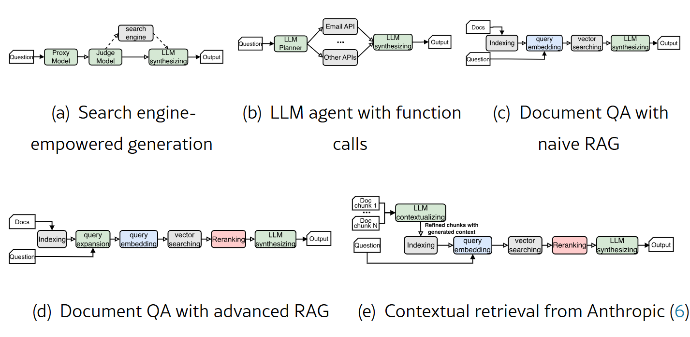
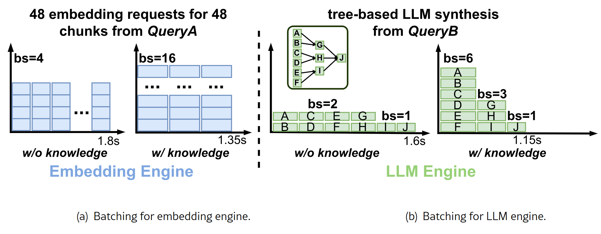
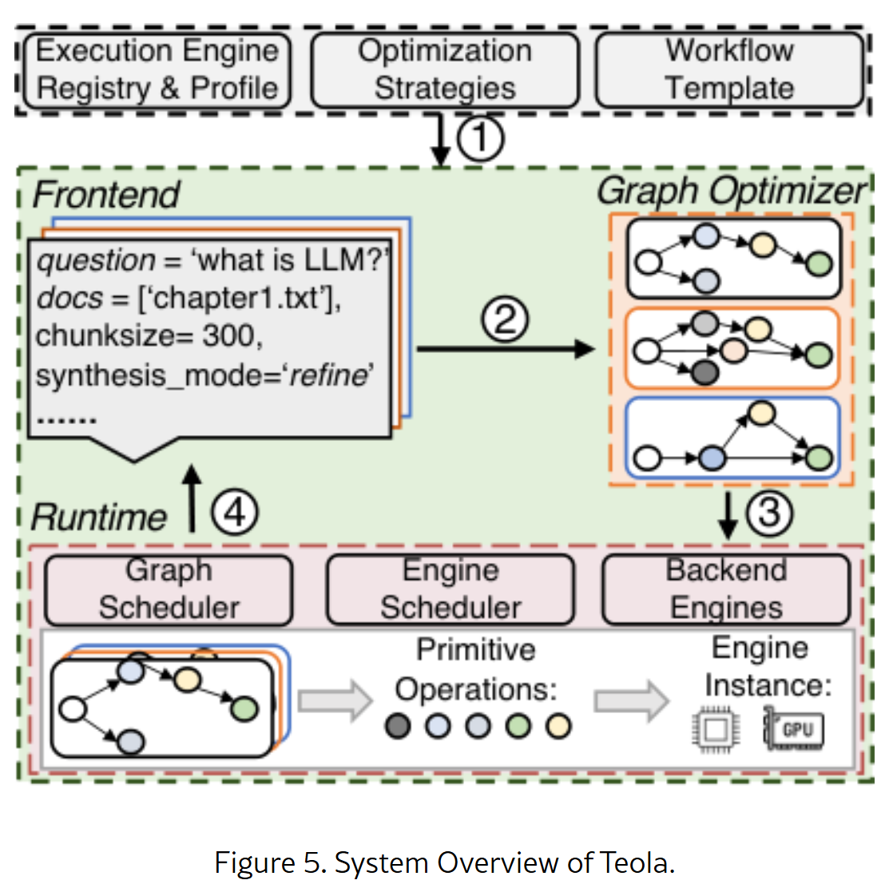
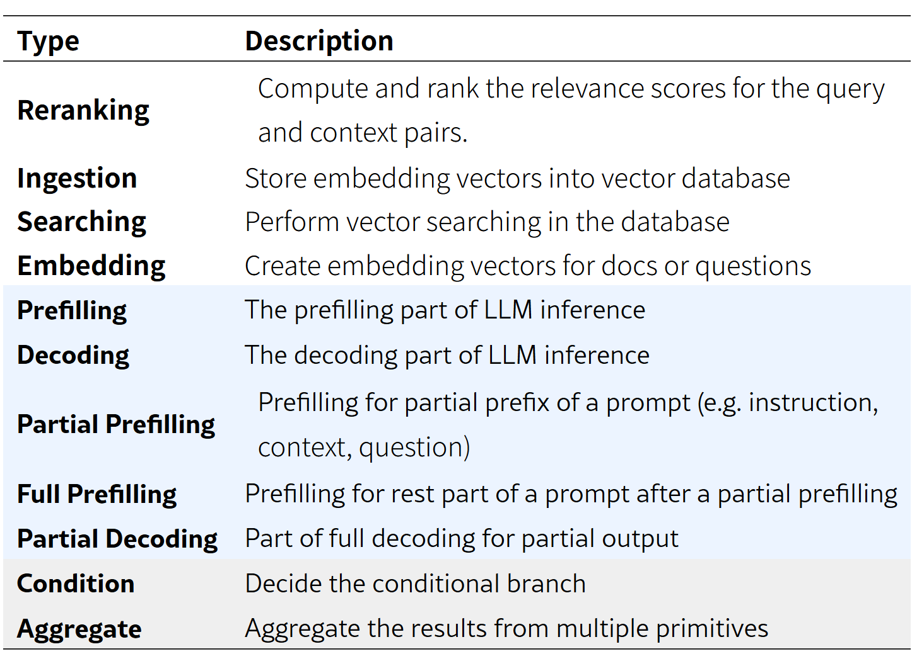
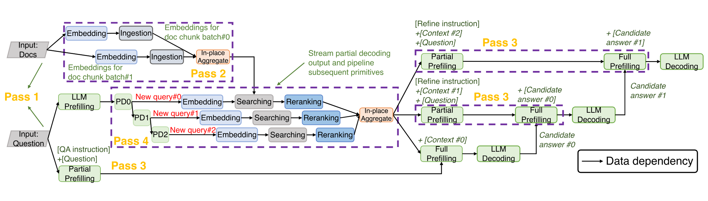

---

title: "Teola: Towards End-to-End Optimization of LLM-based Applications"
created: 2026-11-13
tags:
  - Paper Notes
  - LLMInference

description: "Ayo 把 LLM 应用工作流表示为原语级数据流图（p-graph），经依赖剪枝、阶段分解、prefill 拆分与解码流水线四类 pass 生成执行图，实现跨模块并行与流水线调度。"

---

# Teola: Towards End-to-End Optimization of LLM-based Applications

## Bibliographic Information

- Authors: Xin Tan, Yimin Jiang, Yitao Yang, Hong Xu（1 The Chinese University of Hong Kong；2 未注明单位）
- Year / Venue: 2024 年 6 月，arXiv 预印本 v3（cs.DC / cs.AI / cs.NI）
- DOI: [10.48550/arXiv.2407.00326](https://doi.org/10.48550/arXiv.2407.00326)

## 1. Problem & Solution
Problem: Existing frameworks employ **coarse-grained orchestration with task modules**, which confines optimizations to within each module and yields suboptimal scheduling decisions.

Solution: Ayo——论文提出的细粒度的端到端编排，它以任务原语为基本单元，**将每个查询的工作流表示为原语级的数据流图**。这显式地暴露了更大的设计空间，实现了**跨不同模块原语的并行化与流水线优化**，并增强了调度能力以提升应用级性能

## 2. Findings
### LLM-based Application Workflow

现有框架（LangChain、LlamaIndex、AutoGen）是 module 级链式编排：每个模块（indexing、检索、LLM 生成…）作为黑盒在各自的后端引擎（vLLM、Triton 等）上独立顺序执行。论文指出这带来两个错失的机会：

- 图优化层面：模块间黑盒化，跨模块的并行/流水线完全不可见。比如 query expansion 的 LLM 解码和文档 embedding 其实输入互不依赖，可以并行，但模块链表达不出来。
- 调度层面：前端编排和后端执行解耦，引擎只能做 per-request 优化（比如固定 batch size 保单请求延迟），但这和应用级端到端性能是错配的。论文给了个例子：48 个文档 chunk 的 embedding 请求，Triton 按 batch=4 跑要 1.8s，明知它们来自同一模块就应用 batch=16 追求总完成时间，只要 1.35s。

## 3. Ayo Design

1. Offline: 开发者为应用程序注册执行引擎，例如用于嵌入模型、LLM 和数据库操作的引擎，并附上它们在不同输入规模（如批大小和序列长度）下的延迟特征。他们还提供工作流模板，概述应用程序的组件（例如查询扩展和 LLM 生成）及其执行顺序。开发者还可以选择性地为某些原语操作指定优化策略。应用程序配置并部署完成后，系统即可进行在线服务。
2. Online: 
   - 收到带有特定输入数据和工作流配置的查询后，Teola 会创建一个基于原语的数据流图（p-graph）
   - 应用相关优化生成执行图（e-graph），并将 e-graph 提交给运行时 
   - 运行时准确跟踪并高效调度 e-graph 中的原语在相应后端上的执行
   - 最后，结果在完成后返回给前端。

### Graph Optimizer

#### p-Graph
原语既可以对应已注册执行引擎中某个标准操作的功能（例如嵌入引擎中的嵌入创建，或重排序引擎中的上下文排序），也可以表示细粒度的分解操作。
- 例如，LLM 推理被分解为预填充（Prefilling）和解码（Decoding），其中部分预填充（Partial Prefilling）与完整预填充（Full Prefilling）构成 LLM 预填充，而部分解码（Partial Decoding）则管理完整解码的不同部分。
- 此外，原语还可以是聚合或条件分支等控制流操作（即 Aggregate 和 Condition）。
- 每个原语都包含一份元数据配置文件，详细说明其输入、输出、父节点和子节点，从而构成图构建的基础。
- 该配置文件还包含关键属性，例如 DNN 的批大小或 LLM 的提示词，以及目标执行引擎。

#### Optimization
p-graph 上跑 4 个内置 pass（也支持开发者注册自定义 pass），迭代做模式匹配直到不动点，得到执行图 e-graph：

- Pass 1 Dependency pruning：template 依赖只是高层执行顺序，细化后会引入冗余边。逐一检查 primitive 的真实输入来源，把非数据依赖的边剪掉，让独立分支（如 query expansion 和 indexing）脱离主链并行执行。
- Pass 2 Stage decomposition：对 batchable 且输入超过引擎"最大有效 batch size"（吞吐不再增长的拐点）的 primitive，切成多个 stage 与下游 batchable primitive 形成流水线，末尾插一个 Aggregate 同步。为避免相邻 batchable primitive 组合爆炸，只在达到最大有效 batch size 时才显式切分。
- Pass 3 LLM prefilling split：利用 attention 的因果性——prompt 里已就绪的部分（system instruction、用户问题）不必等检索结果，可以先做 partial prefilling 与上游 primitive 并行，等 context 到了再做 full prefilling 补算剩余部分。本质是把 prefix 预计算显式建模进图里。
- Pass 4 LLM decoding pipelining：利用自回归解码的流式输出。标注为 splittable 的 LLM 调用（如 query expansion 输出 3 条结构化 JSON query），解析器一旦提取出一条完整片段就立即发给下游 primitive，不等全部解码完——形成 partial decoding 流水线。

### Runtime Scheduling
- 上层 Graph scheduler：跟踪每个 query 的 e-graph，in-degree 归零就把 primitive 节点分发给对应引擎调度器。注意它**分发的是"节点"而不是裸请求**——这样下层才能知道请求之间的归属关系，而不是像现有系统那样把请求当成彼此独立的。
- 下层 Engine scheduler：核心机制是 topology-aware batching。对 e-graph 反向拓扑排序算出每个节点的 depth，**调度时把同一 query 的 pending 节点分桶、桶内按 depth 优先（更深的节点对图推进贡献更大）、桶间按到达时间**。
> 用节点在 e-graph 里的拓扑深度近似"对图推进的贡献度"

## 4. Limitation
- Ayo 是针对预定义好的 workflow template 的优化，无法处理动态工作流（如 ReAct 风格的 agent workload）——这类工作流的依赖图会在运行时演化。

## 5. Summary
Ayo 是针对预定好的 llm-based application workflow(langchain, llamaindex, etc.) 的端到端优化系统，它将每个查询的工作流表示为原语级的数据流图，显式地暴露了更大的设计空间，实现了跨不同模块原语的并行化与流水线优化，并增强了调度能力以提升应用级性能。

> 但是 React agent workload 是动态的，依赖图会在运行时演化，Ayo 的优化策略并不适用。大量的 tool call 会不断动态增加 context，达到上限还会增加 compaction，调度没有考虑这种情况会出现问题

> 如何针对 react agent workload 进行这种形式化的 pass 图优化呢？ 对于这种 agent workload，实质上就是 llm call + tool call + user prompt 的多个这样 turn 的组合；工作流模式固定但内部 workload 变化剧烈，不同的任务会有不同的 tool call pattern 以及 llm call 表现；一般的特征是相似的：
> - tool call 有长尾，长尾不能与 llm call overlap
> - tool call 并行有限，subagent 使用有限
> - llm engine 的调度策略是 per-request 的，无法感知到 agent workload 的特性，memory-constrained 会增加额外不必要的的 offload/reload 以及 prefill/recompute，增加延迟和成本
> - 上下文会突变，compaction 或者用户打断某些工具或输入 prompt 导致；这里应该考虑 compaction 在 user idle 执行，并尽可能复用之前的 kv cache 并在下次执行前 insert new kv and evict old kv；应该预加载 tool metadata(保证不变)，后续的 tool call 只需要保留 tool call output 的 kv cache，tool call input 是 one_off 的；tool call result 可以缓存；