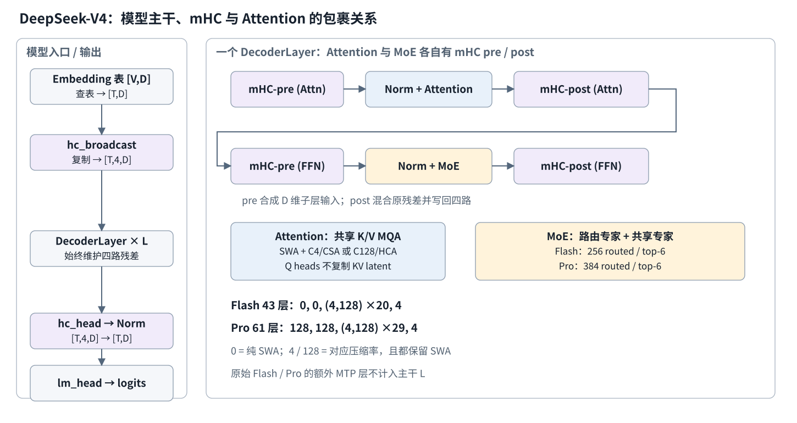
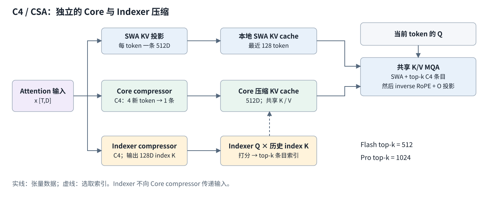
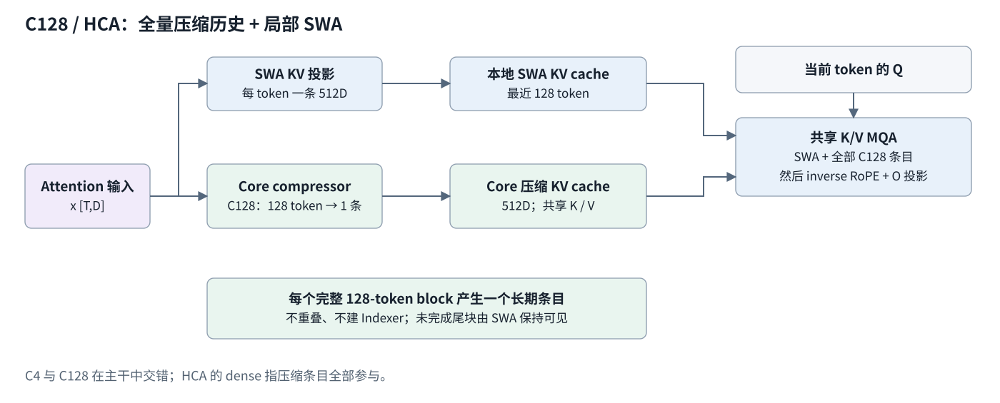
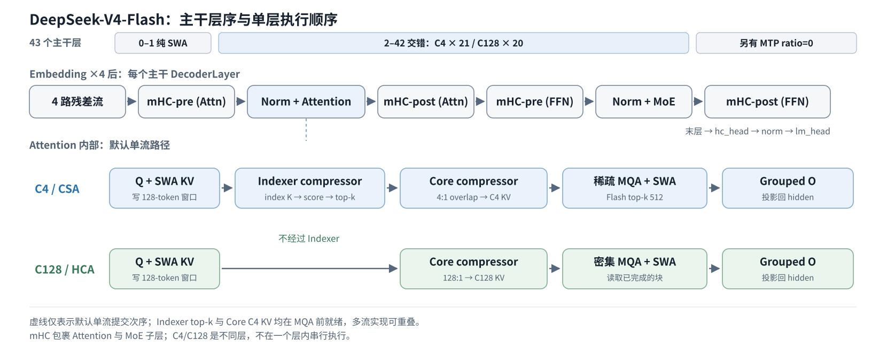
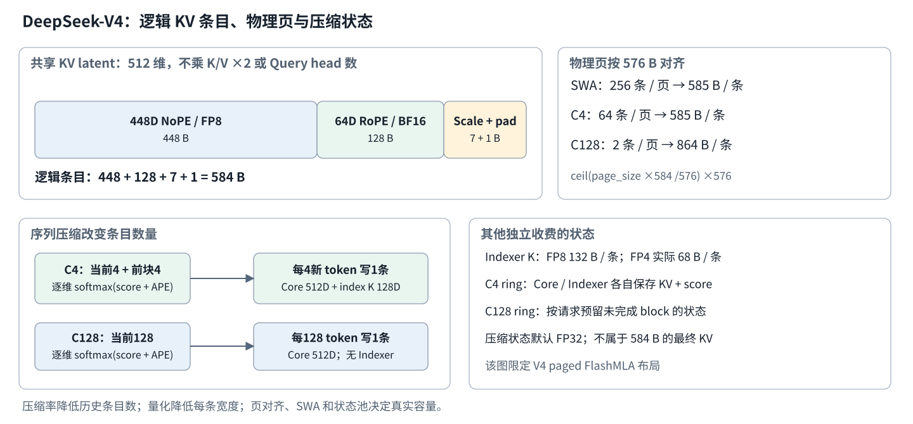
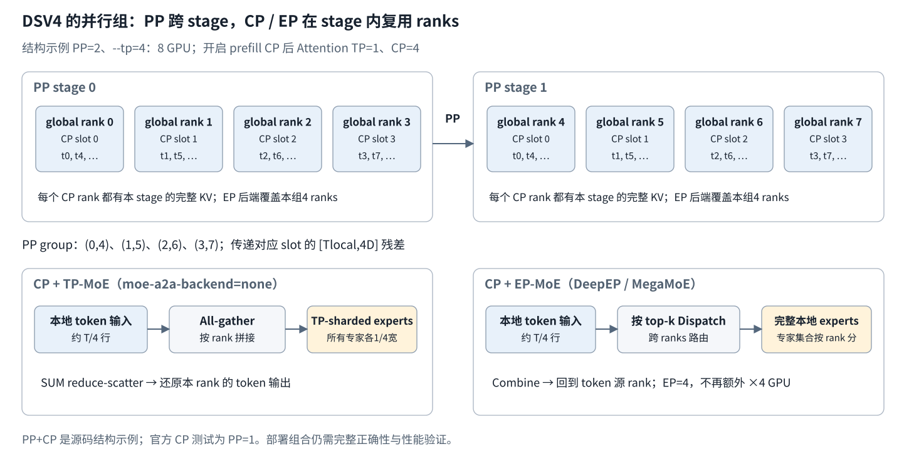
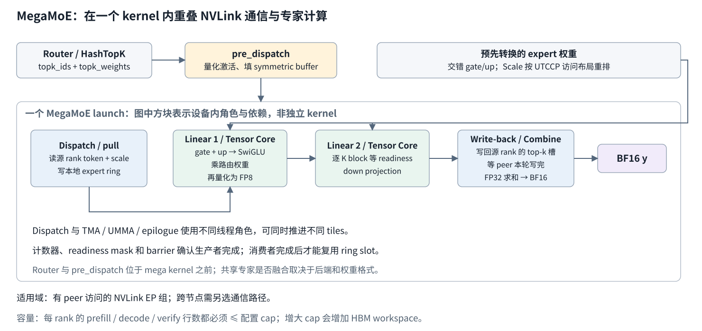
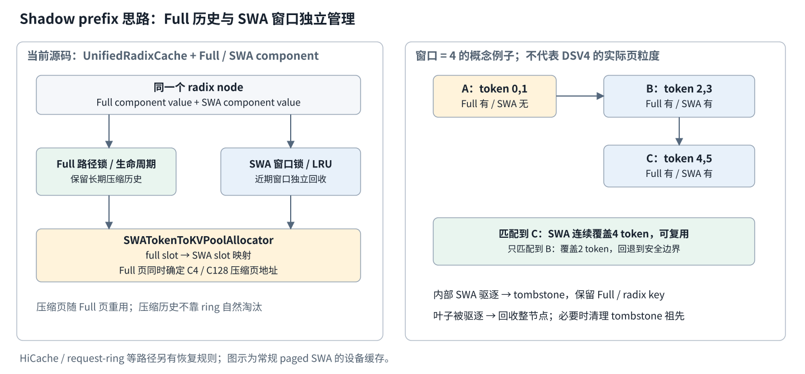

# DeepSeek-V4：模型架构与 SGLang 推理实现

DeepSeek-V4 的长上下文推理由两种压缩粒度共同支撑：C4 保留较细的历史分辨率，再用 Indexer 选出相关条目；C128 把历史压得更短，直接读取所有压缩条目。两者都保留局部 SWA。mHC 则在残差路径维护四路状态，Attention 和 MoE 接收的仍是一条 `hidden_size` 向量。

本文把模型设计与推理实现分开讨论：模型部分依据 [DeepSeek-V4 技术报告](https://arxiv.org/html/2606.19348v1)和原始 [Flash](https://huggingface.co/deepseek-ai/DeepSeek-V4-Flash/blob/main/config.json)、[Pro](https://huggingface.co/deepseek-ai/DeepSeek-V4-Pro/blob/main/config.json) 配置

## 模型架构



| 配置                             |    V4-Flash |      V4-Pro |
| -------------------------------- | ----------: | ----------: |
| `hidden_size`                    |        4096 |        7168 |
| 主干层数                         |          43 |          61 |
| Query heads / head dim           |    64 / 512 |   128 / 512 |
| RoPE / NoPE 维度                 |    64 / 448 |    64 / 448 |
| 主干 C4 / C128 / 纯 SWA 层数     | 21 / 20 / 2 | 30 / 31 / 0 |
| Indexer heads / head dim         |    64 / 128 |    64 / 128 |
| Index top-k                      |         512 |        1024 |
| Routed experts / 每 token 路由数 |     256 / 6 |     384 / 6 |
| Shared experts                   |           1 |           1 |
| MoE intermediate size            |        2048 |        3072 |
| mHC 残差路数 / SWA window        |     4 / 128 |     4 / 128 |

Flash 主干的压缩率序列是 `0, 0, (4,128) ×20, 4`；Pro 是 `128,128,(4,128) ×29,4`。因此 C4 与 C128 在层间交错，不能用“前半段 CSA、后半段 HCA”理解。原始配置的 `compress_ratios` 还各有一个末尾 `0`，对应额外 MTP 层，主干计算只取前 `num_hidden_layers` 项。[^config]

### mHC：四路残差如何进入和离开子层

完整 embedding 表的逻辑形状是 `[vocab_size, hidden_size]`。查表得到 `[T,D]` 后，`hc_broadcast` 复制为 `[T,4,D]`，四路初值相同。CUDA kernel 会实际写入四份激活；扩展操作没有可训练投影，也不会把 embedding 表宽度变成 `4D`。[^broadcast]

```python
# 与 SGLang hc_broadcast 语义等价的示意代码
x = embedding(input_ids)                   # [T, D]
residual = x.unsqueeze(1).repeat(1, 4, 1)   # [T, 4, D]
```

对 Attention 或 MoE 子层，记四路输入为 $X_1,\ldots,X_4$，mHC 可以概括为：

$$
u=\sum_{j=1}^{4}a_jX_j,\qquad y=F(\operatorname{Norm}(u)),\qquad
X'_i=\sum_{j=1}^{4}R_{ij}X_j+p_i y.
$$

`mHC-pre` 计算混合系数并合成一个 $D$ 维输入；`mHC-post` 把子层结果按各路权重写回，并混合残差。Sinkhorn 迭代作用于 $4\times4$ 的残差混合矩阵 $R$，使其接近双随机矩阵；pre/post 的门控另行计算。四路后续可以因为不同的 $p_i$ 和混合权重而分化。**pre 的数据方向是 4→1，post 是写回 4 路**。这里既没有把 Attention 输入扩宽到 `4D`，也没有四份独立的 KV cache。[^mhc]

### Attention：C4/CSA 与 C128/HCA

V4 用一个共享 latent 同时作为 Key 和 Value，执行 Shared K/V MQA。Q 有低秩投影，输出有 grouped projection；理解它与 MLA 的联系时，需要保留这些具体结构，而不是套用 V3 的 KV latent 展开公式。



**C4 / CSA** 每 4 个新 token 生成一条 Core 压缩 KV，压缩时参考前一个 4-token block 和当前 block，共 8 个候选。另一个独立的 compressor 生成 128 维 Indexer K；Indexer Q 对历史 Indexer K 打分，选出 top-k 压缩条目。主 MQA 读取这些条目的 512 维 Core KV，并加入最近 128 token 的 SWA。top-k 按相关性选择，位置可以跨越整段压缩历史。



**C128 / HCA** 每 128 个 token 生成一条 Core KV，只聚合当前 block，没有 overlap，也没有 Indexer。因为历史条目数已缩短到原来的约 1/128，MQA 读取全部完成的压缩条目。这里的 dense attention 指压缩历史全量参与；局部 SWA 仍然存在。

### 其他 Attention 细节

- **Partial RoPE**：仅对最后 64 维施加 RoPE，前 448 维为 NoPE。输出再用 query 位置对应的 inverse RoPE。因为 K/V 共享，Value 路径也携带旋转，inverse RoPE 把输出转换到 query 对应的参考坐标；不能理解成完全消除了所有相对位置信息。
- **SWA**：完整压缩块要等待 4 或 128 个 token。近期窗口让 query 仍能读取未完成 block 的前序 token，也补充近邻细节。SWA 和长期压缩条目共同参与注意力归一化。
- **Attention Sink**：每个 head 有可学习的 sink logit，给 softmax 分母增加一个零 Value 的候选。当历史条目都不相关时，概率质量可以流向 sink，使输出幅度降低。
- **Grouped Output Projection**：把 heads 分成 `g` 组，先分别投影到较小的 `o_lora_rank`，再通过 `wo_b` 合回 `D` 维，避免一个巨大直接输出投影。[^paper] [^model]

## 模型推理

下面沿 SGLang 的实际执行路径展开：先解释单层如何写入和读取状态，再计算容量，最后看这些状态和计算如何映射到多 GPU。

### 单层执行顺序与并发关系



Attention 内部的 C4 层有两条压缩产物：
- **Indexer compressor 生成 128 维 index K**，Indexer Q 对历史 index K 打分并取 top-k
- **Core compressor 生成 512 维 C4 KV**。两者都在最终 MQA 读取之前就绪

时序：
- 默认单流 `_forward_prepare` 的提交次序是写 SWA KV、执行 Indexer（含自身 compressor 和 top-k）、执行 Core compressor、然后 `attn_backend.forward`
- 多 CUDA stream 路径可以让 **Indexer、Core compressor 和 SWA 写入重叠，最终在注意力前汇合**。
- C128 层没有 Indexer，压缩块全量参与 dense MQA；两类层都并入最近 128 token 的 SWA 分支。[^forward] [^paper]


### C4 / C128 compressor：输入、ring 与 CUDA 归约

两个 compressor 都从该层 Attention 输入 `x` 投影出 `(KV, score)`。`wkv_gate` 输出宽度为 `2 × coff × head_dim`：C4 的 `coff=2`，生成 overlap/current 两组 KV 和 score；C128 的 `coff=1`，只有一组。Indexer 的 C4 compressor 把 `head_dim` 从 512 换成 128。`score` **是每个通道一个分数向量**，并非每 token 一个标量。[^compressor]

```text
C4 每 token：  [KV_overlap | KV_current | score_overlap | score_current]
               每段 H 维；Core H=512，Indexer H=128
C128 每 token：[KV_current | score_current]
               每段 H=512
```

设压缩窗口中的候选集合为 $\mathcal W$，第 $d$ 个通道的压缩结果为：

$$
\bar v_d=\frac{\sum_{j\in\mathcal W}\exp(s_{j,d}+\operatorname{APE}_{j,d})v_{j,d}}
{\sum_{j\in\mathcal W}\exp(s_{j,d}+\operatorname{APE}_{j,d})}.
$$

APE 是可学习的位置偏置。softmax 在窗口位置维上归一化，各通道的权重可以不同。这个 pooling 不依赖后来的 Attention Query，所以新 token 到达后就能更新状态，压缩结果可以被任意后续 Query 复用。

#### C4：每 4 个新 token 输出一条，计算窗口是 8 个

常规 decode 路径把每个 token 的四段数据写入 8 行 ring。当前 block 满 4 token 后，kernel 取前一块的 4 份 overlap 投影和当前块的 4 份 current 投影，加入对应 APE，逐通道执行稳定 softmax 和加权和。前一块不存在时屏蔽 overlap 候选。两种投影可以学习不同的历史/当前表达；overlap 让相邻压缩块共享一段输入信息。[^compress-kernel]

Core 和 Indexer 各执行自己的压缩、归一化/旋转及缓存写入。每 4 个原始 token 最终写出 **1 条 512D Core KV + 1 条 128D Indexer K**。ring 保存待聚合输入，压缩池保存完整历史，二者生命周期不同。

#### C128：128 个候选的分层 softmax

常规非 online C128 路径保存 128 行 `(KV,score)`。原始 `c128.cuh` 让 16 个 warp 各处理 8 个位置，先得到本地稳定归约三元组 $(m_w,l_w,p_w)$：局部最大分数、相对该最大值的指数和、加权向量和。随后跨 warp 合并：

$$
m=\max_w m_w,\qquad
l=\sum_w e^{m_w-m}l_w,\qquad
p=\sum_w e^{m_w-m}p_w,\qquad \bar v=p/l.
$$

重新缩放是正确性所需：不同 warp 的局部 softmax 使用不同最大值，不能直接相加各自的归一化输出。实现会用 shared memory 交换局部三元组，再归约；输出经过 norm、RoPE 和存储量化写入 C128 池。[^compress-kernel]

SGLang 还有 `compressor_v2`、online C128 与 MTP 相关 kernel。以上公式说明共同的数学结果；16 warp 的安排只属于引用的 `c128.cuh` 路径，不应当作所有后端的固定 launch 配置。


### KV Cache 量化、池分配与显存预算

`DeepSeekV4TokenToKVPool` 同时容纳长期压缩条目、SWA、Indexer K 和压缩中间状态。下面区分逻辑条目宽度、物理页摊销与容量预算系数。数值限定为**单 PP stage、非统一池、V4 paged FlashMLA 布局、FP8 Indexer、FP32 压缩状态、无推测解码、无 HiSparse**；后面的 PP 表再按本地层重算。


#### `alloc_memory_pool` 到底分配了什么

启动时 `ModelRunner.initialize()` 已加载权重并确定 layer 信息与 KV dtype。之后 `ModelRunner.alloc_memory_pool()` 建立 `KVCacheConfigurator`，调用 `configure(pre_model_load_memory=...)`，把返回的 `req_to_token_pool`、`token_to_kv_pool` 和 `token_to_kv_pool_allocator` 挂回 runner。**Attention backend 在独立的 `init_attention_backends()` 中建立**；`alloc_memory_pool` 本身只分配池，不创建 backend 或 CUDA Graph。[^runner]

```text
ModelRunner.alloc_memory_pool
  → KVCacheConfigurator.configure
    → _profile_available_bytes
    → DSV4PoolConfigurator.calculate_pool_sizes
    → ReqToTokenPool
    → DeepSeekV4TokenToKVPool
       ├─ 每个本地层一份 SWA KV buffer
       ├─ 每个 C4 层一份 C4 KV + Indexer K
       ├─ 每个 C128 层一份 C128 KV
       └─ C4/C128 compressor 中间状态
    → SWATokenToKVPoolAllocator（常规 paged SWA 路径）
  → ModelRunner.init_attention_backends（后续步骤）
```

`_profile_available_bytes` 先读取当前空闲 GPU 内存，再扣除由 `pre_model_load_memory × (1 - mem_fraction_static)` 给出的运行时余量和多模态预留。`config_from_budget` 选择 `DSV4PoolConfigurator`；它先扣固定池，再用每个 full token 的预算系数除剩余字节，结果按 256-token 页向下取整，并受 `max_total_tokens`、PP 最小容量等限制。随后确定可运行请求数，重新定出按请求计的状态池大小。`ReqToTokenPool` 保存请求位置到逻辑 token slot 的映射；主 KV 池保存数据；常规 `SWATokenToKVPoolAllocator` 管理 full slot 与 SWA slot 的映射。`full_size` 是逻辑容量，不代表每一层又存一份未压缩的全长 KV。[^configurator] [^allocator]

`DeepSeekV4TokenToKVPool` 按 `compress_ratios` 构造真实子池：SWA 覆盖本地所有主干层；C4/C128 KV 只覆盖各自的层；C4 另有 Indexer K 池。`layer_mapping` 把全局 layer id 映射到对应压缩池内部的 layer id。C4 压缩状态按 SWA 页寻址；C128 压缩状态按 request slot 寻址。全局逻辑 page size 是 256，C4 物理页是 `256/4=64` 个压缩条目，C128 物理页是 `256/128=2` 个压缩条目，因此 `full_loc // ratio` 和压缩池页边界能够对应。[^pools]

#### KV 量化：从一个条目算到一个原始 token



这里采用 V4 默认页格式。512 维共享 KV latent 分成 448 维 NoPE 和 64 维 RoPE。前者存 FP8（448 B），后者存 BF16（128 B）；7 个量化 scale 加 1 B padding 合计 8 B。所以一个**逻辑 KV 条目**是 `448 + 128 + 8 = 584 B`。这份 latent 同时当 K、V 使用，不能再乘 2；64/128 个 query head 也不会让共享 KV 再乘 head 数。[^layout]

NoPE 的 448 维按 **64 个连续元素一组**量化，所以有 `448/64=7` 个 scale；这 7 组不是 7 个 Attention head。以独立 quant kernel 为例，对一组元素计算绝对值最大值 $a$，再取：

$$
s=2^{\left\lceil\log_2\left(\max(a,\varepsilon)/448\right)\right\rceil},\qquad
q=\operatorname{FP8}\!\left(\operatorname{clamp}(x/s,-448,448)\right).
$$

scale 限定为 2 的幂，因此可用一个 UE8M0 字节保存指数，常规有限值的字节为 `log2(s)+127`；读取时恢复 scale 并计算 $q\times s$。RoPE 的 64 维直接保存 BF16。写 cache 可以融合量化，也可以先生成 `NopeFp8RopeBf16Pack` 再写；页布局还会把 scale 区组织成便于 kernel 读取的形式，逻辑 584 B 不代表逐行结构体一定按这个顺序物理交错。[^kv-quant]

实际 buffer 以页为单位，并按 576 B 的页步长对齐。对 256、64、2 三种 page size：

| 池   | 每页压缩条目 | 页字节数 `ceil(page_size×584/576)×576` | 物理摊销/条目 |
| ---- | -----------: | -------------------------------------: | ------------: |
| SWA  |          256 |                              149,760 B |         585 B |
| C4   |           64 |                               37,440 B |         585 B |
| C128 |            2 |                                1,728 B |     **864 B** |

C128 的 864 B 尤其反直觉：它仍是 584 B 的逻辑条目，但每页只有 2 条，`1168 B` 要上取整到 `3×576=1728 B`。它的物理摊销比直接用 584 B 估计高约 48%。C4 Indexer K 另占 `index_head_dim + index_head_dim/128×4 = 128+4 = 132 B`/压缩条目（FP8 K 加 FP32 scale）。若启用 FP4 Indexer，实际条目为 `128/2 + 128/32 = 68 B`；当前 NVIDIA configurator 仍使用 132 B 作保守估计，HIP FP4 则按 68 B 估计。[^layout] [^indexer]

于是每增加一个**原始 full token 的长程压缩缓存**，每层的斜率是：

$$
b_{C4}=\frac{585+132}{4}=179.25\ \text{B},\qquad
b_{C128}=\frac{864}{128}=6.75\ \text{B}.
$$

C4 的分子包含 Core KV 与 Indexer K；C128 没有 Indexer。top-k 只缩减**本次 Attention 读出的条目数**，不改变缓存里已有的压缩历史长度。Flash 的 `index_topk=512`、Pro 的 `1024`，因此它们影响计算/读带宽，却不进入上式。[^paper]

SWA 需要单算。所有主干层都写本地 SWA KV；它按池中 SWA slot 数量收费，而不是把每个长上下文 token 永久保留一次。默认无推测解码时，C4 的压缩状态 ring 为 8 行；每行 Core `(KV,score)` 加 overlap 共 `4×512×4=8192 B`，Indexer 状态另有 `4×128×4=2048 B`。**一个 256-token SWA 页对应 8 行状态**，所以每个 SWA slot、每个 C4 层要再摊 `8/256×(8192+2048)=320 B`：[^state]

$$
b_{\mathrm{SWA\ slot}}=585L+320L_4,
$$

其中 $L$ 是主干层数，$L_4$ 是 C4 层数。C128 的原始 `(KV,score)` ring 默认 128 行、每行 `2×512×4=4096 B`，**按请求数单独预留**，不是随 full token 数线性增长。若设 `R` 为每 worker 可寻址请求槽数，近似固定项是 $L_{128}×R×128×4096 B$，实际还会给 ring 和 sentinel 留行并向 128 对齐。在线 C128 压缩、MTP、PD 预分配会改变这一项。[^state] [^configurator]

#### 代入 Flash 和 Pro

假设显式使用 `--swa-full-tokens-ratio 0.1`，让 `swa_tokens ≈ 0.1 × full_tokens`，且是上述默认 V4 布局与 FP32 压缩状态。`bytes_per_full_token` 的三项是：

$$
b_{\mathrm{budget}}=
0.1(585L+320L_4)
+179.25L_4
+6.75L_{128}.
$$

| 模型     | 主干层数 `L` | C4 `L₄` | C128 `L₁₂₈` |                    长程压缩池斜率 |                  SWA 与 C4 状态摊销 | `bytes_per_full_token` |
| -------- | -----------: | ------: | ----------: | --------------------------------: | ----------------------------------: | ---------------------: |
| V4-Flash |           43 |      21 |          20 | `21×179.25 + 20×6.75 = 3899.25 B` | `0.1×(43×585 + 21×320) = 3187.50 B` |          **7086.75 B** |
| V4-Pro   |           61 |      30 |          31 | `30×179.25 + 31×6.75 = 5586.75 B` | `0.1×(61×585 + 30×320) = 4528.50 B` |         **10115.25 B** |

这个结果是**分配器容量系数**，不是对一条请求的每个历史 token 都常驻 7086.75/10115.25 B。对单条很长的序列，C4/C128 压缩历史接近表中的 3899.25/5586.75 B/原始 token；SWA 主要保存最近窗口，加上页粒度和状态。以 100 万 token 粗算，长程压缩池分别约 3.90 GB 和 5.59 GB（十进制），还要加 SWA、C128 未完成块状态、页尾、dummy page、其他请求、权重与运行时空间。这也解释了论文的长上下文 KV 图与启动日志的 `bytes_per_full_token` 看上去不一致：**前者描述请求的长期驻留，后者是为多个请求预留池容量的线性化模型**。

另一个必须检查的分支是 **SWA cap mode**。若没有显式指定 `--swa-full-tokens-ratio`，同时给定 `--max-running-requests`、启用合适的 chunked prefill（或作为 PD decode），configurator 会按请求窗口及 radix prefix 尾部的上界固定 `swa_cap_tokens`。此时 SWA 和 C4 状态从线性系数移进 `fixed_bytes`，日志中的 `bytes_per_full_token` 变成 **Flash 3899.25 B、Pro 5586.75 B**；不能用较小的系数就断言总显存更少。若这些条件不满足，则继续走 ratio mode。本文版本的 V4 参数处理还会把未指定的 `max_running_requests` 设为 256，因此“没在命令行填写”不等于 configurator 收到 `None`；应以 resolution 后的参数和 sizing 日志为准。[^configurator]

预算求容量可概括为：

$$
T_{\mathrm{full}}=
\left\lfloor\frac{B_{\mathrm{available}}-B_{\mathrm{C128\ state}}-B_{\mathrm{SWA\ fixed}}-B_{\mathrm{other\ fixed}}}
{b_{\mathrm{budget}}}\right\rfloor_{256},
$$

其中 $\lfloor\cdot\rfloor_{256}$ 表示向下对齐到 256-token 页。代码在取容量前会按请求并发预估固定项，取容量后再用最终 `max_running_requests` 细化状态池；PP 还会同步取可服务的最小容量。这个式子是理解日志的主干，完整实现还包含 DCP、speculative draft、HiSparse、encoder replay、不同 KV 布局等分支。[^configurator]


### PP、TP、CP、EP 如何组合

#### 先区分 `--tp` 与实际 Attention TP

SGLang 的 `tp_size` 是一个 PP stage 内模型并行组的总宽度。Attention 与 MoE 可以在同一组 GPU 上采用不同切分：[^parallel-groups]

$$
\operatorname{attn\_tp\_size}=\frac{\operatorname{tp\_size}}
{\operatorname{attn\_dp\_size}\operatorname{attn\_cp\_size}},\qquad
\operatorname{moe\_tp\_size}=\frac{\operatorname{tp\_size}}
{\operatorname{moe\_ep\_size}\operatorname{moe\_dp\_size}}.
$$

单副本的 GPU 数是 `pp_size × tp_size`；EP 和 CP 在 stage 的 ranks 内派生。比如 `--tp 4 --ep 4` 使用 4 张 GPU。独立 DP replicas 属于另一层部署，本文不叠加。

| 并行方式     | 切分对象                     | 直接节省 / 分担什么             | 在 V4 中的主要通信                    |
| ------------ | ---------------------------- | ------------------------------- | ------------------------------------- |
| PP           | Decoder layers               | 每 GPU 的层权重与本地层 KV      | stage 之间传四路残差                  |
| Attention TP | Q heads、O projection groups | 对应投影权重与 head 计算        | O projection 的归约                   |
| Prefill CP   | 本次 extend 的 token 行      | Q/Attention 与按 token 投影计算 | KV、compressor score 的 gather 与重排 |
| EP           | 专家集合                     | 完整专家权重分布到各 rank       | top-k dispatch / combine              |
| TP-MoE       | 每个专家的 intermediate 维   | 所有专家矩阵的列/行切片         | 输入 gather、部分结果 SUM reduction   |

纯 TP 下，`wq_a`/`wkv` 是 replicated projection；`wq_b` 的 Q heads 按 Attention TP 切分，`wo_a` 按输出组切分，`wo_b` 是 row parallel。共享 512D KV latent 没有按 query heads 切分，所以在常规 V4 pool 下 **KV 容量不能再除以 TP**。[^attn-tp]

#### DSV4 的 CUDA prefill CP 实际启用了什么

通用组构造器能描述 `attn_tp=2、cp=2`。但本文版本的 `validate_deepseek_v4_cp()` 对 CUDA/HIP V4 有更窄的模型专用限制：[^cp-hook]

1. 使用 `--enable-prefill-cp --cp-strategy interleave`；zigzag 只允许 NPU 路径。
2. CUDA/HIP round-robin 模式要求 `attn_dp_size=1`，并将 `attn_cp_size` 设为 `tp_size / attn_dp_size`，因此实际 `attn_tp_size=1`。
3. 设置 `moe_dense_tp_size=1`；MoE routed experts 是否按 TP 或 EP 分布由 backend 决定。
4. 非 NPU 检查 `tp_size <= 8`，应把 stage 内 CP 放在单机通信域；HIP 还明确拒绝 `nnodes>1`。
5. 原始 V4 的 CP 路径关闭 `SGLANG_OPT_FLASHMLA_SPARSE_PREFILL`；TRT-LLM V4 Attention backend 明确拒绝 CP。

所以把参数写成 `--tp 4 --attn-cp-size 2 --enable-prefill-cp`，不能据此认定 DSV4 最终是 Attention TP2×CP2。必须检查 resolution 后的配置与启动日志。这里的“TP+CP”通常意味着 **同一个 stage 总宽度既承载 CP Attention，也承载 TP-MoE 或 EP-MoE**。



#### CP 的 token 与缓存路径

`EagerRunner._execute_extend()` 判断本 batch 是否满足 CP 条件，再由 `_execute_extend_cp()` 构建全局 metadata、取得 embedding、切分 token/positions，在本地 shard 上运行模型 body。以 CP4 为例：[^cp-runner] [^cp-strategy]

```text
rank 0：t0, t4, t8,  …
rank 1：t1, t5, t9,  …
rank 2：t2, t6, t10, …
rank 3：t3, t7, t11, …
```

这是当前 extend 的 packed token 行，不是给每条请求重置一次 rank 0。positions 仍是各 token 的原始序列位置；metadata 会计算每条请求在各 rank 上的 Query 长度，并屏蔽物理 padding。当前 `InterleaveCPStrategy` 已基于 `extend_seq_lens` 处理分块，不能沿用早期代码的断言推导“所有 chunked prefill 都不支持 CP”。

Attention Q 保持本地。SWA KV 写入前通过 `cp_materialize_global_token_order()` gather 并恢复 token 顺序；Core 和 Indexer compressor 的 `compute_kv_score()` 也执行这个步骤。由此各 GPU 的 compressor 都能看到连续的 C4 overlap / C128 block，随后各自写入本地压缩池。末 stage 的输出再 `cp_gather_after_forward()`，恢复全局行顺序交给 logits processor。[^cp-cache]

因此，常规 paged 路径中，每个 CP rank 的 KV pool 保存本 stage 的完整逻辑历史；它们有对称的逻辑索引，但不是同一块物理显存。**这种 prefill CP 分摊计算，不按 CP 倍数减少 KV cache。** `--dcp-size` 的 decode cache 切分、HiSparse 和 layer-owner sharding 是其他路径，需要分别核对。

通信也不能忽略：Core C4 每 token 的 FP32 `kv_score` 是 `4×512×4=8192 B`；Indexer 另有 2048 B。在 CP4、32768-token extend 中，仅 Core C4 的完整投影张量就是 256 MiB，每 rank 相比本地 shard 需补齐约 192 MiB。量化后的 584 B 最终 KV 宽度不适合估算这个 gather 的通信量。这个推导说明，CP 对长 prefill 的收益还取决于通信域、投影开销和 backend，而非只看 Attention 的 FLOPs。

#### CP + TP-MoE：没有 A2A backend 时

`DeepseekV4DecoderLayer._run_moe_ffn_dp_sync()` 在 `is_cp_active()` 且 `moe_a2a_backend=none` 时，先 `attn_cp_interleave_gather()` 把各 rank 的本地 token 行按 rank 拼接。每个 rank 的专家矩阵按 intermediate 维切片，计算全局 token 的部分结果；再 `attn_cp_interleave_reduce_scatter()` 做 SUM 并把各 rank 的 token 行还回去。[^moe-cp]

这里的 gather 不需要改成全局 token 顺序：MoE 的逐 token 计算只需与 HashTopK 使用的 token IDs 保持一致。代码同时把 MoE 内部的 post-experts all-reduce 跳过，因为后续 reduce-scatter 已经做了 SUM；如果两次都执行，会重复归约。

#### CP + EP：DeepEP / MegaMoE 时

启用 `--moe-a2a-backend deepep` 或 `megamoe` 后，参数 resolution 的 `_a2a_ep_size()` 把 `ep_size` 设置为 `tp_size`。比如 stage 宽度 4：Attention 是 CP4、TP1；MoE 是 EP4、TP1。Flash 的 256 个 routed experts 每 rank 放 64 个，Pro 的 384 个每 rank 放 96 个，每个本地专家保持完整 intermediate 维度。[^ep-hook]

CP Attention 输出已经按 token 分散，MoE 不必先复制全部 token。每个源 rank 计算路由，dispatch 把 token 送到 top-k experts 的 owner，expert 计算后 combine 回到 token 源 rank。DeepEP 把通信与 expert runner 分开；MegaMoE 把其中的通信和计算进一步融合。`_run_moe_ffn_dp_sync()` 对这两种路径保留本地 token 行；当没有 CP 而 Attention TP>1 时，它另有按 token scatter 的步骤，避免把复制的输入重复 dispatch。[^moe-cp]

下面是 **4×B200、原始 Flash 的官方 CP CI 配置核心**，删去了测试框架参数与投机解码设置：[^cp-ci]

```bash
python -m sglang.launch_server \
  --model-path deepseek-ai/DeepSeek-V4-Flash \
  --trust-remote-code \
  --tp 4 \
  --attn-cp-size 4 \
  --enable-prefill-cp \
  --cp-strategy interleave \
  --moe-a2a-backend deepep \
  --chunked-prefill-size 8192
```

官方同一测试文件也覆盖 MegaMoE 和无 A2A 的 CP 路径。Flash 的 CI 证据不等于 Pro、其他 GPU 或 PP2 的验证结果。

#### PP + TP + CP：各 stage 怎样接起来

`make_pp_layers()` 按 `[start_layer,end_layer)` 创建本地层。首 stage 执行 embedding 和四路 broadcast；中间 stage 消费 `PPProxyTensors["hidden_states"]`；末 stage 执行 `hc_head`、norm、lm_head。普通 mHC 路径在跨 stage 时把 `[T,4,D]` flatten 成 `[T,4D]`，接收后再 view 回三维，不改变四路的含义。[^pp-model]

以 `PP2、--tp4` 为例，stage 0 为 ranks `[0,1,2,3]`，stage 1 为 `[4,5,6,7]`；PP groups 是 `(0,4)`、`(1,5)`、`(2,6)`、`(3,7)`。CP4 时，对应 CP slot 跨 stage 传本地 token 残差，Query 分片在下一 stage 继续计算；每个 stage 仍 gather 自己的 KV/compressor 输入。Scheduler 的 PP loop 还传请求、metadata 和最后的采样结果，采用异步 send、同步 recv 与 microbatch 轮转。[^parallel-groups] [^pp-scheduler]

```text
PP stage 0：Embedding → 本地 layers → [Tlocal,4D]
                                      ↓ 对应 PP group
PP stage 1：[Tlocal,4D] → view [Tlocal,4,D] → 本地 layers
           → hc_head / norm → CP gather → lm_head / logits
```

这是源码结构的推导。所核对的官方 CP CI 使用 PP1，本文没有实际运行 PP2+CP4；上图与映射不能当作组合部署已通过正确性验证的证据。另一个明确限制是 `hc_pre_from_prev_sublayer=True` 的 pre-mix hand-off 路径要求 `pp_group.world_size==1`，不能把它直接推广到 PP。

如果要验证上述 PP2 组合，参数关系是 `--pp-size 2 --tp 4 --attn-cp-size 4 --enable-prefill-cp --cp-strategy interleave`，MoE 再选择无 A2A 的 TP-MoE 或 DeepEP/MegaMoE 的 EP4。两节点各 4 GPU 时，应把每个 stage 的四个 ranks 放在同一节点，通过 `--nnodes 2`、各自的 `--node-rank` 和共同的 `--dist-init-addr` 初始化；先验证 target-only 的 logits/生成一致性，再加入 graph 或投机解码。这里的参数关系不是已验证的官方部署 recipe。

PP2 默认把多出来的层分到后一个 stage。原始 Flash 分为 21/22 层，Pro 分为 30/31 层：

| 模型 / stage | 主干层数 | C4 / C128 / 纯 SWA | 长程压缩池 B/full-token | ratio=0.1 时预算系数 |
| ------------ | -------: | ------------------ | ----------------------: | -------------------: |
| Flash / 0    |       21 | 10 / 9 / 2         |                 1853.25 |            3401.75 B |
| Flash / 1    |       22 | 11 / 11 / 0        |                 2046.00 |            3685.00 B |
| Pro / 0      |       30 | 14 / 16 / 0        |                 2617.50 |            4820.50 B |
| Pro / 1      |       31 | 16 / 15 / 0        |                 2969.25 |            5294.75 B |

这些系数要再结合每个 stage 的空闲显存和固定状态算容量。PP 同步采用能够共同服务的最小 token 容量；容量不同的 stage 不能各自任意分配。`SGLANG_PP_LAYER_PARTITION` 能改层分配，但均衡层数不保证均衡工作量：C4 的 Indexer/稀疏选择、C128 的 dense 压缩历史、embedding/lm_head 与 MoE 权重都会影响峰值和延迟。[^pp-slice] [^configurator]

#### Decode 与 Prefill 的并行布局并不相同

`is_cp_active()` 只对可用的 context-parallel extend 生效。普通 decode 一次每请求只有少量新 token，不按上述方式切分长 Query 序列。SGLang 另有 `--enable-cp-decode-attn-tp`：decode 时从 CP 配置下复制的 Attention 权重中切出 Q heads/O projection 的 TP shard，用这些 ranks 做 Attention TP；离开 scope 后恢复权重视图，并缓存切片地址以满足 CUDA Graph。它减少 decode 的重复 head 计算，仍不能据此推导 KV pool 缩小。[^cp-decode]


### MegaMoE：使用场景、内部机制与配置

#### 为什么把通信与计算合成一个 kernel

常规 EP-MoE 的主链是 `Router → Dispatch → Linear1 → SwiGLU → Linear2 → Combine`。Dispatch 根据专家 owner 搬运 token，Combine 把专家输出送回 token 源 rank 并按 top-k 权重求和。分别 launch 时，通信/计算的 stage 边界会引入调度与同步成本，中间 token 还要落入 dispatch/GEMM 的各类工作区。

MegaMoE 把 **EP dispatch、两次专家 GEMM、SwiGLU、EP combine** 放进一个设备内 mega kernel，让 NVLink 数据搬运和 Tensor Core 计算在不同 tiles 上并行推进。Router/HashTopK 与输入量化仍在 mega kernel 前，整个模型的 mHC、Attention 和 logits 也没有因此融合进去。[^mega-readme]



它使用的是自己的 symmetric-memory EP 通信。因此“没有调用 DeepEP”只说明换了通信实现；专家仍然分布到不同 GPU，仍然发生跨 rank dispatch/combine。

#### SGLang 的调用链

`DeepseekV2MoE.forward()` 是 V4 MoE 复用的入口，先检查 `should_use_mega_moe()`。满足 backend、专家权重已转换及 token cap 等条件后进入：[^mega-wrapper]

```text
DeepseekV2MoE.forward
  → should_use_mega_moe
  → forward_mega_moe
    → 共享专家路径（若该配置未融合）
    → gate + TopK / HashTopK
    → run_mega_routed_experts
      → _get_mega_moe_symm_buffer(EP group)
      → mega_moe_pre_dispatch：量化激活、写路由与 scale
      → DeepGEMM mega kernel
    → 必要时加共享专家输出
```

返回的是源 rank 的 `[num_local_tokens, hidden_size]` BF16 结果，已经完成 routed experts 的通信与加权 combine。共享专家是否放在同一个 kernel 内有额外条件：所读的 SM100 W4A8 路径要求开关、FP8 shared weights 和相应 block-scale 格式；其他情况下先算共享专家，再与 routed 输出相加。不能把“融合 MoE”理解成任何权重格式下都会融合 shared expert。

权重转换通常在加载后完成。第一层的 gate/up 权重由 `[gate | up]` 变成较小粒度交错的布局，使 epilogue 方便成对读取并执行 SwiGLU；FP4/FP8 scale 再按 UTCCP 所需访问方式重排。SGLang 保存转换后的 `mega_l1_weights` / `mega_l2_weights`，并按 EP group、token cap、模型宽度、MMA 类型、shared experts、SM 数缓存 symmetric buffer。不同形状不应任意复用同一个工作区。[^mega-weights]

#### MegaMoE 源码：线程角色与数据布局

以下沿公开 DeepGEMM commit `057ca5964aae0879ff2e0eb71ee05a3cb0ba3df7` 的 `sm100_fp8_fp4_mega_moe_impl()` 分析 **FP4 routed weights × FP8 activations，即 W4A8**。同一个模板还有 FP8 weight 分支；这里的 Linear1 / Linear2 表示专家的两次线性投影，源码中简写为 L1 / L2，与 GPU 的 L1/L2 Cache 是不同对象。[^mega-kernel]

完整文件和逐段中文注释放在 [源码阅读包](code/deepgemm-megamoe/README.md)，也可 [直接下载 ZIP](code/deepgemm-megamoe/DeepGEMM-SM100-W4A8-annotated.zip)。阅读包有 10 个完整文件、181 处中文注释，保留 4194 行原代码；注释中的 `原始 Lxxx` 指 upstream 行号，`manifest.json` 记录原始 blob hash 和本地行号映射。下面只摘关键逻辑，完整实现中的模板参数、shape 检查与部分数据重排留在源码包中。

先看实际执行资源。host heuristic 返回 `128 dispatch + 128 non-epilogue + 256 epilogue = 512 threads/CTA`，共 16 个 warp；launch 为 `.grid_dim = num_sms`、`.cluster_dim = (2,1,1)`。两个 CTA 配合一次 2-CTA Tensor Core 运算，leader 的 scheduler 向两个 CTA 发布同一个 task：[^mega-host]

| warp 编号，每个 CTA 内 | 角色 | 真实源码入口 |
| --- | --- | --- |
| 0～3 | dispatch | 主 kernel L342：计数、发布 routing metadata、pull 激活与 scale |
| 4 | activation / SFA TMA load | L690：等 ring 就绪，把输入与 scale 搬入 SMEM |
| 5 | weight / SFB TMA load | L756：把当前 expert 的 weight tile 与 scale 搬入 SMEM |
| 6 | MMA issue | L819：只有 leader CTA 发出 2-CTA MMA 指令 |
| 7 | scheduler | L939：只有 leader CTA 领取、排序、发布 tasks |
| 8～15 | epilogue → combine | L946：处理输出；全部 tasks 结束后转做 top-k reduction |

`blockIdx.x` 在代码里叫 `sm_idx`，实际是工作 CTA 的编号。scheduler 的 locality affinity 则通过 `ptx::get_sm_idx()` 查询物理 SM。不能把两种编号直接等同。

设源 rank 有 $T$ 个 token，hidden 为 $H$，expert intermediate 为 $I$，路由数为 $K_t$。单 expert 的逻辑 GEMM 为：

$$
[M,H]\times[H,2I]\rightarrow[M,2I]
\xrightarrow{\mathrm{SwiGLU}}[M,I],\qquad
[M,I]\times[I,H]\rightarrow[M,H].
$$

源码的 MMA 采用 swap A/B，物理 UMMA 的 M/N 与上述逻辑矩阵不同：物理 `UMMA_M=256` 对应两 CTA 的输出通道，物理 `UMMA_N` 对应 token 行数。下文的 N block 一直按逻辑输出通道解释。

再区分 buffer 的生命周期：[^mega-signals]

| 数据 | 索引 / 生命周期 | 为什么这样分配 |
| --- | --- | --- |
| 源 rank `input_token / input_sf / topk` | `[source token]` 或 `[source token, top-k]`，本轮 input 容量 | 接收端通过 peer pointer 拉取，router 不在主 kernel 内重算 |
| `src_token_topk_idx` | `[local expert, source rank, source slot]` | 接收端恢复 token 与 top-k slot |
| `l1_token / l1_sf / l1_topk_weights` | 按 ring 取模 | 保存 Linear1 输入，可在消费结束后复用 |
| `l2_token / l2_sf` | 按 ring 取模 | 保存 SwiGLU 后的 FP8 中间结果，供 Linear2 消费 |
| `TokenSrcMetadata` | **完整逻辑 pool 索引，不取模** | Linear2 写回前仍要知道原 token 的地址 |
| `combine_token_buffer` | `[top-k slot, source token, hidden]`，可有额外 shared slot | 各 expert 写不同槽位，最后由源 rank 求和 |

`combine_token_buffer.get_rank_buffer(dst_topk_idx)` 复用了通用 `Buffer` 工具类的接口名；此处参数选择的是 **top-k slot**，真正写哪块 GPU 由随后 `sym_buffer.map(ptr, dst_rank_idx)` 决定。

#### 1. 发布 routing metadata：先告诉 owner 去哪里拉

SGLang 先执行独立的 `mega_moe_pre_dispatch_kernel()`：BF16 input 按 32 元素一组求 absmax，量化为 FP8 E4M3，保存 UE8M0 scale；复制已算好的 top-k ids/weights，padding 的路由置为 `-1`、weight 置为 `0`。它没有融合 gate/top-k 的计算。主 kernel 开头的 `cudaGridDependencySynchronize()` 与前置路径的 PDL 配合，保证读取 input 时相应依赖已满足。[^mega-predispatch]

主 kernel 的 dispatch warps 对 top-k 遍历两次。第一次在 CTA shared histogram 统计每个 expert 的路由 token 数，再用 64-bit 原子加分配 source rank 内的连续 slot：

```cpp
// 原始主 kernel L376-L379：高 32 位是贡献 CTA 数，低 32 位是 token 数。
const uint64_t send_value =
    (1ull << 32) | static_cast<uint64_t>(shared_storage.expert_token_count[i]);
shared_storage.expert_token_count[i] = static_cast<uint32_t>(
    ptx::atomic_add(workspace.get_expert_send_count_ptr(i), send_value));
// atomic 返回旧低 32 位，作为这个 CTA 在该 expert/source-rank 列表的起点。
```

第二次遍历编码后的 `token_topk_idx = token_idx * kNumTopk + slot`，向 expert owner 发布源索引：

```cpp
// 原始主 kernel L384-L389；省略 read_topk_idx 的外围 lambda。
const auto dst_rank_idx = expert_idx / kNumExpertsPerRank;
const auto dst_slot_idx =
    atomicAdd_block(shared_storage.expert_token_count + expert_idx, 1);
const auto dst_ptr = workspace.get_src_token_topk_idx_ptr(
    expert_idx % kNumExpertsPerRank, sym_buffer.rank_idx, dst_slot_idx);
*sym_buffer.map(dst_ptr, dst_rank_idx) = token_topk_idx;
```

例如 `EP=2`、总 experts=8，则每 rank 有 4 个 experts。源 rank 0 的 token 7、top-k slot 2 路由到 expert 5：owner 为 rank 1、local expert 为 1；目的端保存编码 `7*K_t+2`，稍后通过除法与取模恢复 `source_token=7`、`source_slot=2`。

随后 dispatch 做本 rank grid sync。SM0 发布各 source rank 的 expert count，并对 owner 的 `expert_recv_count_sum` 作 system-scope atomic add。接收端等待该 64-bit 数的高位达到 `kNumSMs*kNumRanks`，才采用低位的最终接收数。最后通过 NVLink barrier 汇合 metadata 写入。**expert 数量已知与激活数据已到齐是两个时间点**：scheduler 可以据数量建立 tasks，Linear1 的 activation loader 还要等对应 tile 的 arrival counter。[^mega-scheduler] [^mega-comm]

#### 2. 接收端 pull：peer input 到本地 expert ring

接收端按 local expert 划分连续的逻辑 token pool，每个 expert 的起点按 `BLOCK_M` 对齐。其内部 source ranks 使用 round-robin。源码以 iterative min-peeling 处理不同 source rank 的 token 数：若数量为 `[3,1,2]`，拉取 rank 顺序为 `0,1,2,0,2,0`，某 rank 用尽后从后续轮中移除。[主 kernel L480-L534](https://github.com/deepseek-ai/DeepGEMM/blob/057ca5964aae0879ff2e0eb71ee05a3cb0ba3df7/deep_gemm/include/deep_gemm/impls/sm100_fp8_fp4_mega_moe.cuh#L480-L534)

对当前逻辑块 $p$，物理 ring 块和代数分别为：

$$
r=p\bmod R_b,\qquad g=\lfloor p/R_b\rfloor,
$$

其中 $R_b=\texttt{kNumRingTokens}/\texttt{BLOCK\_M}$。源码先等待旧输入被消费，然后取得源 rank 的 input 地址和本地 ring 地址：

```cpp
// 原始主 kernel L545-L554。
constexpr uint32_t kNumL1BlockNs = L1_SHAPE_N / BLOCK_N;
const auto l1_empty_count_target =
    (pool_block_idx / kNumRingBlocks) * kNumL1BlockNs;
if (l1_empty_count_target > 0) {
    const auto empty_ptr =
        workspace.get_l1_empty_count_ptr(pool_block_idx % kNumRingBlocks);
    while (ptx::ld_acq(empty_ptr) < l1_empty_count_target);
}

const auto src_base_ptr = sym_buffer.map(
    buffer.input_token_buffer.get_data_buffer(src_token_idx).get_base_ptr(),
    current_rank_in_expert_idx);
const auto dst_base_ptr = buffer.l1_token_buffer
    .get_data_buffer(pool_token_idx % kNumRingTokens).get_base_ptr();
```

`SymBuffer::map()` 只做 `peer_base-local_base` 偏移映射，实际 peer 读取由随后的 load 指令触发。每条激活按 chunk 执行 **peer global → 本 CTA SMEM → 本地 global L1 ring**：前一段使用 TMA load 和 mbarrier，后一段使用 TMA store，并等待完成。scale 另经普通 peer loads 取得并转成 UTCCP 所需布局；top-k weight 和 source metadata 也在这一阶段保存。[pointer 映射](https://github.com/deepseek-ai/DeepGEMM/blob/057ca5964aae0879ff2e0eb71ee05a3cb0ba3df7/deep_gemm/include/deep_gemm/layout/sym_buffer.cuh#L20-L40)、[pull 与发布](https://github.com/deepseek-ai/DeepGEMM/blob/057ca5964aae0879ff2e0eb71ee05a3cb0ba3df7/deep_gemm/include/deep_gemm/impls/sm100_fp8_fp4_mega_moe.cuh#L555-L616)

最后一块 activation store 完成、scale/weight/metadata 写好后，dispatch 才执行 `red_add_rel(l1_full_count, ...)`。每个普通 token 增加 1；expert 尾块最后一个 token 会补上 padding 的计数。例如 `BLOCK_M=16`、尾块只有 5 个 token，前四个各加 1，最后一个加 `16-4=12`，合计仍是 16。padding 不会伪造真实 source metadata，计算与写回用 `valid_m` 过滤。

因此 activation TMA warp 统一等待：

$$
\texttt{l1\_full\_count}[r]=\texttt{BLOCK\_M}\,(g+1).
$$

计数按代累积，避免在每个 token tile 后先清零再复用。它发布的是 **整个 M tile 已可读**；并没有做到单 token 到达就立刻启动任意 Linear1 tile。

#### 3. Linear1：TMA、Tensor Core、SwiGLU 和中间量化

warp 4 负责 activation/SFA，warp 5 负责 weight/SFB；各自先等 `empty_barriers[stage]`，再把 tile 搬到 SMEM。`full_barriers[stage]` 同时跟踪两个 CTA 中 A/B 角色的 arrival 和 TMA transaction bytes。leader 的 MMA warp 等 full，执行 UTCCP 把 scale 搬入 TMEM，再发 `SM100_MMA_MXF8F6F4_2x1SM_SS::fma()`。这里 activation 为 FP8、routed weight 为 FP4、累加器为 FP32。[TMA 与 MMA mainloop](https://github.com/deepseek-ai/DeepGEMM/blob/057ca5964aae0879ff2e0eb71ee05a3cb0ba3df7/deep_gemm/include/deep_gemm/impls/sm100_fp8_fp4_mega_moe.cuh#L690-L930)

每个 K block 的 MMA 完成后，commit 向 operand empty barrier 发信号，允许 TMA 覆盖对应 SMEM stage；最后一个 K block 另向 TMEM full barrier 发信号，允许 epilogue 读取输出。**SMEM operand 复用与 TMEM accumulator 复用分别同步**。

Linear1 epilogue 等 TMEM full，用 `tcgen05.ld` 把 FP32 输出搬进寄存器；最后一个有效 store block 读完后便可释放 TMEM，后续 SwiGLU/量化/store 继续使用寄存器与 SMEM。gate/up 权重预先按 8-channel 粒度交错，因此一个 `BLOCK_N=128` 的 L1 tile 含配对的 gate/up，SwiGLU 后输出 **64 个 intermediate channels**。

数值顺序还有一个容易漏掉的细节：FP32 gate/up 先 round 到 BF16，再做可选 clamp、SwiGLU，随后乘 top-k weight，最后按 32-channel group 量化为 FP8。gate clamp 为上界，up clamp 为双侧边界。核心摘录为：

```cpp
// 原始主 kernel L1112-L1113：先模拟 BF16 gate/up 数值。
auto bf16_gate = __float22bfloat162_rn(fp32_values[k * 2 + 0]);
auto bf16_up =   __float22bfloat162_rn(fp32_values[k * 2 + 1]);
// ...可选 clamp，以及 gate/(1+exp(-gate))...

// 原始 L1133-L1134：weights 是本 token 的路由权重，量化发生在这之后。
const auto up = __bfloat1622float2(bf16_up);
activation_values[i][k] = __fmul2_rn(__fmul2_rn(gate, up), weights);
```

也就是中间结果已经包含路由权重：

$$
\widetilde Z_e=Q_{\mathrm{FP8},32}\!\left(
w_{t,e}\,\mathrm{SiLU}(G_e)\odot U_e
\right),\qquad Y_e=\mathrm{Linear2}_e(\widetilde Z_e).
$$

把权重移到最终 combine 在实数线性代数中可以等价；有限精度下，权重参与中间 absmax、scale 和 FP8 rounding，执行结果不一定逐位相同。阅读这个实现时应保留实际顺序。[SwiGLU、权重、amax 和 FP8 store](https://github.com/deepseek-ai/DeepGEMM/blob/057ca5964aae0879ff2e0eb71ee05a3cb0ba3df7/deep_gemm/include/deep_gemm/impls/sm100_fp8_fp4_mega_moe.cuh#L1093-L1235)

epilogue 的 amax 经 thread、4-lane 子组、warp-pair 归约，选择使 `amax/scale≤448` 的 power-of-two UE8M0 scale，保存 FP8 activation 与 scale。SMEM→global 的 TMA store 先需要 proxy fence，再 issue、commit、wait；全部写完后才发布 L2 readiness。一个普通 `__syncthreads()` 无法代替这些异步引擎的完成等待。[^mega-ptx]

#### 4. Linear2：按 K block 等输入，调度器先保证生产任务能运行

每个 L1 N block 产出 `BLOCK_N/2` 个中间通道，因此一个 Linear2 K block 依赖的 L1 N block 数是：

$$
q=\frac{\texttt{BLOCK\_K}}{\texttt{BLOCK\_N}/2}.
$$

本 W4A8 配置 `BLOCK_N=128`、`BLOCK_K=128`，所以 **一个 L2 K block 等两个 L1 N blocks**。`L2KBlockDependency` 的关键原码如下；这里只省略模板/检查修饰，字段与表达式保留：

```cpp
// scheduler/mega_moe.cuh 原始 L144-L164。
static constexpr uint32_t kNumL1BlockNs = L1_SHAPE_N / BLOCK_N;
static constexpr uint32_t kNumL1BlockNsPerL2KBlock = BLOCK_K / (BLOCK_N / 2);
static constexpr uint64_t kFullMask =
    kNumL1BlockNs == 64 ? ~0ull : (1ull << kNumL1BlockNs) - 1;
const uint64_t* mask_ptr;
uint64_t expected_mask, pending_mask = kFullMask;

L2KBlockDependency(const uint64_t* mask_ptr, const uint32_t& generation_idx)
    : mask_ptr(mask_ptr),
      expected_mask(generation_idx & 1 ? 0ull : kFullMask) {}

static void arrive(const uint64_t* mask_ptr, const uint32_t& n_block_idx) {
    ptx::red_xor_rel(mask_ptr, 1ull << n_block_idx);
}

void wait(const uint32_t& k_block_idx) {
    const auto k_block_mask =
        ((1ull << kNumL1BlockNsPerL2KBlock) - 1)
        << (k_block_idx * kNumL1BlockNsPerL2KBlock);
    while (pending_mask & k_block_mask)
        pending_mask = ptx::ld_acq_gpu(mask_ptr) ^ expected_mask;
}
```

这里使用 **atomic XOR 翻 bit**。偶数代的完成值是 1，奇数代的完成值是 0；mask 的值必须结合 generation 解释。[dependency 原码](https://github.com/deepseek-ai/DeepGEMM/blob/057ca5964aae0879ff2e0eb71ee05a3cb0ba3df7/deep_gemm/include/deep_gemm/scheduler/mega_moe.cuh#L140-L165)

举一个只为解释 mask 的小例子：`I=256`，L1 输出为 `2I=512`，共有 4 个 L1 N blocks。L2 的 K0 依赖 N0/N1，K1 依赖 N2/N3；二进制从高 bit 到低 bit 写：

| generation | 初始 mask | N0/N1 完成后的 mask | 完成目标 `expected_mask` | 已能消费的 K block |
| --- | --- | --- | --- | --- |
| 0 | `0000` | `0011` | `1111` | K0，因 `(0011 XOR 1111)&0011=0` |
| 1 | `1111` | `1100` | `0000` | K0，因 `(1100 XOR 0000)&0011=0` |

当 K0 已齐，activation TMA warp 可加载 K0；Tensor Core 就能开始该部分累加，K1 继续等后半中间通道。kernel 不要求所有 experts 或整批 Linear1 全部结束。**scheduler 也没有遍历 mask 来寻找任意 ready task**：它按任务队列与 warmup/交替策略发 task，真正的 K-block 等待在 activation TMA role 中。[loader 的逐 K 等待](https://github.com/deepseek-ai/DeepGEMM/blob/057ca5964aae0879ff2e0eb71ee05a3cb0ba3df7/deep_gemm/include/deep_gemm/impls/sm100_fp8_fp4_mega_moe.cuh#L712-L729)

那为什么还需要 warmup？persistent CTA pair 若全领到 L2 并等待未发出的 L1，这些 L1 无法取得执行资源，就会死锁。设全 GPU 有 $C=\mathrm{NumSMs}/2$ 个 CTA pairs，共 $M$ 个逻辑 M blocks；一个 M block 有 $B_1=(2I)/256$ 个 L1 N-cluster tasks、$B_2=H/256$ 个 L2 N-cluster tasks。`get_num_l1_warmup_waves()` 计算两种约束：[^mega-scheduler]

$$
W_{\mathrm{first}}=
\left\lceil\frac{\lceil C/B_2\rceil B_1}{C}\right\rceil,
\qquad
W_{\mathrm{interleave}}=
\left\lceil\frac{B_1+(M-1)\max(B_1-B_2,0)}{C}\right\rceil+1.
$$

前者保证第一波 L2 涉及的 M blocks 已有足够 L1 生产任务；后者补偿 L1/L2 交替时可能累积的 L1 欠账，并留一波 rounding 余量。实际 warmup 取两者最大值，再用总 L1 wave 数封顶。之后通常交替发 L2、L1。

发某 M block 的 L2 前，scheduler 还等所有 locality queues 的 L1 counter 越过该块全部 L1 tasks 的领取边界。**task 已领取与数据已经写好仍然不同**：前者由 task counter 判断，后者由 mask 判断。

任务发布本身使用两个 SMEM payload stages。producer 严格按 `wait(empty) → claim global task → publish to CTA0/1`；消费者复制 `TaskInfo` 后，各自推进游标。两 CTA 的 epilogue threads 等 MMA 完成后到达 `task_info_empty`，producer 才能覆写该 payload。不能为了“提前调度”把 claim 移到 empty wait 前，否则计数可能越过实际可运行的生产进度。[任务顺序与发布](https://github.com/deepseek-ai/DeepGEMM/blob/057ca5964aae0879ff2e0eb71ee05a3cb0ba3df7/deep_gemm/include/deep_gemm/scheduler/mega_moe.cuh#L372-L418)、[producer mainloop](https://github.com/deepseek-ai/DeepGEMM/blob/057ca5964aae0879ff2e0eb71ee05a3cb0ba3df7/deep_gemm/include/deep_gemm/scheduler/mega_moe.cuh#L454-L475)

#### 5. 写回与 combine：先写槽位，再发布 peer 本轮完成

Linear2 epilogue 从完整 pool 的 `TokenSrcMetadata` 恢复 `{dst_rank, dst_token, dst_topk_slot}`，把 FP32 累加结果 round 成 BF16，经 SMEM 重排后用向量 store 写源 rank 的 combine 槽：

```cpp
// 主 kernel 原始 L1336、L1346-L1351；省略 packed 的 SMEM load。
const auto& [dst_rank_idx, dst_token_idx, dst_topk_idx] = cached_src_metadata[j];
const auto dst_token = buffer.combine_token_buffer.get_rank_buffer(dst_topk_idx)
    .get_data_buffer(dst_token_idx);
const auto dst_ptr = math::advance_ptr<float4>(
    dst_token.get_base_ptr(),
    n_idx * static_cast<uint32_t>(sizeof(nv_bfloat16))
        + (lane_idx % 16) * static_cast<uint32_t>(sizeof(float4)));
*sym_buffer.map(dst_ptr, dst_rank_idx) = packed;
```

不同 top-k experts 写不同槽位，所以远端写回不对最终 `y` 作 `atomicAdd`。某 expert 的 N tiles 各写独立 hidden 切片；padding 行跳过。这里无需再乘 top-k weight，因为 Linear1 已经乘过。

所有 tasks 完成后，本 rank epilogue CTAs 先 `grid_sync()`，汇合本轮所有 L2 stores。SM0 再向每个目的/source rank 发布 system-release 的完成标记，源 rank 用 system-acquire 检查。还有一个细节：**不同 GPU 的 grid id 不要求相等**。dispatch 先互换各 rank 的 `gridid+1`；计算端完成后向目的端写的是目的端本轮的 id：

```cpp
// 主 kernel 原始 L1407-L1419：先缓存各目的 rank 的本轮 id。
uint64_t peer_grid_idx = 0;
if (sm_idx == 0 and epilogue_thread_idx < kNumRanks)
    peer_grid_idx = *workspace.get_peer_grid_idx_ptr(epilogue_thread_idx);
comm::grid_sync<kNumSMs, kEpilogueGridSyncIndex>(
    workspace, sm_idx, epilogue_thread_idx,
    [&]() { ptx::sync_aligned(kNumEpilogueThreads, kEpilogueFullBarrierIdx); });
if (sm_idx == 0 and epilogue_thread_idx < kNumRanks)
    ptx::st_rel_sys(
        sym_buffer.map(workspace.get_combine_ready_grid_idx_ptr(sym_buffer.rank_idx),
                       epilogue_thread_idx),
        peer_grid_idx);
```

源 rank 只等待当前 token 实际路由到的 owner peers；但 `combine_ready_grid_idx[peer]` 表示的是 **peer 的本轮全部 L2 writes 已完成**，没有单 token 的完成信号。Linear2 的 K-block 流水较细，最终 combine 的 peer-ready 较粗，这两种粒度不能混写。[peer-ready 发布与等待](https://github.com/deepseek-ai/DeepGEMM/blob/057ca5964aae0879ff2e0eb71ee05a3cb0ba3df7/deep_gemm/include/deep_gemm/impls/sm100_fp8_fp4_mega_moe.cuh#L1405-L1441)

最后 epilogue warps 复用 SMEM，两个 TMA load stages 交替预取 combine slots；当前 BF16 slot 在 FP32 `float2` 寄存器中累加时，下一个 slot 正在加载。存在 shared slot 时先累加 shared，再按 top-k 顺序加 routed slots，最后 round 成 BF16 写 `y`。这里是 **求和**，路由加权已包含在每个 expert partial result 中。[combine reduction](https://github.com/deepseek-ai/DeepGEMM/blob/057ca5964aae0879ff2e0eb71ee05a3cb0ba3df7/deep_gemm/include/deep_gemm/impls/sm100_fp8_fp4_mega_moe.cuh#L1445-L1519)

#### 6. ring、counter、mask 各自怎样安全复用

把四个 ring signals 放在一起，才能看清数据的所有权转移。记 $N_1=2I/128$、$N_2=H/128$，分别为一个 M block 的全部 L1、L2 N blocks：[^mega-signals]

| 信号 | 谁更新 / 谁等 | 本代 $g$ 的条件 | 保护的对象 |
| --- | --- | --- | --- |
| `l1_full_count[r]` | dispatch 发布；L1 activation loader 等 | `BLOCK_M*(g+1)` | 当前代 L1 activation、scale、weight 已到齐 |
| `l1_empty_count[r]` | 每个 L1 N block 的 epilogue 增加；dispatch 等 | 覆盖前至少 `g*N1` | 旧 L1 输入已经被所有 L1 N tiles 消费 |
| `l2_full_mask[r]` | L1 N block store 完成后 release XOR；L2 activation loader acquire | 当前 K 的 bits 都匹配 generation 完成值 | 相应 FP8 intermediate 与 scale 可读 |
| `l2_empty_count[r]` | 每个 L2 N block MMA 完成后 epilogue 增加；L1 epilogue 等 | 写本代 L2 输入前等 `g*N2` | 旧 intermediate 不再被所有 L2 N tiles 读取 |

尤其 `l2_empty_count` 在 Linear2 epilogue 分支开头就增加，然后才进行 BF16 输出处理与远端写回。原因是本 task 的全部 K MMA 已完成，旧 L2 输入已经不再需要；后续处理读取 TMEM/寄存器和完整 pool metadata。**输入可以覆盖与输出已送达 source rank 是两个完成条件**。[L2 empty 的位置](https://github.com/deepseek-ai/DeepGEMM/blob/057ca5964aae0879ff2e0eb71ee05a3cb0ba3df7/deep_gemm/include/deep_gemm/impls/sm100_fp8_fp4_mega_moe.cuh#L1237-L1273)

例如 `BLOCK_M=16`、ring 有 2 个 M blocks，物理 slot 0 的几代状态是：

| 逻辑 pool block | 物理 slot / generation | L1 full 目标 | 覆盖 L1 前的 empty 下限 | 覆盖 L2 前的 empty 目标 | 本代 L2 mask 完成值 |
| --- | --- | --- | --- | --- | --- |
| 0 | 0 / 0 | 16 | 0 | 0 | 全 1 |
| 2 | 0 / 1 | 32 | `N1` | `N2` | 全 0 |
| 4 | 0 / 2 | 48 | `2*N1` | `2*N2` | 全 1 |

这个表只解释 slot 寻址与阈值，**不表示任意模型都能只分配 2 个 ring blocks**。单 bit parity 无法独立区分相隔两代的状态；若 scheduler 提前太多、ring 容量不足，旧 mask 可能被误判为新代完成。源码把 ring 容量计算与 scheduler 的 warmup/交替策略绑定，使用 `get_num_max_live_pool_blocks()` 给保守上界：[^mega-scheduler] [^mega-buffer]

$$
T_{\max,\mathrm{recv}}=P\,T_{\max,\mathrm{rank}}\,
\min(K_t,E_{\mathrm{local}}),\qquad
M_b=\left\lceil T_{\max,\mathrm{recv}}/b\right\rceil+E_{\mathrm{local}}.
$$

host 对所有候选 $b\in\{8,16,32,64,96,128,192,240\}$，结合 warmup 后的 live M blocks、L1/L2 前沿差与额外 wave margin 计算 `live_blocks(b)`，再分配：

$$
T_{\mathrm{ring}}=
\operatorname{align}_{1920}\left(\max_b b\cdot\mathrm{live\_blocks}(b)\right).
$$

scale ring 还需单独取最大值 `max_b((T_ring/b)*align(b,128))`。这解释了为什么工作区不能只按 `token_cap*hidden` 计算，也说明修改调度次序会影响容量与 generation 协议，不能只替换 scheduler 几行而保留原容量。

同步还应按 scope 和异步完成逐项阅读：[^mega-ptx] [^mega-comm]

- 本 GPU 的 ring arrival 用 `red.release.gpu` 发布，消费方用 `ld.acquire.gpu` 观察；L2 mask 同样是 GPU-scope release XOR / acquire load。
- `l1/l2_empty_count` 的 `red_add` 是普通 atomic reduction，**没有 release qualifier**。它们的安全性依赖前面的 MMA/TMA 完成及线程同步，不能把每次 counter 更新都称为 release。
- 跨 GPU metadata barrier、combine-ready 使用 `sys` scope；grid sync 先汇合本 rank 所有相关 CTA 的 writes，再由 SM0 发送 system-release 信号。
- TMA 与 TMEM 的异步数据还需要自己的 transaction completion、wait 和 proxy fence。acquire/release 管理发布顺序，不能替代异步引擎完成等待。
- GEMM tasks 结束后，dispatch 与 epilogue 汇合再清理 workspace；清理可和最终 combine reduction 重叠。跨 rank cleanup barrier 为下一次 launch 建立复用边界。[workspace cleanup](https://github.com/deepseek-ai/DeepGEMM/blob/057ca5964aae0879ff2e0eb71ee05a3cb0ba3df7/deep_gemm/include/deep_gemm/impls/sm100_fp8_fp4_mega_moe.cuh#L621-L689)

因此这条融合路径仍有 metadata 汇合、tile arrival wait、K-block wait 和最终 peer-ready 等待。它的收益来自较少 launch，以及把 activation pull、两次 GEMM 和 epilogue 组织为驻留 CTA 内的生产消费；源码本身不能证明任意 batch、路由分布和拓扑下都更快。

还要核对实际使用的 DeepGEMM build。**本文公开 DeepGEMM pin 的 `get_num_sms_for_mega_moe()` 明确要求 runtime SM 数等于物理 SM 数**，以支持整卡 locality 调度；SGLang 所读包装则有 `SGLANG_OPT_DEEPGEMM_MEGA_MOE_RESERVED_SMS` 和向偶数对齐的逻辑。两个仓库的 pin 是各自实现证据，不能据此认为可直接组成同一套 build；预留 SM 数能否使用，应检查已安装 `sgl-deep-gemm` 的对应代码。这里未进行 B200 编译、跨 GPU 运行或性能测量。[DeepGEMM SM 检查](https://github.com/deepseek-ai/DeepGEMM/blob/057ca5964aae0879ff2e0eb71ee05a3cb0ba3df7/csrc/jit_kernels/heuristics/mega_moe.hpp#L65-L69)、[SGLang SM 包装](https://github.com/sgl-project/sglang/blob/f47d89564dc2479be8e2e866a2b17f149318758e/python/sglang/srt/layers/moe/mega_moe.py#L62-L96)

#### 使用边界：硬件、权重、流量和拓扑

| 条件                                     | 本文版本实际行为 / 适用边界                                                                                |
| ---------------------------------------- | ---------------------------------------------------------------------------------------------------------- |
| SM100-class Blackwell + 原始 FP4 experts | W4A8 默认；`--enable-w4a4-mxfp4-megamoe` 选择 W4A4 路径，需要对应 DeepGEMM build                           |
| SM90 Hopper + FP8 checkpoint             | 有单独的实验性 all-FP8 路径，需要带 SM90 MegaMoE API 的 `sgl-deep-gemm`；不能使用 Blackwell 的 FP4 路径    |
| AMD HIP                                  | 另有 aiter/flydsl MegaMoEv2；不是下面的 CUDA symmetric-memory kernel                                       |
| 大 decode batch / 长 prefill / 吞吐优先  | 官方 Blackwell cookbook 将 MegaMoE 放在 high-throughput recipe；token cap 足够时可以处理 prefill           |
| 很小 decode batch                        | launch 减少可能有益，但不能从融合本身推导低延迟一定更好；需与 TP-only / 其他 runner 实测                   |
| Hash routing / MTP                       | 当前包装传 `input_ids_global` 给 HashTopK，没有旧版的 `is_nextn` 一律排除；官方 CP CI 也有 MegaMoE + EAGLE |
| TBO / SBO                                | 启动检查明确拒绝；MegaMoE 没有供外部拆分的 `dispatch_a/combine_a` 接口                                     |
| 跨节点普通 RDMA EP                       | 公开 CUDA kernel 依赖 peer 映射/NVLink 操作，不提供 DeepEP 的 RDMA 路径；需选相应 A2A backend              |

判断拓扑时应看 **实际 peer 访问域**。多进程 launch 不等于跨节点网络通信；反过来，具备特殊 NVLink fabric 的系统也不能只凭“节点数”推断远端访问能力。本文没有核验 MegaMoE 在跨节点 fabric 下的组合，应采用官方验证过的配置。PP 可以把 stage 放到不同节点，而把每个 stage 的 EP 组留在本地 NVLink 域，这是不同的通信关系。[^mega-compat] [^mega-readme] [^cookbook]

原文中“只适合单卡/小 EP”“最多 1024 token”“hash/MTP 不支持”的判断属于旧路径或不准确概括。当前 `SymmBuffer` 也有单 rank 分支，但融合通信的主要价值来自多 rank EP；能构造单 rank buffer 不表示特定模型的单卡显存、吞吐已验证。DeepGEMM 原仓有 BF16 API，也不能据此认定 SGLang 的 V4 包装会自动选择 BF16 MegaMoE。

#### token cap 怎样计算

本文 SGLang 环境变量默认值是 `8192`，不是固定 1024：

```bash
export SGLANG_OPT_DEEPGEMM_MEGA_MOE_NUM_MAX_TOKENS_PER_RANK=4096
```

它约束的是**单次 forward、每 rank 的 token 行数**，包括物理 padding。`validate_mega_moe_token_budget()` 至少检查两类上界：[^mega-budget]

$$
N_{\text{prefill,local}}\approx
\begin{cases}
\lceil N_{\text{chunk}}/C\rceil,&\text{prefill CP}\cr
\lfloor N_{\text{chunk}}/D_A\rfloor,&\text{Attention DP}\cr
N_{\text{chunk}},&\text{普通 TP / 静态 PP}\cr
\end{cases}
$$

Attention DP / 普通 TP 还需要按相应 Attention TP 宽度向上对齐。decode/verify 的保守上界是 `decode CUDA Graph max batch × 每请求验证 token 数`，后者在投机解码时通常由 `speculative_num_draft_tokens` 给出。

例如 chunk=8192、CP4 时，prefill 每 rank 约 2048 行；graph max batch=256、verify 每请求 4 token 时，上界是 1024 行，cap=4096 能覆盖这两个数。切换成无 token partition 的纯 TP 后，同一个 chunk 变成每 rank 8192 行，需要提高 cap 或减小 chunk。

更大的 cap 会增加输入区、metadata、combine 槽、expert ring 等 HBM 预留。DeepGEMM 还把 cap 对齐到自己的 token 粒度，并按最坏路由数和可存活 tile 数计算 ring 容量。不能仅按 `cap × hidden_size` 估 workspace。V4 属于启动时要求检查 cap 的模型；不能依赖“超限就一定能自动回退到普通 fused MoE”。静态配置会被提前拒绝，运行时入口也有超限断言。[^mega-buffer] [^mega-budget]

#### CP4 + EP4 的 MegaMoE 启动示例

下面保留官方 B200 CP CI 的核心组合，明确给出 chunk 与 cap，采用默认 W4A8；它说明参数如何配合，并非本机性能报告：

```bash
export SGLANG_OPT_DEEPGEMM_MEGA_MOE_NUM_MAX_TOKENS_PER_RANK=4096

python -m sglang.launch_server \
  --model-path deepseek-ai/DeepSeek-V4-Flash \
  --trust-remote-code \
  --tp 4 \
  --attn-cp-size 4 \
  --enable-prefill-cp \
  --cp-strategy interleave \
  --moe-a2a-backend megamoe \
  --chunked-prefill-size 8192 \
  --max-running-requests 128
```

使用 W4A4 时追加 `--enable-w4a4-mxfp4-megamoe`。不要再把 `--moe-runner-backend` 指向另一个普通 runner；`megamoe` 是 A2A/backend 总路径，旧的 `--moe-runner-backend megamoe` 在这版也只是别名解析。`--moe-a2a-backend flashinfer_megamoe` 则是另一种实现与配置约束，不能与本文 DeepGEMM `megamoe` 混用。实际部署还要核对 CUDA Graph padding、投机 token 数、KV 余量与量化 build。[^cp-ci] [^mega-compat]


### 前缀缓存：SWA tombstone、窗口恢复与 Full 页回收



旧文使用的 `SWARadixCache` / Shadow Radix Cache 描述的是一个仍然有用的思想：长期压缩历史可以复用，但很早的局部 SWA 数据不必永久占用显存。本文 commit 把这类逻辑放在 `UnifiedRadixCache` 的 Full/SWA components 中。Full 路径拥有长期逻辑位置，SWA component 存翻译后的局部池索引；内部节点的 SWA `value=None` 表示 tombstone，而 Full value 与 radix key 仍可保留。[^prefix-cache]

Full 锁保护依赖的路径；SWA 锁保护一个窗口覆盖的 segment，并用边界 UUID 配对释放。常规设备池驱逐 SWA 内部节点时保留 radix 结构；叶子驱逐会级联释放对应 component 并删除节点，必要时清理成为叶子的 tombstone 祖先。当前源码的状态保存在 component data 中，不再适合照搬旧的 `full_lock_ref/swa_lock_ref` 字段结构。

前缀能否复用，要看命中末端是否有足够连续 SWA 覆盖。假设窗口为 4，A 的 token `[0,1]` 已无 SWA，B `[2,3]` 与 C `[4,5]` 仍有 SWA：匹配到 C 时后缀覆盖 4 token，可以复用；只匹配到 B 时后缀覆盖 2 token，应退回安全边界。这是概念例子，实际 V4 按 256-token 页与 128-token 窗口管理，不能据此推导 slot 粒度相同。

重新计算后的请求插入旧 tombstone 时，会按请求的 SWA eviction boundary 把 span 分成三种范围：已经失效的不恢复；整个范围有效则恢复；边界落在范围中间则 split，只恢复有效后缀。`SWAComponent._clip_to_window()`、`_recover_from_incoming()` 进一步考虑 Full 是否仍被其他请求锁定：未锁可采用新 full indices 并释放旧 Full；被锁时通过 cache action 恢复 SWA，避免替换其他持有者使用的 Full 映射。[^prefix-insert]

**C4/C128 的完整压缩历史不会靠 compressor ring 的时间覆盖自然淘汰。** 常规 paged pool 中，full page ID 决定对应 C4/C128 压缩页 ID；释放 Full 页意味着关联的压缩地址可以随着该 Full 页再次分配而复用。SWA 映射与页独立回收，compressor ring 只保存未完成 block/overlap 的中间状态。把这三种所有权混在一起，容易误判前缀命中和显存释放。[^allocator] [^pools]

HiCache 的 host-only SWA、request-scoped SWA ring 和统一 KV 布局有各自的恢复规则。例如 host 有数据时可以先 load-back 后继续匹配；request ring 不保存在树节点里，不能直接用常规设备 SWA tombstone 规则限制所有命中。上面的说明限定在普通 paged SWA 设备缓存。

### 其他相关推理技术：哪些可以组合，哪些改变预算

| 技术                         | 主要作用                                               | 与本文主路径的关系 / 约束                                                                        |
| ---------------------------- | ------------------------------------------------------ | ------------------------------------------------------------------------------------------------ |
| 多 CUDA stream overlap       | 重叠 Indexer、Core compressor、SWA 准备与其他计算      | 数据依赖不变；最终 MQA 前必须汇合，提交先后不等于依赖先后                                        |
| CUDA Graph / piecewise graph | 减少重复 CPU launch，固定输入/工作区地址               | cap 必须包含 graph padding；graph/workspace 的预留会影响 KV 可用显存                             |
| EAGLE / 原始模型 MTP         | 一次验证多个候选 token，减少串行 decode 轮数           | 原始模型有额外 MTP 层；增加 draft cache、verify 行数和 compressor 状态，不能沿用无投机的显存系数 |
| DSpark                       | 使用对应 checkpoint 的 draft head 与辅助状态           | 官方 cookbook 要求 PP1；不能把原始 MTP 层计数直接套到 DSpark/新 checkpoint                       |
| CP decode Attention TP       | 在非 CP extend 阶段把复制的 Attention 权重切成 TP 视图 | 优化 decode 的 head 计算；不等于 `--dcp-size` 的 KV 分片                                         |
| FP4 Indexer                  | 减少 Indexer K 存储与打分开销                          | 实际 K 条目 68 B；NVIDIA configurator 的保守预算仍可能按 132 B                                   |
| HiCache / UnifiedRadixCache  | GPU、CPU、存储层间的前缀缓存迁移                       | 需要组件一致的 prefix 与恢复边界；SWA/压缩状态不能简单当成同一种全长 KV                          |
| HiSparse                     | 为稀疏选择管理 GPU 热 KV 与 host 历史，降低设备驻留    | 改变 Core KV 的设备预算和映射；本文 584/585/864 B 表不是其总设备容量公式                         |
| PD disaggregation            | Prefill 与 Decode 由不同 worker 承担                   | 必须匹配 KV dtype、实际 layout 与状态协议；本文 commit 的 V4 TRT-LLM backend 明确拒绝 PD         |
| TBO / SBO                    | 用两批或单批拆分重叠 MoE 通信与计算                    | DeepEP 有拆分路径；DeepGEMM MegaMoE 的兼容性检查拒绝外部 TBO/SBO                                 |

这些能力不能只按名称叠加。比如 CP 复制 KV、PP 只留本地层、HiSparse 改变设备驻留，三者作用在不同维度；MegaMoE 降低某段 launch/同步成本，却扩大预分配 workspace；投机解码减少串行轮数，同时提高一次 verify 的 token 行数。最终要在相同 checkpoint、硬件、context、并发度和输出长度下同时看 TTFT、TPOT、吞吐、峰值显存与正确性。本文提供源码中的分配与执行约束，不给没有实测支持的速度排序。[^cookbook] [^cp-hook] [^mega-budget]

读启动日志时可以按这条顺序定位差异：**先确认 checkpoint 和本地 PP 层范围，再确认 KV layout 与 SWA ratio/cap，接着核对实际 attn-TP/CP/EP 配置，最后检查 Indexer 精度、压缩状态、speculative tokens 和 MegaMoE/CUDA Graph workspace**。如此才能把“每 token 多大”和“为什么用了这些 GPU”落实到具体对象。

## Reference


[^config]: [Flash config](https://huggingface.co/deepseek-ai/DeepSeek-V4-Flash/blob/main/config.json)、[Pro config](https://huggingface.co/deepseek-ai/DeepSeek-V4-Pro/blob/main/config.json)；[SGLang PP-local slice 与 owner layers](https://github.com/sgl-project/sglang/blob/f47d89564dc2479be8e2e866a2b17f149318758e/python/sglang/srt/model_executor/pool_configurator.py#L1043-L1057)。
[^model]: [DeepSeek-V4 paper §2.2](https://arxiv.org/html/2606.19348v1)；[DecoderLayer.forward](https://github.com/sgl-project/sglang/blob/f47d89564dc2479be8e2e866a2b17f149318758e/python/sglang/srt/models/deepseek_v4.py#L3102-L3267)。
[^forward]: [MQALayer 的串行与多流准备路径](https://github.com/sgl-project/sglang/blob/f47d89564dc2479be8e2e866a2b17f149318758e/python/sglang/srt/models/deepseek_v4.py#L1470-L1516)、[Indexer backend](https://github.com/sgl-project/sglang/blob/f47d89564dc2479be8e2e866a2b17f149318758e/python/sglang/srt/layers/attention/dsv4/indexer.py#L499-L570)。
[^paper]: [DeepSeek-V4 paper §2.3 与 §4.2.1](https://arxiv.org/html/2606.19348v1)。
[^runner]: [ModelRunner 的分配与 backend 初始化](https://github.com/sgl-project/sglang/blob/f47d89564dc2479be8e2e866a2b17f149318758e/python/sglang/srt/model_executor/model_runner.py#L911-L1057)。
[^configurator]: [KVCacheConfigurator](https://github.com/sgl-project/sglang/blob/f47d89564dc2479be8e2e866a2b17f149318758e/python/sglang/srt/mem_cache/kv_cache_configurator.py#L2214-L2257)、[DSV4PoolConfigurator](https://github.com/sgl-project/sglang/blob/f47d89564dc2479be8e2e866a2b17f149318758e/python/sglang/srt/model_executor/pool_configurator.py#L994-L1582)。
[^allocator]: [DSV4 pool 与 allocator 选择](https://github.com/sgl-project/sglang/blob/f47d89564dc2479be8e2e866a2b17f149318758e/python/sglang/srt/mem_cache/kv_cache_configurator.py#L593-L675)；[Full/SWA 页释放与映射](https://github.com/sgl-project/sglang/blob/f47d89564dc2479be8e2e866a2b17f149318758e/python/sglang/srt/mem_cache/allocator/swa.py#L456-L622)。
[^pools]: [DeepSeekV4TokenToKVPool](https://github.com/sgl-project/sglang/blob/f47d89564dc2479be8e2e866a2b17f149318758e/python/sglang/srt/mem_cache/deepseek_v4_memory_pool.py#L901-L1200)。
[^layout]: [KVLayout.page_bytes](https://github.com/sgl-project/sglang/blob/f47d89564dc2479be8e2e866a2b17f149318758e/python/sglang/kernels/ops/attention/dsv4/kv_layout.py#L16-L77)、[SingleKVPool.get_bytes_per_token](https://github.com/sgl-project/sglang/blob/f47d89564dc2479be8e2e866a2b17f149318758e/python/sglang/srt/mem_cache/deepseek_v4_memory_pool.py#L259-L289)。
[^indexer]: [Indexer 每条字节数与 FP4 分支](https://github.com/sgl-project/sglang/blob/f47d89564dc2479be8e2e866a2b17f149318758e/python/sglang/srt/mem_cache/deepseek_v4_memory_pool.py#L43-L47)。
[^state]: [CompressStatePool 行宽和 ring](https://github.com/sgl-project/sglang/blob/f47d89564dc2479be8e2e866a2b17f149318758e/python/sglang/srt/mem_cache/deepseek_v4_compress_state.py#L140-L185)、[C4/C128 状态预算](https://github.com/sgl-project/sglang/blob/f47d89564dc2479be8e2e866a2b17f149318758e/python/sglang/srt/model_executor/pool_configurator.py#L1280-L1403)。
[^compressor]: [Compressor 参数与压缩输出](https://github.com/sgl-project/sglang/blob/f47d89564dc2479be8e2e866a2b17f149318758e/python/sglang/srt/layers/attention/dsv4/compressor.py#L334-L373)、[compressor_v2 的压缩及写入](https://github.com/sgl-project/sglang/blob/f47d89564dc2479be8e2e866a2b17f149318758e/python/sglang/srt/layers/attention/dsv4/compressor_v2.py#L53-L136)。

[^broadcast]: [模型 embedding 构造与 forward](https://github.com/sgl-project/sglang/blob/f47d89564dc2479be8e2e866a2b17f149318758e/python/sglang/srt/models/deepseek_v4.py#L3827-L3839)、[`hc_broadcast`](https://github.com/sgl-project/sglang/blob/f47d89564dc2479be8e2e866a2b17f149318758e/python/sglang/kernels/ops/layernorm/mhc.py#L1754-L1778)。
[^kv-quant]: [NoPE 分组量化、power-of-two scale 与 RoPE BF16 保存](https://github.com/sgl-project/sglang/blob/f47d89564dc2479be8e2e866a2b17f149318758e/python/sglang/kernels/ops/attention/dsv4/quant_k_cache.py#L19-L119)。
[^mhc]: [mHC pre/post 参考计算](https://github.com/sgl-project/sglang/blob/f47d89564dc2479be8e2e866a2b17f149318758e/python/sglang/kernels/ops/layernorm/mhc.py#L1784-L1831)。
[^compress-kernel]: [C4 CUDA kernel](https://github.com/sgl-project/sglang/blob/f47d89564dc2479be8e2e866a2b17f149318758e/python/sglang/kernels/jit/csrc/deepseek_v4/c4.cuh)、[C128 CUDA kernel](https://github.com/sgl-project/sglang/blob/f47d89564dc2479be8e2e866a2b17f149318758e/python/sglang/kernels/jit/csrc/deepseek_v4/c128.cuh)。
[^parallel-groups]: [`initialize_model_parallel`](https://github.com/sgl-project/sglang/blob/f47d89564dc2479be8e2e866a2b17f149318758e/python/sglang/srt/distributed/parallel_state.py#L2550)、[并行宽度推导](https://github.com/sgl-project/sglang/blob/f47d89564dc2479be8e2e866a2b17f149318758e/python/sglang/srt/runtime_context.py)。
[^attn-tp]: [V4 Q / KV / O 的并行投影](https://github.com/sgl-project/sglang/blob/f47d89564dc2479be8e2e866a2b17f149318758e/python/sglang/srt/models/deepseek_v4.py#L880-L960)。
[^cp-hook]: [`validate_deepseek_v4_cp` 与 TRT-LLM backend 限制](https://github.com/sgl-project/sglang/blob/f47d89564dc2479be8e2e866a2b17f149318758e/python/sglang/srt/arg_groups/deepseek_v4_hook.py#L48-L201)。
[^cp-runner]: [`EagerRunner._execute_extend_cp`](https://github.com/sgl-project/sglang/blob/f47d89564dc2479be8e2e866a2b17f149318758e/python/sglang/srt/model_executor/runner/eager_runner.py#L384-L450)。
[^cp-strategy]: [`InterleaveCPStrategy`](https://github.com/sgl-project/sglang/blob/f47d89564dc2479be8e2e866a2b17f149318758e/python/sglang/srt/layers/cp/interleave.py)、[CP 公共接口与 input IDs](https://github.com/sgl-project/sglang/blob/f47d89564dc2479be8e2e866a2b17f149318758e/python/sglang/srt/layers/cp/utils.py)。
[^cp-cache]: [V4 KV gather / global token order](https://github.com/sgl-project/sglang/blob/f47d89564dc2479be8e2e866a2b17f149318758e/python/sglang/srt/models/deepseek_v4.py#L1983-L2078)、[Compressor.compute_kv_score](https://github.com/sgl-project/sglang/blob/f47d89564dc2479be8e2e866a2b17f149318758e/python/sglang/srt/layers/attention/dsv4/compressor.py#L445-L457)。
[^moe-cp]: [V4 `_run_moe_ffn_dp_sync`](https://github.com/sgl-project/sglang/blob/f47d89564dc2479be8e2e866a2b17f149318758e/python/sglang/srt/models/deepseek_v4.py#L3371-L3529)。
[^ep-hook]: [A2A backend 的 EP width resolution](https://github.com/sgl-project/sglang/blob/f47d89564dc2479be8e2e866a2b17f149318758e/python/sglang/srt/arg_groups/overrides.py#L1512-L1555)。
[^cp-ci]: [B200 DeepSeek-V4-Flash CP CI：DeepEP、MegaMoE、非 A2A 与 DSpark](https://github.com/sgl-project/sglang/blob/f47d89564dc2479be8e2e866a2b17f149318758e/test/registered/cp/test_deepseek_v4_flash_fp4_b200_cp.py)。
[^pp-model]: [PP stage 入口、mHC flatten 与末 stage 输出](https://github.com/sgl-project/sglang/blob/f47d89564dc2479be8e2e866a2b17f149318758e/python/sglang/srt/models/deepseek_v4.py#L4256-L4395)、[pre-mix hand-off 的 PP 限制](https://github.com/sgl-project/sglang/blob/f47d89564dc2479be8e2e866a2b17f149318758e/python/sglang/srt/models/deepseek_v4.py#L4017)。
[^pp-scheduler]: [Scheduler PP loop / P2P metadata 与 proxy tensor](https://github.com/sgl-project/sglang/blob/f47d89564dc2479be8e2e866a2b17f149318758e/python/sglang/srt/managers/scheduler_pp_mixin.py)。
[^pp-slice]: [`get_pp_indices`](https://github.com/sgl-project/sglang/blob/f47d89564dc2479be8e2e866a2b17f149318758e/python/sglang/srt/distributed/utils.py#L105-L145)。
[^cp-decode]: [`CpDecodeAttnTpContext`](https://github.com/sgl-project/sglang/blob/f47d89564dc2479be8e2e866a2b17f149318758e/python/sglang/srt/layers/cp/cp_decode_attn_tp.py)。
[^mega-readme]: [DeepGEMM MegaMoE 用法与支持域](https://github.com/deepseek-ai/DeepGEMM/blob/057ca5964aae0879ff2e0eb71ee05a3cb0ba3df7/README.md#mega-moe)。
[^mega-wrapper]: [SGLang MegaMoE readiness、路由、shared experts、工作区和 launch](https://github.com/sgl-project/sglang/blob/f47d89564dc2479be8e2e866a2b17f149318758e/python/sglang/srt/layers/moe/mega_moe.py#L62-L457)、[SM90 专用路径](https://github.com/sgl-project/sglang/blob/f47d89564dc2479be8e2e866a2b17f149318758e/python/sglang/srt/layers/moe/mega_moe_sm90.py)。
[^mega-weights]: [SGLang expert weight 转换](https://github.com/sgl-project/sglang/blob/f47d89564dc2479be8e2e866a2b17f149318758e/python/sglang/srt/layers/moe/mega_moe.py#L460-L579)、[DeepGEMM gate/up 与 scale 转换](https://github.com/deepseek-ai/DeepGEMM/blob/057ca5964aae0879ff2e0eb71ee05a3cb0ba3df7/deep_gemm/mega/__init__.py)。
[^mega-kernel]: [SM100 FP8×FP4 MegaMoE kernel](https://github.com/deepseek-ai/DeepGEMM/blob/057ca5964aae0879ff2e0eb71ee05a3cb0ba3df7/deep_gemm/include/deep_gemm/impls/sm100_fp8_fp4_mega_moe.cuh)。
[^mega-scheduler]: [MegaMoE tile scheduler、warmup 与 L2 readiness mask](https://github.com/deepseek-ai/DeepGEMM/blob/057ca5964aae0879ff2e0eb71ee05a3cb0ba3df7/deep_gemm/include/deep_gemm/scheduler/mega_moe.cuh)。
[^mega-host]: [SM100 MegaMoE tile / thread heuristic](https://github.com/deepseek-ai/DeepGEMM/blob/057ca5964aae0879ff2e0eb71ee05a3cb0ba3df7/csrc/jit_kernels/heuristics/mega_moe.hpp#L86-L125)、[128 dispatch / 128 non-epilogue threads](https://github.com/deepseek-ai/DeepGEMM/blob/057ca5964aae0879ff2e0eb71ee05a3cb0ba3df7/csrc/jit_kernels/heuristics/mega_moe.hpp#L219-L247)、[512-thread / 2-CTA launch](https://github.com/deepseek-ai/DeepGEMM/blob/057ca5964aae0879ff2e0eb71ee05a3cb0ba3df7/csrc/jit_kernels/impls/sm100_fp8_fp4_mega_moe.hpp#L191-L198)。
[^mega-signals]: [TokenSrcMetadata、Workspace 和四个 ring signals](https://github.com/deepseek-ai/DeepGEMM/blob/057ca5964aae0879ff2e0eb71ee05a3cb0ba3df7/deep_gemm/include/deep_gemm/layout/mega_moe.cuh#L42-L252)、[activation / scale / combine buffer 布局](https://github.com/deepseek-ai/DeepGEMM/blob/057ca5964aae0879ff2e0eb71ee05a3cb0ba3df7/deep_gemm/include/deep_gemm/layout/mega_moe.cuh#L345-L466)。
[^mega-predispatch]: [SGLang W4A8 pre-dispatch 调用](https://github.com/sgl-project/sglang/blob/f47d89564dc2479be8e2e866a2b17f149318758e/python/sglang/srt/layers/moe/mega_moe.py#L409-L435)、[独立 FP8 量化与路由复制 kernel](https://github.com/sgl-project/sglang/blob/f47d89564dc2479be8e2e866a2b17f149318758e/python/sglang/kernels/jit/csrc/deepseek_v4/mega_moe_pre_dispatch.cuh#L50-L156)。
[^mega-comm]: [grid_sync 与 NVLink barrier 的 release / acquire 汇合](https://github.com/deepseek-ai/DeepGEMM/blob/057ca5964aae0879ff2e0eb71ee05a3cb0ba3df7/deep_gemm/include/deep_gemm/comm/barrier.cuh#L33-L91)。
[^mega-ptx]: [DeepGEMM GPU / system scope PTX 辅助函数](https://github.com/deepseek-ai/DeepGEMM/blob/057ca5964aae0879ff2e0eb71ee05a3cb0ba3df7/deep_gemm/include/deep_gemm/ptx/ld_st.cuh#L267-L362)、[UE8M0 数值边界](https://github.com/deepseek-ai/DeepGEMM/blob/057ca5964aae0879ff2e0eb71ee05a3cb0ba3df7/deep_gemm/include/deep_gemm/common/math.cuh#L111-L145)、[NVIDIA PTX memory consistency model](https://docs.nvidia.com/cuda/parallel-thread-execution/index.html#memory-consistency-model)。
[^mega-compat]: [MegaMoE alias、平台与 TBO/SBO 检查](https://github.com/sgl-project/sglang/blob/f47d89564dc2479be8e2e866a2b17f149318758e/python/sglang/srt/arg_groups/mega_moe_hook.py)、[FlashInfer MegaMoE 的独立约束](https://github.com/sgl-project/sglang/blob/f47d89564dc2479be8e2e866a2b17f149318758e/python/sglang/srt/arg_groups/moe_hook.py#L199-L285)。
[^mega-budget]: [Prefill/decode/verify 的每 rank token cap 验证](https://github.com/sgl-project/sglang/blob/f47d89564dc2479be8e2e866a2b17f149318758e/python/sglang/srt/arg_groups/mega_moe_hook.py#L51-L197)、[默认 cap 和 SM 余量](https://github.com/sgl-project/sglang/blob/f47d89564dc2479be8e2e866a2b17f149318758e/python/sglang/srt/environ.py#L1312-L1315)。
[^mega-buffer]: [DeepGEMM SymmBuffer 分配与 rendezvous](https://github.com/deepseek-ai/DeepGEMM/blob/057ca5964aae0879ff2e0eb71ee05a3cb0ba3df7/deep_gemm/mega/__init__.py#L18-L80)、[workspace/ring 字节计算](https://github.com/deepseek-ai/DeepGEMM/blob/057ca5964aae0879ff2e0eb71ee05a3cb0ba3df7/csrc/apis/mega_moe.hpp#L36-L145)。
[^prefix-cache]: [UnifiedRadixCache](https://github.com/sgl-project/sglang/blob/f47d89564dc2479be8e2e866a2b17f149318758e/python/sglang/srt/mem_cache/unified_radix_cache.py)、[Full/SWA 组件的驱逐、锁和匹配规则](https://github.com/sgl-project/sglang/blob/f47d89564dc2479be8e2e866a2b17f149318758e/python/sglang/srt/mem_cache/unified_cache/components/README.md)。
[^prefix-insert]: [SWA component 窗口裁剪与 insert 恢复](https://github.com/sgl-project/sglang/blob/f47d89564dc2479be8e2e866a2b17f149318758e/python/sglang/srt/mem_cache/unified_cache/components/swa.py#L394-L479)。
[^cookbook]: [本文 commit 的 DeepSeek-V4 cookbook：量化、MegaMoE、CP、HiCache、HiSparse、PD 和 speculative 配置](https://github.com/sgl-project/sglang/blob/f47d89564dc2479be8e2e866a2b17f149318758e/docs/cookbook/autoregressive/DeepSeek/DeepSeek-V4.mdx)。
